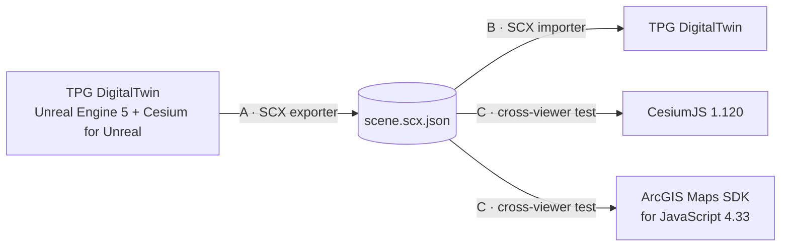

# SCX Scene Context JSON
## Findings from implementation and cross-viewer testing

**Geonovum Testbed 2026 · Topic 5 "Web 3D Context"**

| | |
|---|---|
| Issued by | The People Group |
| Document type | Findings report with supporting evidence |
| Version | 1.0 |
| Test period | 9–16 October 2026 |
| Test environment | TPG DigitalTwin (Unreal Engine 5, Cesium for Unreal), CesiumJS 1.120, ArcGIS Maps SDK for JavaScript 4.33 |

## Contents

- [Summary](#summary)
- [Findings at a glance](#findings-at-a-glance)
- [Structure of this report](#structure-of-this-report)
- [0. Scope and test setup](#0-scope-and-test-setup)
- [Part 1. Specification findings](#part-1-specification-findings)
- [Part 2. Interoperability findings](#part-2-interoperability-findings-same-document-different-result)
- [Part 3. Implementation findings](#part-3-implementation-findings-digitaltwin-exporter-and-importer)
- [Part 4. Recommendations for the SCX specification](#part-4-recommendations-for-the-scx-specification-4-additions-in-order-of-priority)
- [Annex A. Evidence index](#annex-a-evidence-index)
- [Annex B. References](#annex-b-references)

---

## Summary

The People Group implemented an exporter and an importer for Scene Context JSON (SCX) in its DigitalTwin platform and opened the exported scenes side by side in CesiumJS and ArcGIS. This report documents what we found, with the documents, code, measurements and service responses each finding is based on, and translates the findings into proposals for the SCX specification.

The main conclusions:

- **The camera position travels, the lens does not.** Position, heading and tilt were reproduced exactly in three engines. The visible area differed by almost a factor of two because each engine uses a different default and definition of the field of view. We added `fov` and propose projection type and clipping planes (1.2).
- **The nested `interval` structure is hard to implement and easy to get wrong.** It required workarounds in a typed environment and our own exporter produced output that does not validate. We propose a simple `{ start, end }` object (1.1).
- **A layer reference must be complete and typed unambiguously.** An incomplete WMS URL produced two different pictures from one document, and independently written exporter and importer code already disagreed on format strings. We propose that `url` is the complete request and a closed `type`/`format` table (1.4, 1.5).
- **The same 3D Tiles give different results per viewer.** All 1309 building tiles of one dataset contain invalid glTF that Cesium-based viewers accept and ArcGIS silently does not draw; heights stored as NAP but declared ellipsoidal cause a vertical offset of about 41 m in ArcGIS; instanced tree tiles are not supported by ArcGIS at all. We propose per-layer metadata for tile version, content type and vertical datum (1.6, 1.9).
- **Simulation results cannot be exchanged yet.** 21 of the 28 resources in the test scene, including every time-dependent simulation result, have no stable URL another viewer can request. The 4D part of the scene therefore cannot be exported today (2.3).
- **Results between implementations are only comparable with a shared status vocabulary** per layer (1.7).

The recommendations for the specification are listed in order of priority in Part 4.

## Findings at a glance

| # | Finding | Source | Status |
|---|---|---|---|
| [1.1](#11-interval-is-a-nested-array-sources-b-a-spec-planned) | `interval` is a nested array | B, A | spec, planned |
| [1.2](#12-camera-field-of-view-clipping-planes-and-projection-sources-c-b-spec-fov-implemented) | Camera: field of view, clipping planes and projection | C, B | spec, fov implemented |
| [1.3](#13-selection-and-visibility-of-objects-is-not-part-of-the-scene-source-b-spec) | Selection and visibility of objects is not part of the scene | B | spec |
| [1.4](#14-url-must-be-the-complete-request-source-c-spec-planned) | `url` must be the complete request | C | spec, planned |
| [1.5](#15-a-closed-typeformat-vocabulary-with-type-as-fallback-sources-a-b-spec-planned) | A closed `type`/`format` vocabulary, with `type` as fallback | A, B | spec, planned |
| [1.6](#16-the-same-3d-tiles-behave-differently-per-viewer-invalid-gltf-unsupported-content-and-a-vertical-offset-in-arcgis-source-c-data-side-spec) | The same 3D Tiles behave differently per viewer: invalid glTF, unsupported content and a vertical offset in ArcGIS | C | data-side, spec |
| [1.7](#17-a-status-vocabulary-per-layer-for-importers-source-c-spec) | A status vocabulary per layer for importers | C | spec |
| [1.8](#18-timestamps-are-utc-the-spec-should-say-so-and-importers-should-parse-them-that-way-source-a-spec-planned) | Timestamps are UTC: the spec should say so and importers should parse them that way | A | spec, planned |
| [1.9](#19-the-vertical-datum-rule-in-45-holds-and-should-stay-normative-source-c-spec-confirms) | The vertical datum rule in §4.5 holds and should stay normative | C | spec, confirms |
| [2.1](#21-tile-loading-and-level-of-detail-differ-per-viewer-sources-b-c-engine) | Tile loading and level of detail differ per viewer | B, C | engine |
| [2.2](#22-urls-tied-to-a-subscription-do-not-travel-source-c-implemented-spec-note) | URLs tied to a subscription do not travel | C | implemented, spec note |
| [2.3](#23-simulation-results-have-no-address-source-c-data-side) | Simulation results have no address | C | data-side |
| [2.4](#24-service-availability-is-outside-the-document-source-c-engine-17) | Service availability is outside the document | C | engine, 1.7 |
| [2.5](#25-terrain-url-conventions-differ-source-c-engine-spec-note) | Terrain URL conventions differ | C | engine, spec note |
| [2.6](#26-monolithic-tiles-cannot-be-made-fast-on-the-client-source-c-data-side) | Monolithic tiles cannot be made fast on the client | C | data-side |
| [2.7](#27-ipv6-on-the-test-machine-source-c-environment) | IPv6 on the test machine | C | environment |
| [2.8](#28-what-transferred-without-problems-source-c-ok) | What transferred without problems | C | ok |
| [3.1](#31-layer-converter-dropped-temporal-on-read-sources-a-c-implemented-16-oct-verification-in-the-editor-pending) | Layer converter dropped `temporal` on read | A, C | implemented 16 Oct, verification in the editor pending |
| [3.2](#32-exporter-writes-startend-next-to-interval-source-a-implemented-16-oct) | Exporter writes `start`/`end` next to `interval` | A | implemented 16 Oct |
| [3.3](#33-geojson-format-mismatch-source-a-planned-importer) | GeoJSON format mismatch | A | planned, importer |
| [3.4](#34-open-end--is-read-as-the-minimum-date-source-a-planned-importer) | Open end `..` is read as the minimum date | A | planned, importer |
| [3.5](#35-utc-parsing-gives-kindlocal-source-a-planned-importer) | UTC parsing gives `Kind=Local` | A | planned, importer |
| [3.6](#36-no-fallback-on-type-when-format-is-missing-source-a-planned-importer) | No fallback on `type` when `format` is missing | A | planned, importer |
| [3.7](#37-importer-ignores-index-viewfov-crs-and-timeinterval-source-a-planned-importer) | Importer ignores `index`, `view.fov`, `crs` and `time.interval` | A | planned, importer |
| [3.8](#38-nested-interval-needs-a-wrapper-object-in-blueprints-source-b-workaround-in-place) | Nested `interval` needs a wrapper object in Blueprints | B | workaround in place |
| [3.9](#39-writer-emits-interval--and-temporal-null-source-a-planned-exporter) | Writer emits `"interval": []` and `"temporal": null` | A | planned, exporter |
| [3.10](#310-resource-type-strings-differ-per-import-path-source-a-implemented) | Resource type strings differ per import path | A | implemented |
| [3.11](#311-unrealsharp-list-properties-cannot-be-assigned-source-a-implemented-known) | UnrealSharp list properties cannot be assigned | A | implemented, known |
| [3.12](#312-importer-creates-every-resource-with-id--temp-source-a-planned-importer) | Importer creates every resource with `Id = 'temp'` | A | planned, importer |
| [3.13](#313-full-round-trip-a--b--a-source-a-planned) | Full round trip A → B → A | A | planned |

Sources: A = exporter, B = importer, C = cross-viewer test. Status labels are explained in [Part 0](#0-scope-and-test-setup).

---

## Structure of this report

Part 0 describes the scope and test setup. Part 1 contains findings that lead to proposals for the SCX specification, Part 2 findings where the same document gives different results in different viewers, and Part 3 findings from our own implementation. Part 4 summarises the recommendations. Annex A lists the evidence and Annex B the referenced standards and documents.

Each finding describes the observation, the evidence it is based on, our proposal and the status of the implementation in the TPG DigitalTwin. Where something was not measured or verified, this is stated.

## 0. Scope and test setup

**SCX.** Scene Context JSON is the scene-exchange document from the Esri Testbed II report *Import & Export Scenes* (Thomas Lier, 2026). The minimal Testbed II schema has `view` (position, heading, tilt), `time` (`current`, `start`, `end`) and `layers[]` (`title`, `index`, `type`, `visible`, `url`). On top of that we tested our own extensions: `crs`, `format`, `group`, `fov`, `time.interval`/`trs` and per-layer `temporal`.

**What we built and tested.** The findings come from three parts of our work, referred to below as sources A, B and C: (A) an SCX exporter in the TPG DigitalTwin (Unreal Engine 5 with Cesium for Unreal), (B) an SCX importer in the same DigitalTwin, and (C) a cross-viewer test in which the exported document was opened side by side in CesiumJS 1.120 and ArcGIS Maps SDK for JavaScript 4.33.



**Test scene.** The Rotterdam / Merwehaven twin: 28 resources in 12 dataset groups. Export of 16 Oct 2026 06:38 UTC:

```
[SCX] Export ok: 7 lagen, 21 meldingen -> .../DigitalTwin/Saved/SCX\scene.scx.json
```

All examples below refer to this exported document (7 layers):

<details>
<summary>Show the full exported document (42 lines)</summary>

```json
{
  "scx": "0.2",
  "crs": "http://www.opengis.net/def/crs/OGC/0/CRS84h",
  "view": {
    "heading": 60.36840177457133,
    "tilt": 61.56493555426842,
    "fov": 90,
    "position": { "latitude": 51.907087154690586, "longitude": 4.40862666978378, "altitude": 333.28461497015434 }
  },
  "time": {
    "current": "2026-10-16T13:00:00Z",
    "interval": [],
    "trs": "http://www.opengis.net/def/uom/ISO-8601/0/Gregorian"
  },
  "layers": [
    { "title": "Water areas", "index": 0, "type": "scene", "format": "application/json", "visible": true,
      "url": "https://www.3drotterdam.nl/datasource-data/383dc58b-0fb1-4d8a-a476-12fa01ba8809/tileset.json",
      "group": "3D Rotterdam - Terrein / Terrain" },
    { "title": "Terrein - Actueel (Terrain - Current) with layer.json", "index": 1, "type": "elevation",
      "format": "application/vnd.quantized-mesh", "visible": true,
      "url": "https://www.3drotterdam.nl/datasource-data/d60bdba8-c40b-42e2-bc47-78c8adabbb29/layer.json",
      "group": "3D Rotterdam - Terrein / Terrain" },
    { "title": "3D Rotterdam Luchtfoto / Aerial Photography WMS", "index": 2, "type": "imagery",
      "format": "application/vnd.ogc.wms_xml", "visible": true,
      "url": "https://diensten.rotterdam.nl/arcgis/services/LUCHTFOTO/luchtfoto_actueel/MapServer/WMSServer",
      "group": "3D Rotterdam - Luchtfoto / Aerial Photography" },
    { "title": "Rotterdam 3D Bomen - Huidige Situatie - Common Model", "index": 3, "type": "scene",
      "format": "application/json", "visible": true,
      "url": "https://dtacogo.data.purplepolarbear.nl/tileservers/rotterdam-bomen-cm/tileset.json",
      "group": "Stekkerdoos The People Group" },
    { "title": "Rotterdam 3D Gebouwen - Huidige Scenario - Common Model", "index": 4, "type": "scene",
      "format": "application/json", "visible": true,
      "url": "https://dtacogo.data.purplepolarbear.nl/tileservers/rotterdam-gebouwen-cm/tileset.json",
      "group": "Stekkerdoos The People Group" },
    { "title": "M4H-FI", "index": 5, "type": "scene", "format": "application/json", "visible": true,
      "url": "https://www.nederlandin3d.nl/dtacogo/334e5d46-5ef8-44bf-8ad8-0dc04813def5/tileset.json",
      "group": "BIM Design" },
    { "title": "Persistent WMS", "index": 6, "type": "imagery", "format": "application/vnd.ogc.wms_xml", "visible": false,
      "url": "https://hub.clearly.app/active-hub/68341e06e78ef8cde83f837d/datasets/6a044faf4b826f9cc63f5896/resources/6a044fbe4b826f9cc63f5897/share/futureinsight-dtacogo-dev/wms_example_results/rotterdam/viewer/wms.viewer",
      "group": "Tygron Rotterdam Static Heat Stress Result" }
  ]
}
```

</details>

**Status labels.** Each finding is marked with one or more of: `spec` (proposal for the SCX specification, report §4), `implemented` (changed in the TPG DigitalTwin), `planned` (change scheduled in the TPG DigitalTwin), `data-side` (for the data or service provider), `engine` (viewer behaviour, outside the document).

---

## Part 1. Specification findings

### 1.1 `interval` is a nested array (sources B, A; spec, planned)

`time.interval` and `layers[].temporal.interval` are defined as "null, or an array containing exactly one array of exactly two date strings". The shape comes from OGC API Features/Records `extent.temporal`. In practice it is awkward in typed environments, it looks like a list while the spec allows only one entry, and our own writer already produces values that break it.

The schema currently reads (`Tools/ScxCesiumViewer/schema/scx.schema.json`, `$defs/interval`):

```json
"interval": {
  "description": "OGC API extent.temporal: [[begin, einde]], null of \"..\" = open",
  "type": "array",
  "minItems": 1,
  "items": {
    "type": "array",
    "minItems": 2,
    "maxItems": 2,
    "items": { "type": ["string", "null"] }
  }
}
```

A valid value then looks like this:

```json
"temporal": { "interval": [["2025-10-01T08:00:00Z", "2025-11-01T08:00:00Z"]], "trs": "http://www.opengis.net/def/uom/ISO-8601/0/Gregorian" }
```

with `".."` for an open end:

```json
"temporal": { "interval": [["2025-10-01T08:00:00Z", ".."]] }
```

**Blueprints cannot hold `TArray<TArray<FString>>`.** For the importer we needed a wrapper `UObject` that only holds the inner array (`Script/ManagedDigitalTwin/Geonovum/UCS_NestedStringArray.cs`):

```csharp
[UClass]
public partial class UCS_NestedStringArray : UObject
{
    [UProperty(PropertyFlags.BlueprintReadWrite)]
    public partial IList<string> Items { get; set; }
}
```

The document model therefore has `IList<UCS_NestedStringArray>` instead of a start/end pair (`UCS_ScxDocLayerTemporal.cs`):

```csharp
[UProperty(PropertyFlags.BlueprintReadWrite)]
[JsonPropertyName("interval")] public partial IList<UCS_NestedStringArray> Interval { get; set; }
```

Reading the start date in a Blueprint is `Interval → Get (index 0) → Items → Get (index 0)` on an object reference. With an object form it would be a single `Start` pin. We expect the same friction in other typed languages (C#, C++, Java, Kotlin, Swift): it is a pair of two values written as a list of lists.

**The reader has to be written by hand.** `System.Text.Json` cannot deserialise into UnrealSharp `UObject` lists, so the time converter walks the tokens itself, with an extra inner loop just for the second array level (`Json/UCS_ScxDocTimeConverter.cs`, `Read`):

```csharp
case "interval":
    interval = [];
    while (reader.Read())
    {
        if (reader.TokenType == JsonTokenType.EndArray) { break; }
        UCS_NestedStringArray inner = UObject.NewObject<UCS_NestedStringArray>(_root);
        while (reader.Read())
        {
            if (reader.TokenType == JsonTokenType.EndArray) { break; }
            inner.Items.Add(reader.GetString()!);
        }
        interval.Add(inner);
    }
    break;
```

**Our own output does not validate.** The 16 Oct export writes `"interval": []` on `time` (see §0), while the schema requires `minItems: 1`. For layers without a validity period the layer writer emits `"temporal": null`. Both are meant as "no range" and neither is allowed by the current schema.

**The open end `..` is not parsed.** The importer's `MinDate`/`MaxDate` getters call `DateTime.TryParse` on each string. Reproduced in PowerShell on the dev machine (same .NET parser):

```
TryParse('..') -> False
```

The getter then falls back to its default, so `["2025-10-01T08:00:00Z", ".."]` ends up as MinDate = MaxDate = MinFDateTime in the DigitalTwin instead of "from 1 Oct 2025, no end date". The layer never shows up on the time slider.

**We already write a duplicate for compatibility.** Esri Testbed II readers expect flat `start`/`end`, so since 16 Oct the exporter writes both forms (`UCS_ScxDocTimeConverter.Write`):

```csharp
// Testbed II (Esri) compatibility: readers of the original SCX expect flat start/end.
// Derived from the first interval; ".." (open end) is omitted.
if (value.Interval != null && value.Interval.Count > 0 && value.Interval[0].Items.Count >= 2)
{
    string start = value.Interval[0].Items[0];
    string end = value.Interval[0].Items[1];
    if (!string.IsNullOrEmpty(start) && start != "..") { writer.WriteString("start", start); }
    if (!string.IsNullOrEmpty(end) && end != "..") { writer.WriteString("end", end); }
}
```

For a document with a range this gives:

```json
"time": {
  "current": "2025-10-15T08:00:00Z",
  "interval": [["2025-10-01T08:00:00Z", "2025-11-01T08:00:00Z"]],
  "start": "2025-10-01T08:00:00Z",
  "end": "2025-11-01T08:00:00Z",
  "trs": "http://www.opengis.net/def/uom/ISO-8601/0/Gregorian"
}
```

So the same range ends up in the document twice, in two shapes.

**Proposal (spec).** Replace the nested array with an object, leave out a bound (or set it to `null`) for an open end, and drop the deprecated flat `start`/`end`:

```json
"time": {
  "current": "2025-10-15T08:00:00Z",
  "interval": { "start": "2025-10-01T08:00:00Z", "end": "2025-11-01T08:00:00Z" },
  "trs": "http://www.opengis.net/def/uom/ISO-8601/0/Gregorian"
},
"layers": [
  { "title": "Merwehaven traffic — after", "temporal": { "interval": { "start": "2026-01-01T00:00:00Z" } } }
]
```

Schema fragment:

```json
"interval": {
  "type": "object",
  "properties": {
    "start": { "type": ["string", "null"], "format": "date-time" },
    "end":   { "type": ["string", "null"], "format": "date-time" }
  },
  "additionalProperties": false
}
```

If alignment with OGC API is considered more important, the report should at least state that exactly one interval is allowed, that `..` means open, and that `[]` and `null` are not valid ways to say "no range".

**Implementation in the TPG DigitalTwin.**
- Exporter (A): writes the nested form plus `start`/`end` (since 16 Oct). Planned: stop writing `"interval": []` and `"temporal": null` and leave the properties out instead. One line in each writer.
- Importer (B): reads via `UCS_NestedStringArray`, which works. Planned: treat `..`, `null` and empty as open before calling `TryParse`, so one bound can be set while the other stays at `MinFDateTime`/`MaxFDateTime` (the helpers for this already exist).
- Both: with the object form, `UCS_NestedStringArray` and the inner loop can go, and the Blueprint reads `Temporal.Interval.Start` directly. We would keep reading the nested form for one version.

---

### 1.2 Camera: field of view, clipping planes and projection (sources C, B; spec, fov implemented)

Position, heading and tilt transfer correctly, but the resulting image differs per viewer because the lens is not described. We added `fov`, which fixes the zoom. Near/far clipping and orthographic versus perspective projection are still missing.

**Same camera, three lenses** (measured 9 Oct, Merwehaven):

| Viewer | Default horizontal FOV | Visible ground width at 310 m range |
|---|---|---|
| Unreal Engine 5 (`APlayerCameraManager.FOVAngle`) | 90° | 620 m |
| CesiumJS 1.120 (`PerspectiveFrustum.fov`) | 60° | 358 m |
| ArcGIS Maps SDK 4.33 (`SceneView.camera.fov`, diagonal 55°) | 55° diagonal | ≈ 323 m |

Width = 2 · d · tan(fov/2). The first reaction during testing was that the camera pointed somewhere else. In fact the position (51.70279 N, 5.28602 E, 310 m, heading 155°, tilt 63°) was identical in all three viewers. Only the zoom differed, by almost a factor of two between Unreal and ArcGIS.

**What the exporter writes and how the viewers use it.** Exporter (`UCS_ScxExporter.cs`):

```csharp
fovDegrees = camera.FOVAngle;                       // Unreal: horizontal FOV in degrees
...
view.Fov = (fovDegrees > 0 && fovDegrees < 180) ? fovDegrees : 0;   // 0 = "unknown", property kept optional
```

In CesiumJS (`Tools/ScxCesiumViewer/index.html`) `frustum.fov` applies to the wider canvas dimension, so a horizontal value has to be converted for a portrait canvas:

```js
C.viewer.camera.frustum.fov = aspect >= 1
  ? Cesium.Math.toRadians(fovH)
  : 2 * Math.atan(Math.tan(Cesium.Math.toRadians(fovH) / 2) / aspect);
```

In ArcGIS `camera.fov` is diagonal, so we convert horizontal to diagonal using the pane aspect ratio:

```js
const diag = 2 * Math.atan(Math.tan(fovH * Math.PI / 360) * Math.sqrt(1 + (h / w) * (h / w)));
```

Resulting fragment in the 16 Oct export:

```json
"view": { "heading": 60.368, "tilt": 61.565, "fov": 90, "position": { ... } }
```

The three engines use three definitions of fov (horizontal, wider axis, diagonal). The spec has to say which one SCX means. We chose horizontal, in degrees.

**Still missing (B).** With `fov` aligned, the DigitalTwin importer and the browser viewers still differ in near/far clipping (Unreal default near plane 10 cm; CesiumJS near 1 m, far 5·10⁸ m; ArcGIS does not expose it) and in projection type. All three support orthographic views, but SCX cannot express one. The level of detail loaded under the same camera also differed (see 2.1); that is an engine property, not a camera property.

**BCF as a reference.** This is our own suggestion from the importer work, not a Geonovum requirement. BuildingSMART BCF 3.0 ([BCF-XML 3.0 documentation](https://github.com/BuildingSMART/BCF-XML/tree/release_3_0/Documentation), section *Visualization information*) defines a viewpoint as a camera location, a view direction and an up vector (six degrees of freedom), supports perspective and orthogonal cameras, and standardises clipping planes. The same model exists in JSON in [BCF-API 3.0](https://github.com/buildingSMART/BCF-API/blob/release_3_0/README.md), section 3.5. The fragment below uses the BCF-API JSON names (BCF-XML uses `PerspectiveCamera`, `CameraViewPoint`, `FieldOfView` etc.); the values are placeholders. We checked the field definitions against both specifications on 16 Oct 2026.

<details>
<summary>Show the BCF camera fragment (19 lines)</summary>

```json
{
  "perspective_camera": {
    "camera_view_point": { "x": 0.0, "y": 0.0, "z": 0.0 },
    "camera_direction":  { "x": 1.0, "y": 0.0, "z": 0.0 },
    "camera_up_vector":  { "x": 0.0, "y": 0.0, "z": 1.0 },
    "field_of_view": 60.0,
    "aspect_ratio": 1.33
  },
  "orthogonal_camera": {
    "camera_view_point": { "x": 0.0, "y": 0.0, "z": 0.0 },
    "camera_direction":  { "x": 1.0, "y": 0.0, "z": 0.0 },
    "camera_up_vector":  { "x": 0.0, "y": 0.0, "z": 1.0 },
    "view_to_world_scale": 1.0,
    "aspect_ratio": 1.33
  },
  "clipping_planes": [
    { "location": { "x": 0.5, "y": 0.5, "z": 0.5 }, "direction": { "x": 1.0, "y": 0.0, "z": 0.0 } }
  ]
}
```

</details>

Two differences matter. BCF `ClippingPlanes` "define a subsection of a building model", each by `Location` and `Direction`; they are section planes, not near/far frustum planes. And BCF `FieldOfView` is "the entire vertical field of view angle of the camera, expressed in degrees", while SCX `fov` is horizontal. So BCF is a model to borrow from, not something to copy one-to-one.

**Proposal (spec).** Extend `view`:

```json
"view": {
  "position": { "longitude": 4.4086, "latitude": 51.9071, "altitude": 333.28 },
  "heading": 60.37,
  "tilt": 61.56,
  "fov": 90,
  "projection": "perspective",
  "near": 1.0,
  "far": 100000.0,
  "ortho": { "width": 500.0 }
}
```

- `fov`: horizontal, degrees, optional; if absent the viewer uses its default (already implemented).
- `projection`: `"perspective"` (default) or `"orthographic"`; for orthographic, `ortho.width` in metres replaces `fov`.
- `near`/`far`: metres, optional and advisory. A viewer may clamp them for depth precision and reports that in its status (1.7).
- heading/tilt stay. They follow the GeoPose/ArcGIS convention and convert to BCF direction/up vectors with a fixed formula. A `direction`/`up` pair could be allowed as an alternative for BIM-oriented clients.

**Implementation in the TPG DigitalTwin.**
- Exporter (A): writes `fov` from `FOVAngle`. Planned: write `projection` (Unreal `ECameraProjectionMode`), `near` (`GNearClippingPlane`) and, for orthographic, `ortho.width` (`OrthoWidth`).
- Importer (B): applies position/heading/tilt through the Cesium georeference (`Yaw = heading − 90`, `Pitch = tilt − 90` in the East-South-Up frame, the inverse of the exporter's `heading = esu.Yaw + 90`, `tilt = esu.Pitch + 90`). Planned: `view.fov` is ignored for now; call `SetFOV(fov)` on the camera manager, and `SetProjectionMode`/`SetOrthoWidth` once the spec has them.
- Browser viewers (C): apply `fov` with the conversions above and write it back on export. If it is absent, each viewer keeps its default and reports "fov: viewer default".

---

### 1.3 Selection and visibility of objects is not part of the scene (source B; spec)

A viewpoint that is shared to say "look at this" also needs to carry which objects are selected, hidden or highlighted. SCX only has `layers[].visible`. There is no state per feature, so "the building at Marconistraat 12 is selected" cannot be transferred.

Today the only visibility information is one boolean per layer, for example the Tygron layer that is switched off:

```json
{ "title": "Persistent WMS", "index": 6, "visible": false, ... }
```

The DigitalTwin does have this state. The attribute panel in `WBP_MainV2` selects a 3D Tiles feature by feature ID and property set (the "object attributes" popup), and the 3D Rotterdam tilesets carry stable identifiers in their `properties` block; the water-areas tileset declares `IDBAG`, `LOKAALID` and `FUNCTIE`. A selected feature can be addressed, but SCX has no place for it.

For reference, the BCF components block (our own choice of reference, see 1.2; fragment in BCF-API 3.0 JSON, section 3.5.2.9, where `Selection` "lists all components that should be selected (highlighted)", `Visibility` "decides which objects are visible and which are hidden" and `Coloring` "allows specifying the color of components"):

```json
"components": {
  "selection": [ { "ifc_guid": "3$cshxZO9AJBefedPXk3jR" } ],
  "visibility": {
    "default_visibility": true,
    "exceptions": [ { "ifc_guid": "0ldc4FdjT5y8OMLdPNCDxe" } ],
    "view_setup_hints": { "spaces_visible": false, "space_boundaries_visible": false, "openings_visible": false }
  },
  "coloring": [ { "color": "ff00ff00", "components": [ { "ifc_guid": "1zQJzO2u5Bbf23QmkhSsZ1" } ] } ]
}
```

**Proposal (spec).** An optional `view.components`, based on BCF but keyed per layer, because geospatial features are identified within a dataset rather than globally:

```json
"view": {
  "components": {
    "selection":  [ { "layer": 4, "id": "NL.IMBAG.Pand.0599100000650143" } ],
    "visibility": { "default": true, "exceptions": [ { "layer": 5, "id": "M4H-FI/Level 3" } ] },
    "coloring":   [ { "color": "#FF0000", "components": [ { "layer": 4, "id": "NL.IMBAG.Pand.0599100000650143" } ] } ]
  }
}
```

`layer` refers to `layers[].index`. `id` is the feature identifier as defined by the layer's format: for 3D Tiles the feature-table or metadata property named in the spec (e.g. `IDBAG` or `id`), for GeoJSON `feature.id`, for WMS not applicable.

**Implementation in the TPG DigitalTwin.**
- Exporter (A), planned: The source would be the current selection in the attribute panel (feature ID + tileset) and a hide list per feature, if there is one.
- Importer (B), planned: After loading a tileset, apply selection and colouring through the Cesium for Unreal feature-ID lookup and the existing highlight material. Unknown ids get status `component-not-found` (1.7).
- Browser viewers (C): CesiumJS `Cesium3DTileFeature` by property; ArcGIS `highlight()` on the layer view.

---

### 1.4 `url` must be the complete request (source C; spec, planned)

In the DigitalTwin a WMS resource stores the endpoint and the selected layer names in separate fields. The export only carried the endpoint, and the two viewers then made two different pictures from the same document.

What we exported:

```json
{ "title": "3D Rotterdam Luchtfoto / Aerial Photography WMS", "type": "imagery", "format": "application/vnd.ogc.wms_xml",
  "url": "https://diensten.rotterdam.nl/arcgis/services/LUCHTFOTO/luchtfoto_actueel/MapServer/WMSServer" }
```

What the service returns for a GetMap without `layers`/`styles` (16 Oct):

```xml
<ServiceExceptionReport version="1.3.0" xmlns="http://www.opengis.net/ogc">
  <ServiceException code="StylesNotDefined">
Parameter 'styles' is required.
  </ServiceException>
</ServiceExceptionReport>
```

GetCapabilities of this service lists exactly one named layer, `0`, with style `default`.

How the two engines dealt with it (9 Oct):

| Engine | Behaviour with endpoint-only URL |
|---|---|
| CesiumJS `WebMapServiceImageryProvider` | refuses: `layers` is a required constructor option. Our viewer falls back to the first named layer from GetCapabilities and reports "layers: guessed `0`" |
| ArcGIS `WMSLayer` | accepts it: loads GetCapabilities itself and shows the service's default sublayers |

Without the fallback, one viewer shows the aerial photo and the other shows nothing.

**Proposal (spec).** Make it normative that `url` is the complete request a client can issue without further knowledge. For WMS that means at least `service`, `request=GetMap`, `version`, `layers`, `styles`, `format` and `crs`, with `bbox`/`width`/`height` left to the client:

```json
"url": "https://diensten.rotterdam.nl/arcgis/services/LUCHTFOTO/luchtfoto_actueel/MapServer/WMSServer?service=WMS&version=1.3.0&request=GetMap&layers=0&styles=default&format=image/jpeg&crs=EPSG:3857&transparent=false"
```

For 3D Tiles the complete request is the `tileset.json`; for quantized-mesh terrain it is the directory (see 2.5).

**Implementation in the TPG DigitalTwin.**
- Exporter (A), planned: Read the selected layer names and image format from the WMS resource (the Blueprint "Apply WMS" path has them) and build the query string.
- Importer (B): `CreateDataResource(..., Url, ...)` passes the URL through unchanged. Planned: when a WMS URL already contains `layers=`, split it into endpoint and layer list for the Cesium for Unreal `WebMapServiceRasterOverlay`, which takes them as separate properties.
- Browser viewers (C): parse the query string; CesiumJS takes `layers` from it, ArcGIS `sublayers`.

---

### 1.5 A closed `type`/`format` vocabulary, with `type` as fallback (sources A, B; spec, planned)

Our exporter and importer were written separately and already disagree on one format string. Testbed II documents have no `format` at all. Without a closed table and a fallback rule, implementations will drift apart.

What the exporter writes (`UCS_ScxExporter.cs`, resource type → SCX):

```csharp
case Tile3D / "3dtiles":   type = "scene";     format = "application/json";               // 3D Tiles tileset.json
case Terrain3D / "3dterrain": type = "elevation"; format = "application/vnd.quantized-mesh";
case Wms / "WMS":          type = "imagery";   format = "application/vnd.ogc.wms_xml";
case GeoJson:              type = "scene";     format = "application/geo+json";
```

What the importer accepts (`UCS_ScxDocLayer.ParseFormat()`):

```csharp
return Type switch
{
    "scene"     => Format switch { "application/json"                => EDataResourceType.Tile3D,    _ => EDataResourceType.Unknown },
    "elevation" => Format switch { "application/vnd.quantized-mesh"  => EDataResourceType.Terrain3D, _ => EDataResourceType.Unknown },
    "imagery"   => Format switch { "application/vnd.ogc.wms_xml"     => EDataResourceType.Wms,       _ => EDataResourceType.Unknown },
    _ => EDataResourceType.Unknown
};
```

Traced by hand through both code paths:

| Document fragment | Exporter origin | Importer result |
|---|---|---|
| `"type":"scene","format":"application/json"` | 3D Tiles | Tile3D ✔ |
| `"type":"scene","format":"application/geo+json"` | GeoJSON | **Unknown**, layer dropped without a message |
| `"type":"scene"` (no `format`, Testbed II document) | Esri export | **Unknown**, every Testbed II scene layer is dropped |
| `"type":"imagery","format":"image/png"` (tile template, as the Esri scripts produce) | Esri export | **Unknown** |

There is also an ambiguity in `application/json`. A 3D Tiles `tileset.json` and a GeoJSON file are both JSON, and the format string is the only reliable way to tell them apart. Cesium ion uses `application/json` for 3D Tiles, but the string itself says nothing about 3D Tiles. A dedicated token would be safer.

**Proposal (spec).** A closed table in which `type` is enough on its own and `format` refines it:

| `type` | `format` (optional) | Meaning | Default when `format` absent |
|---|---|---|---|
| `scene` | `application/json` or `application/vnd.3dtiles+json` (preferred) | 3D Tiles 1.0/1.1 `tileset.json` | 3D Tiles |
| `scene` | `application/geo+json` | GeoJSON features, extruded or draped | — |
| `scene` | `model/gltf-binary` | single glTF/GLB placed at the layer's position | — |
| `elevation` | `application/vnd.quantized-mesh` | Cesium quantized-mesh terrain (directory URL) | quantized-mesh |
| `elevation` | `image/tiff; application=geotiff` | COG DEM | — |
| `imagery` | `application/vnd.ogc.wms_xml` | OGC WMS GetMap template | WMS |
| `imagery` | `image/png`, `image/jpeg` | XYZ/TMS tile template `{z}/{x}/{y}` | tile template |
| `imagery` | `application/vnd.ogc.wmts_xml` | WMTS | — |

Rule: an importer that does not recognise the `format` falls back on `type` plus URL sniffing (`tileset.json`, `layer.json`, `{z}`) and reports `unsupported-format` (1.7) instead of dropping the layer.

**Implementation in the TPG DigitalTwin.**
- Exporter (A): already writes the `scene`/`elevation`/`imagery` tokens from the table. Once agreed we switch 3D Tiles to `application/vnd.3dtiles+json`, writing `application/json` alongside for one version.
- Importer (B), planned: Add `application/geo+json` → `GeoJson`, add the `type`-only fallback with URL sniffing, and show `Unknown` as a message in the importer widget instead of skipping the layer.

---

### 1.6 The same 3D Tiles behave differently per viewer: invalid glTF, unsupported content and a vertical offset in ArcGIS (source C; data-side, spec)

**Revised 16 Oct.** On 9 Oct the ArcGIS pane showed buildings "lower and not in the right place", and we put that down to the 3D Tiles 1.0 up-axis rule. That explanation was wrong. On 16 Oct, with ArcGIS Maps SDK 4.33.11 and both panes driven by the same camera in headless Chrome, the M4H-FI b3dm renders in ArcGIS exactly where CesiumJS renders it, and a diagnostic proxy that rewrites `asset.gltfUpAxis` (Y, Z, removed) makes no difference. We found three other causes:

- **(a) Invalid glTF in the building tiles.** All 1309 `rotterdam-gebouwen-cm` tiles declare `emissiveFactor` with four components, where glTF 2.0 requires exactly three. CesiumJS and Cesium for Unreal accept it. The ArcGIS loader drops the primitive without an error: the layer reports `loaded`, fetches the tiles and draws nothing. With the array cut to three components, ArcGIS draws the buildings on the same footprints as CesiumJS.
- **(b) A vertical offset of about 41 m in ArcGIS.** ArcGIS draws the ECEF tile geometry about 41 m below its draped basemap; CesiumJS draws it on the imagery. Seen from an oblique camera the buildings then appear shifted against the aerial photo. The offset is close to the geoid height at Rotterdam (≈ 42 m). With `elevationInfo.offset = +41` in ArcGIS the two panes coincide.
- **(c) ArcGIS cannot render the instanced tree tiles.** `rotterdam-bomen-cm` consists of `cmpt` composites of `i3dm` instances. ArcGIS supports neither. After conversion to 3D Tiles 1.1 glb with `EXT_mesh_gpu_instancing` it still draws nothing, and a tileset that uses 1.1 `contents` arrays is refused. CesiumJS renders both the original and the converted set.

The document carries no content type, version or vertical datum, so a viewer cannot warn about any of this. It just shows a different picture.

**The tileset header as served** (`M4H-FI`, 16 Oct):

```json
{
  "asset": { "version": "1.0", "tilesetVersion": "300603524459" },
  "geometricError": 48.828125,
  "root": {
    "boundingVolume": { "region": [0.076972057, 0.905892477, 0.077278643, 0.906099862, -13.4, 50.0] },
    "geometricError": 24.4140625,
    "refine": "ADD",
    "children": [ { "geometricError": 0.0, "refine": "REPLACE", "content": { "uri": "15/33572/6934.b3dm" } } ]
  },
  "vcsMeta": { "tileStructure": { "addressSchema": "GOOGLE", "minTileLevel": 15, "maxTileLevel": 15 }, "shading": "PBR" }
}
```

`asset.version` is `1.0`, there is no `asset.gltfUpAxis`, and the generator is Virtual City Systems' X3DM pipeline. Under 1.0 the glTF is Y-up and the viewer has to apply the Y-up→Z-up rotation before adding `RTC_CENTER`.

**The 1.0 up-axis rule, and ArcGIS does apply it** (tile `15/33572/6934.b3dm`, `RTC_CENTER` in the feature table, rotation in the single node matrix):

| Reading of the tile | Computed centre | Geometry height (ellipsoidal) |
|---|---|---|
| node matrix + Y-up→Z-up (1.0 spec) | 4.41893 E, 51.91152 N | −1.5 … 21 m |
| node matrix only (no legacy up-axis step) | 4.42358 E, 51.91010 N | −393 … 88 m |

The second reading would put the model 320 m east and 160 m south, and tilted. Measured on 16 Oct, ArcGIS 4.33.11 uses the first reading. Test: a scene with only M4H-FI, camera 51.90676 N 4.41896 E, 330 m, heading 0, tilt 45, fov 60, in both panes. The tileset-centre marker (51.90976 N 4.41896 E) sits in the middle of the building block in both CesiumJS and ArcGIS, with the original 1.0 b3dm and with a copy upgraded to 1.1 glb (`3d-tiles-tools upgrade`). The up-axis proxy (`sw.js`, `proxy/<upY|upZ|none>/…/tileset.json`) gave the same picture in all three modes. What we saw on 9 Oct was most likely (b) from an oblique camera, combined with (a) for the building tiles that did not appear at all.

**(a) The invalid material.** Material of every `rotterdam-gebouwen-cm` tile (generator "X3DM Generator HEAD/4.4.7", Virtual City Systems, 2015–2022):

```json
{ "alphaMode": "OPAQUE", "doubleSided": false, "emissiveFactor": [0, 0, 0, 1], "name": "M_0",
  "pbrMetallicRoughness": { "baseColorFactor": [1, 1, 1, 1], "metallicFactor": 0, "roughnessFactor": 1 } }
```

`emissiveFactor` has four components; glTF 2.0 requires three. The M4H-FI tile (generator 4.6.5, 2015–2025) has `[0, 0, 0]` and renders. In the upgraded copy all 1309 of 1309 tiles are affected. What ArcGIS reports through the page's debug hook: layer view `loadStatus: "loaded"`, `loadError: null`, `updating: false`, 8 glb files fetched, nothing drawn. The same tile with `emissiveFactor` cut to `[0, 0, 0]` draws on the CesiumJS footprint. Things we tried separately that did not help: all-`REPLACE` refinement, a one-level subtree, a wider bounding region, and stripping all extensions from the glb. CesiumJS renders the original without complaint, so the defect stays hidden in a Cesium-based stack and only shows up in a stricter loader.

**(b) The vertical offset.** Near-nadir test (tilt 3°, 650 m, camera over 51.9049 N 4.4231 E) with the repaired buildings in ArcGIS and the original in CesiumJS, and the same PDOK orthophoto in both panes. The tileset-centre marker lands on the same photo feature (a pier tip) in both panes, so the imagery is registered identically. In CesiumJS the building footprints match the roofs. In ArcGIS they are shifted radially away from the image centre, up to about 20 m at 300 m from nadir. Seen from above, a radial shift like that points to a height error: Δx = Δh · d / H gives Δh ≈ 20 · 650 / 300 ≈ 43 m. We settled the sign with two more nadir captures and a check on a full-resolution screen: `layer.elevationInfo = { mode: "absolute-height", offset: +41 }` puts the footprints exactly on the roofs, `−41` does not. So in ArcGIS the geometry sits about 41 m below its draped ground, while in CesiumJS it sits on it.

Our explanation, combined with the NAP heights below: the tiles carry NAP heights as if they were ellipsoidal (0–15 m). CesiumJS drapes its imagery on the ellipsoid (h = 0), so NAP-as-ellipsoidal data lands on the imagery. ArcGIS drapes its basemap on a flat ground at orthometric height 0, which is the geoid, about 42 m above the ellipsoid at Rotterdam (EGM96 and NLGEO2018 differ by about a metre there). The same data then ends up 41 m below the basemap. How exactly ArcGIS handles the geoid internally is an engine question; we did not verify it. For SCX the point is that the same ECEF geometry sits at a different height relative to each engine's draped ground, and the document has no way of saying which is intended. Our viewer now uses +41 m for ArcGIS by default for scenes in the Netherlands.

| Reference surface | Height above WGS84 ellipsoid (Rotterdam) | Role in the test |
|---|---|---|
| Ellipsoid (WGS84, h = 0) | 0 m | CesiumJS drapes its imagery here; SCX camera altitude (CRS84h) refers to it |
| Geoid ≈ NAP 0 | ≈ 42 m | ArcGIS draws its flat ground and basemap here |
| Tile geometry (NAP values stored as ellipsoidal) | −1.5 … 15 m | lands on the imagery in CesiumJS, ≈ 41 m below the basemap in ArcGIS |


**(c) The trees.** `rotterdam-bomen-cm`: 107 `cmpt` tiles, each with three `i3dm` inner tiles of 72 instances (`POSITION`, `SCALE_NON_UNIFORM`, `NORMAL_UP/RIGHT`, `BATCH_ID`) that reference ten external prototypes `proto_0.glb … proto_9.glb` (11.9 MB together). Root region height range −9999 … 15 m. ArcGIS: `IntegratedMesh3DTilesLayer` only accepts b3dm/glb meshes (Esri BUG-000166202: "only integrated mesh type"). After conversion with `splitCmpt` + `convertI3dmToGlb` (593 glb with `EXT_mesh_gpu_instancing`, `EXT_instance_features`, `EXT_structural_metadata`), CesiumJS renders the trees. ArcGIS fails to create the layer view when the tileset lists the parts as 1.1 `contents` (`Failed to create layerview … integrated-mesh-3dtiles`), and with one part per tile it loads, fetches 8 glb and draws nothing. The prototypes also have the four-component `emissiveFactor` (1186 occurrences in 593 files).

What does work (16 Oct, evening): `trees-to-geojson.mjs` reads the i3dm feature tables (`POSITION`, `SCALE_NON_UNIFORM`, prototype uri) of all 107 composites into one GeoJSON point file with 199 945 trees, heights 5–25 m, 32.5 MB. The viewer loads it in ArcGIS as a `GeoJSONLayer` with a 3D object symbol sized by the `height` property and the same z-offset. The trees then appear in ArcGIS where CesiumJS draws the instanced models. This is a case for alternate representations per layer in SCX: one dataset, two encodings, and the document should be able to offer both.

**The heights in the data are NAP, not ellipsoidal.** From the same decode: ground at −1.5…5 m, where the true ellipsoidal height in Rotterdam is about 42 m. Inside the 3D Rotterdam stack this is consistent, because its terrain uses the same convention. On a true-ellipsoid terrain (Cesium World Terrain, ArcGIS World Elevation) the whole city ends up about 42 m underground. Together with (b) this makes finding 4 from the Geonovum discussion measurable (see 1.9).

**Water areas.** `Water areas` (one 10.5 MB b3dm, VCS generator 4.5.5, 9899 batch ids, heights −35 … 5 m) has the same four-component `emissiveFactor`. With the repaired copy and the +41 m offset, the harbour basins render dark blue in ArcGIS on the same water as in the aerial photo. Before the repair the layer was "loaded" and empty.

**Proposal (spec).** Optional metadata per layer that an importer can check and report on:

```json
{ "title": "M4H-FI", "type": "scene", "format": "application/vnd.3dtiles+json",
  "url": "https://www.nederlandin3d.nl/dtacogo/.../tileset.json",
  "tiles": { "version": "1.0", "content": "b3dm", "gltfUpAxis": "Y" },
  "verticalDatum": "http://www.opengis.net/def/crs/EPSG/0/5709" }
```

`tiles.version` copied from `asset.version`; `tiles.content` so an importer can refuse `cmpt`/`i3dm`/`pnts` up front; `verticalDatum` as a CRS URI (EPSG:5709 = NAP height) so a viewer can apply or refuse the offset. We also propose `invalid-content` in the status vocabulary (1.7): an importer that validates glTF (the Khronos validator rules are enough) can then say why a layer is empty instead of showing nothing.

**Implementation in the TPG DigitalTwin.**
- Viewer tooling (C), all in `Tools/ScxCesiumViewer/`: `convert-tiles.mjs` downloads a tileset and upgrades it to 3D Tiles 1.1 glb with Cesium's `3d-tiles-tools`, then runs `fix-gltf.mjs`, which repairs the `emissiveFactor` defect in place (1312 files repaired in the building set, 0 in M4H-FI). `convert-cmpt.mjs` splits composites and converts i3dm to instanced glb (works in CesiumJS, not in ArcGIS). By default the page now gives ArcGIS the same behaviour as CesiumJS: every 3D Tiles layer loads immediately, the repaired local copy from `Saved/SCX/tiles/map.json` is used where there is one (the original url otherwise), tree points replace i3dm, and `elevationInfo.offset = +41 m` is applied. The ArcGIS caption bar matches the Cesium one. The diagnostics (source selector with the up-axis proxy modes of `sw.js`, z-offset box, reload button) are in a collapsed "ArcGIS diagnostics" block in the sidebar, with query overrides `arcgisTiles=`, `arcgisOffset=` and `tiles=request`. Headless cross-viewer captures with per-layer diagnostics come from a Puppeteer script (`window.__scx` debug hook). Planned: show the applied offset in the layer status, replace the fixed +41 m with a geoid lookup, and map tree species/prototypes to matching 3D symbols in the point representation.
- Exporter (A), planned: Fetch `tileset.json` once at export time (we already read it for the status) and copy `asset.version`, the content extension and, if present, `asset.gltfUpAxis`.
- Importer (B): Cesium for Unreal renders all of these tilesets, including the defective material and the instanced trees. The only thing to add is version and content type in the layer status.
- Data-side (the actual fix): (1) the output of VCS X3DM Generator 4.4.7 has to be regenerated or post-processed so `emissiveFactor` has three components; a validator check in the provider's pipeline would have caught it. (2) Trees for ArcGIS need a non-instanced representation: a point dataset with a 3D symbol, or baked geometry at a lower level of detail. (3) Heights must be true ellipsoidal, or the dataset must state its vertical datum. (4) Tiles as 3D Tiles 1.1 glb with explicit transforms. We will report the `emissiveFactor` defect to the data provider with `fix-gltf.mjs` as reference fix. For the plug-fest the provider has to host the repaired building set (1344 MB locally); a local copy cannot be reached by other viewers.

---

### 1.7 A status vocabulary per layer for importers (source C; spec)

We could only compare the viewers because our browser viewer reports a status per layer. The DigitalTwin importer currently drops unknown layers without a message. Without a shared vocabulary, plug-fest results between implementations cannot be compared.

Statuses the browser viewer produced for the 9 Oct document (CesiumJS / ArcGIS; the ArcGIS 3D Tiles column re-checked on 16 Oct, see 1.6):

| Layer | CesiumJS | ArcGIS |
|---|---|---|
| Water areas (3D Tiles) | loaded | loaded, nothing drawn (invalid glTF, 1.6) |
| Terrain quantized-mesh | loaded (url rewritten: `layer.json` stripped) | unsupported format |
| Luchtfoto WMS | loaded (layers guessed: `0`) | loaded (service defaults), from 11:30 `service unavailable (HTTP 500)` |
| Bomen / Gebouwen CM (3D Tiles) | loaded | loaded, nothing drawn (i3dm resp. invalid glTF, 1.6) |
| M4H-FI (3D Tiles) | loaded after 23 MB | loaded, ≈ 41 m vertical offset (1.6) |
| Tygron hub WMS | auth required (HTTP 401) | auth required |

The service responses behind two of these:

```
GET https://hub.clearly.app/active-hub/68341e06e78ef8cde83f837d/.../wms.viewer?service=WMS&request=GetCapabilities
HTTP/1.1 401 Unauthorized
{"error":"Unauthorized","message":"Missing authorization header"}
```

```
GET https://diensten.rotterdam.nl/arcgis/services/LUCHTFOTO/luchtfoto_actueel/MapServer/WMSServer?... (9 Oct, from ~11:30)
HTTP/1.1 500   ArcGIS Web Adaptor: Could not access any server machines
```

The exporter's own messages, 21 for this scene, all of the same kind:

```
[SCX] Laag 'Rotterdam Kerncijfers Mobiliteit - Common Model' (groep 'Common model Stekkers') overgeslagen:
      resourcetype 'api' is geen laadbare SCX-laag (API-endpoint of jobresultaat zonder stabiele URL).
[SCX] Laag 'Geojson flows' (groep 'Merwehave: traffic after') overgeslagen: resourcetype 'api' ...
```

**Proposal (spec, informative annex).** A fixed list of statuses every importer reports per layer, plus free text:

| Status | Meaning |
|---|---|
| `loaded` | content requested and rendered |
| `loaded-with-adjustment` | loaded after the importer changed something (url rewritten, layers guessed, fov default); the detail says what |
| `unsupported-type` / `unsupported-format` | the importer knows the token but cannot render it (ArcGIS + quantized-mesh) |
| `unknown-format` | token not in the vocabulary (1.5) |
| `invalid-content` | content fetched but not renderable (e.g. glTF that fails validation, 1.6) |
| `no-url` | layer has no loadable address (2.3) |
| `unresolved-placeholder` | url contains an unexpanded variable such as `$activeHubId` (2.2) |
| `auth-required` | HTTP 401/403 |
| `service-unavailable` | HTTP 5xx, DNS failure, timeout (2.4) |
| `component-not-found` | a `view.components` id did not resolve (1.3) |

And the counterpart for exporters: `exported`, `skipped-no-url`, `skipped-unsupported`, `placeholder-resolved`.

**Implementation in the TPG DigitalTwin.**
- Exporter (A): already emits one message per skipped resource (the `Messages` list, printed as `[SCX] ...`). Planned: tag each with the matching status token so a test harness can count them.
- Importer (B), planned: `WBP_SMIP_SCX_Importer` only has a text box and a load button. Add a list per layer (title, status, detail) fed by `ParseFormat()` (`Unknown` → `unknown-format`), the load result of the resource (HTTP code → `auth-required`/`service-unavailable`) and a `$` check on the URL.
- Browser viewers (C): already implemented with this meaning; the names will be changed to the agreed tokens.

---

### 1.8 Timestamps are UTC: the spec should say so and importers should parse them that way (source A; spec, planned)

All SCX timestamps are ISO 8601 with a `Z`. The .NET parser in our importer discards that unless told otherwise, so a round trip through the DigitalTwin shifts every time by the machine's UTC offset. The spec does not say how offsets are to be handled.

The parser call in the importer (`UCS_ScxDocLayerTemporal.cs`, the same in `UCS_ScxDocTime.cs`):

```csharp
DateTime.TryParse(Interval[0].Items[0], System.Globalization.CultureInfo.InvariantCulture.DateTimeFormat, out DateTime parsedDate)
```

There is no `DateTimeStyles` argument. Reproduced with the same parser on the dev laptop (time zone W. Europe, +01:00, DST +02:00 on 1 Oct):

```
Parse('2025-10-01T08:00:00Z')                 -> Kind=Local  value=2025-10-01T10:00:00.0000000+02:00
with DateTimeStyles.AdjustToUniversal         -> Kind=Utc    value=2025-10-01T08:00:00.0000000Z
```

The DigitalTwin's `FDateTime` has no time zone; `ToFDateTime()` copies the clock time. The export then writes that clock time with a `Z` again:

| Step | Value |
|---|---|
| Document in | `2025-10-01T08:00:00Z` |
| After `TryParse` (Kind=Local) | 2025-10-01 10:00 local |
| `FDateTime` in the twin | 2025-10-01 10:00 |
| Export | `2025-10-01T10:00:00Z` |

One round trip adds 2 hours; DT → browser → DT twice adds 4. For a traffic scenario defined per hour, that moves the "after" dataset into the wrong slot.

**Proposal (spec).** All date-time values are RFC 3339 / ISO 8601 with a mandatory UTC designator or offset. Writers SHOULD use `Z`; readers MUST honour the offset.

**Implementation in the TPG DigitalTwin.**
- Importer (B), planned: Parse with `DateTimeStyles.AssumeUniversal | DateTimeStyles.AdjustToUniversal` in the `TryParse` calls (`MinDate`, `MaxDate` in temporal; `MinDate`, `MaxDate`, `CurrentDate` in time) and convert to `FDateTime` as UTC.
- Exporter (A): already writes `Z` from `FDateTime` taken as UTC (`"current": "2026-10-16T13:00:00Z"` in §0). No change.

---

### 1.9 The vertical datum rule in §4.5 holds and should stay normative (source C; spec, confirms)

With terrain in CesiumJS and no terrain in ArcGIS, the same ellipsoidal camera altitude (CRS84h, `"altitude": 333.28`) ends up at visibly different heights above the ground. The decoded tiles (1.6) show NAP heights in data that is supposed to be ellipsoidal.

`crs` in the document is `http://www.opengis.net/def/crs/OGC/0/CRS84h` (ellipsoidal height). The ground in the tiles is −1.5…5 m; the true ellipsoidal ground in Rotterdam is about 42 m (geoid undulation at 51.9 N 4.4 E). A viewer that places the camera at 333.28 m ellipsoidal over a NAP terrain puts it about 42 m too high relative to the ground; over a true-ellipsoid terrain the city is about 42 m underground. In 1.6 we measured the effect: the same ECEF building geometry sits about 41 m below the draped basemap in ArcGIS and on it in CesiumJS, and an `elevationInfo.offset` of +41 m in ArcGIS puts the footprints on the roofs. Cesium's ground is the ellipsoid, Esri's flat ground is the geoid, and the data is NAP labelled as ellipsoidal. SCX currently cannot say which reference the author intended.

**Proposal (spec).** Keep §4.5 (camera altitude ellipsoidal in CRS84h) and add the per-layer `verticalDatum` from 1.6, so an importer can detect and report the mismatch.

---

## Part 2. Interoperability findings (same document, different result)

### 2.1 Tile loading and level of detail differ per viewer (sources B, C; engine)

Same document, same camera, 9 Oct:

| | CesiumJS 1.120 | ArcGIS Maps SDK 4.33 | Cesium for Unreal (DigitalTwin) |
|---|---|---|---|
| Detail control | `maximumScreenSpaceError`, skip-LOD, progressive loading, `foveatedScreenSpaceError` | none exposed | `MaximumScreenSpaceError`, `PreloadAncestors/Siblings`, `ForbidHoles` |
| Render on demand | yes (`requestRenderMode`) | no | no |
| Device pixel ratio | configurable (page sets 1) | follows the browser | native |
| Default FOV | 60° | 55° diag | 90° |

The scene can be reproduced in all three, but the detail you see and how fast it appears depend on the engine, not on the document. We suggest the report treats this as out of scope for the format, while allowing it in the status detail (1.7, e.g. `screen-space-error: 16`).

### 2.2 URLs tied to a subscription do not travel (source C; implemented, spec note)

The URL as stored in the DigitalTwin resource:

```
https://hub.clearly.app/active-hub/$activeHubId/datasets/6a044faf4b826f9cc63f5896/resources/6a044fbe4b826f9cc63f5897/share/.../wms.viewer
```

`$activeHubId` is filled in by the authorisation manager inside our viewer. We fixed the exporter to resolve it at export time; the 16 Oct document has `active-hub/68341e06e78ef8cde83f837d/...`.

The resolved URL still needs a session:

```
HTTP/1.1 401 Unauthorized
Access-Control-Allow-Origin: *
{"error":"Unauthorized","message":"Missing authorization header"}
```

In our view SCX should not carry tokens, and it should not suggest the URL is public either. The importer should be able to report `auth-required` (1.7). For the report we propose a sentence stating that placeholders are not allowed in `url` and that authentication is handled outside the document.

**Implementation in the TPG DigitalTwin.** The exporter resolves placeholders (done). Importer, planned: `$` in the URL → `unresolved-placeholder`, 401/403 → `auth-required`.

### 2.3 Simulation results have no address (source C; data-side)

Of the 28 resources in the twin, 21 have resource type `api`. The exporter log of 16 Oct has 21 lines like these:

```
[SCX] Laag 'Project API' (groep 'Floodmodels Goudesingel (test)') overgeslagen: resourcetype 'api' is geen laadbare SCX-laag ...
[SCX] Laag 'Rana API' (groep 'Floodmodels Goudesingel (test)') overgeslagen: ...
[SCX] Laag 'Geojson flows' (groep 'Merwehave: traffic after') overgeslagen: ...
[SCX] Laag 'Rotterdam - Stekkerdoospagina' (groep 'Common model Stekkers') overgeslagen: ...
```

This matters for 4D. The datasets with `validFrom`/`validTo` tags (Merwehaven traffic, heat and flooding, before/during/after) contain only `api` resources: OGC API Processes endpoints, RANA, DAT.Mobility and Tygron job results, and "Stekkerdoos" pages. None of them has a URL another viewer can GET. As a result the 4D part of the scene cannot be exported today, which is why the 16 Oct document has `"interval": []` and no `temporal` on any layer.

**Proposal (data-side, needed for scenario D).** Register job results in the OUP as datasets with a stable resource URL that can be fetched with GET (GeoJSON or 3D Tiles), and store `validFrom`/`validTo` as dataset metadata that the exporter maps to `temporal.interval`.

**Implementation in the TPG DigitalTwin.** The exporter skips `api` resources with a message (done) and will map `validFrom`/`validTo` to `temporal` as soon as such a dataset has a loadable resource (the code path exists, see 3.1). The importer maps `Temporal` to `StaticMinDate`/`StaticMaxDate` on the created resource; with fix 3.1 that path is now reached.

### 2.4 Service availability is outside the document (source C; engine, 1.7)

On 9 Oct, `diensten.rotterdam.nl` answered GetCapabilities at 10:50 with `HTTP 200`. From about 11:30 every request, including the ArcGIS REST root, returned `HTTP 500 "ArcGIS Web Adaptor: Could not access any server machines"`. The document did not change. Both browser viewers kept the layer in the list with status `service unavailable`. A viewer that fails the whole import because of one layer makes the document look broken. We suggest the report states that a failing layer never fails the scene.

### 2.5 Terrain URL conventions differ (source C; engine, spec note)

The DigitalTwin stores and exports `.../d60bdba8-.../layer.json`. `Cesium.CesiumTerrainProvider.fromUrl(url)` expects the directory and appends `layer.json` itself, so with the file URL it requests `.../layer.json/layer.json` and gets a 404. Our browser importer strips the file name and reports `loaded-with-adjustment`. ArcGIS cannot load quantized-mesh at all (only Esri elevation services/LERC), reports `unsupported-format`, and shows a flat scene under the same camera (relevant for 1.9).

**Proposal.** The spec states per format what the complete URL is (1.4): for quantized-mesh, the directory. Exporter, planned: strip `layer.json`. Importer: Cesium for Unreal `CesiumTerrain` also takes the directory; accept both.

### 2.6 Monolithic tiles cannot be made fast on the client (source C; data-side)

Root tiles measured on 9 Oct:

| Tileset | Structure | Root content |
|---|---|---|
| M4H-FI (BIM, nederlandin3d.nl) | root `refine: ADD`, one child at level 15 (`minTileLevel = maxTileLevel = 15`), `geometricError 0` | `15/33572/6934.b3dm` **23.4 MB** |
| 3D Rotterdam water areas | root `refine: ADD`, one child at level 13, `geometricError 0` | `13/8386/1731.b3dm` **10.5 MB** |

The tileset JSON in 1.6 shows this: there are no intermediate levels, so nothing appears until the whole tile has loaded. Client-side measures (coarse-first loading, request budgets, the tile cache in `sw.js` that makes the second load local) help on the second run, not the first. Our recommendation to providers is LOD-tiled 3D Tiles 1.1.

### 2.7 IPv6 on the test machine (source C; environment)

On 9 Oct, `dtacogo.data.purplepolarbear.nl` and `service.pdok.nl` published AAAA records, and IPv6 connections from the test laptop timed out (21 s in plain clients; browsers lose time on fallback for every new connection). `3drotterdam.nl` and `diensten.rotterdam.nl` have no AAAA record and were not affected. This is not a format issue, but timing figures at the plug-fest will be off unless IPv6 is disabled on the demo adapter. All figures in this document were measured over IPv4.

### 2.8 What transferred without problems (source C; ok)

| Aspect | Result |
|---|---|
| Camera position/heading/tilt | Unreal 51.70279 N 5.28602 E 310 m, heading 155°, tilt 63° → the same values in CesiumJS and ArcGIS. The §4.5 conventions (heading 0 = north, clockwise; tilt 0 = nadir; ellipsoidal altitude) map directly to ArcGIS (`camera.heading`, `camera.tilt`, `z`) and with one subtraction to CesiumJS (`pitch = tilt − 90`). |
| Time | `time.current` and per-layer `temporal.interval` drive one shared clock in the browser page; layers switch in both engines while scrubbing. |
| 3D Tiles | five tilesets load directly from the URL in CesiumJS. ArcGIS accepts the tilesets through `IntegratedMesh3DTilesLayer` despite the documented limitation, but draws some of them empty or with a vertical offset (1.6). |
| CORS | every public source sends `Access-Control-Allow-Origin: *` (3drotterdam.nl adds `Access-Control-Allow-Methods: GET`; diensten.rotterdam.nl echoes the origin with credentials). |
| gzip | 3drotterdam.nl serves `tileset.json` with `Content-Encoding: gzip`; browsers decode it transparently. |

About the Testbed II reference scripts (`arcgisToSCX`, `applySCXToCesium`, `cesiumToSCX`, `scxToArcGIS` in the appendix of the Esri report): on this scene they fall short in four places. Every layer becomes a `UrlTemplateImageryProvider` (no 3D Tiles, terrain, WMS or GeoJSON); `pitch = −tilt` makes tilt 90 the nadir, which contradicts the report's own table and the ArcGIS Web Scene convention; time is `current` only; and there is no CRS, format or FOV. Our implementation extends exactly those four points. The scripts remain the baseline for the ArcGIS↔Cesium imagery path.

---

## Part 3. Implementation findings (DigitalTwin exporter and importer)

### 3.1 Layer converter dropped `temporal` on read (sources A, C; implemented 16 Oct, verification in the editor pending)

Before the fix (`Json/UCS_ScxDocLayerConverter.cs`), the `temporal` token was deserialised into a local variable that was never assigned to the object. `Temporal` was always `null`, so the importer's `StaticMinDate/StaticMaxDate` branch never ran. After:

```csharp
case "temporal": temporal = JsonSerializer.Deserialize<UCS_ScxDocLayerTemporal>(ref reader, options); break;
...
obj.Temporal = temporal;
```

Planned check: import a hand-written document with `"temporal": {"interval": [["2026-01-01T00:00:00Z","2026-02-01T00:00:00Z"]]}` and inspect `StaticMinDate` on the created resource in the Blueprint debugger.

### 3.2 Exporter writes `start`/`end` next to `interval` (source A; implemented 16 Oct)
See 1.1. Purpose: Esri Testbed II readers keep working. We remove it again if the spec adopts the object form.

### 3.3 GeoJSON format mismatch (source A; planned, importer)
See 1.5. Add `"application/geo+json" => EDataResourceType.GeoJson` under `"scene"` in `ParseFormat()`.

### 3.4 Open end `..` is read as the minimum date (source A; planned, importer)
See 1.1. Fix: in `MinDate`/`MaxDate`, `if (s == ".." || string.IsNullOrEmpty(s)) return bound == start ? MinFDateTime() : MaxFDateTime();` before `TryParse`.

### 3.5 UTC parsing gives `Kind=Local` (source A; planned, importer)
See 1.8. Fix: `DateTime.TryParse(s, CultureInfo.InvariantCulture, DateTimeStyles.AssumeUniversal | DateTimeStyles.AdjustToUniversal, out var d)` in five places.

### 3.6 No fallback on `type` when `format` is missing (source A; planned, importer)
See 1.5. Testbed II documents never have `format`, so today every such layer becomes `Unknown`.

### 3.7 Importer ignores `index`, `view.fov`, `crs` and `time.interval` (source A; planned, importer)
Traced through the `LoadScxDoc` custom event in `WBP_SMIP_SCX_Importer`: `View.Position` → `CesiumGeoreference` origin + pawn camera; `Time.CurrentDate` → `BP_EnvironmentManager.SetDateTime`; per layer `CreateDataResource(Id = 'temp', Title, Url, Visible, ParseFormat())` into a dataset per `Group` under `BP_Scx_DataSource` "SCX Imports"; `Temporal` → `StaticMinDate/MaxDate`. Not read: `index` (layer order), `fov` (1.2), `crs` (should be checked against CRS84h or converted) and `time.interval` (slider range). None of these break the import, but the round trip loses information.

### 3.8 Nested `interval` needs a wrapper object in Blueprints (source B; workaround in place)
See 1.1. The wrapper goes away with the object form.

### 3.9 Writer emits `"interval": []` and `"temporal": null` (source A; planned, exporter)
See 1.1. Leave the property out instead.

### 3.10 Resource type strings differ per import path (source A; implemented)
Resources imported from the OUP carry the OUP format string (`3dtiles`, `3dterrain`, `WMS`, `api`); resources added at runtime carry the enum name (`Tile3D`, `Wms`). The exporter's mapping (1.5) accepts both. The importer creates resources via `ParseFormat()` → enum, so a DT → SCX → DT round trip changes the stored string from `3dtiles` to `Tile3D`. Harmless for now; worth normalising in `UBaseDataResource`.

### 3.11 UnrealSharp list properties cannot be assigned (source A; implemented, known)
`obj.Interval = list` throws `NotSupportedException`; lists have to be cleared and filled (`foreach (var item in interval) obj.Interval!.Add(item);` in the time converter above). This affected the exporter and five places in the converters. We mention it because the next implementer will run into it too.

### 3.12 Importer creates every resource with `Id = 'temp'` (source A; planned, importer)
Two imports of the same document create resources that cannot be told apart. A stable id (hash of `url`, or `group/index`) would make re-importing idempotent.

### 3.13 Full round trip A → B → A (source A; planned)
Unreal export → Unreal import → Unreal export, then diff the two documents. After the planned changes above we expect no differences except key order. In the current state we expect: `temporal` lost (fixed in 3.1), times shifted by +2 h (3.5), GeoJSON layers lost (3.3), `fov`/`index` lost (3.7).

---

## Part 4. Recommendations for the SCX specification (§4 additions, in order of priority)

1. **`interval` as object `{ start, end }`**, open bound omitted or null; remove the deprecated flat `start`/`end` (1.1).
2. **Camera:** keep `view.fov` (horizontal, degrees); add `projection`, `near`, `far`, `ortho.width` (1.2).
3. **`view.components`** for selection, visibility and colouring, modelled on BCF, keyed by layer index + feature id (1.3).
4. **`url` is the complete request**, with WMS as the worked example; quantized-mesh = directory; no placeholders (1.4, 2.2, 2.5).
5. **Closed `type`/`format` table**, `type` sufficient on its own, `application/vnd.3dtiles+json` preferred for 3D Tiles (1.5).
6. **Per-layer `tiles.version` / `gltfUpAxis` / `verticalDatum`** (1.6, 1.9).
7. **Status vocabulary** for importers and exporters, as an informative annex (1.7).
8. **Timestamps:** RFC 3339 with mandatory offset; writers use `Z` (1.8).
9. **Scope:** engine LOD/performance and service availability are outside the document; a failing layer never fails the scene (2.1, 2.4).
10. **Recommendations to providers:** valid glTF (run the Khronos validator in the pipeline; the four-component `emissiveFactor` leaves the whole city empty in ArcGIS), LOD-tiled 3D Tiles 1.1 glb with explicit transforms and true ellipsoidal heights, a non-instanced tree representation for viewers without i3dm support, and stable URLs for simulation results (1.6, 2.3, 2.6).

---

## Annex A. Evidence index

- `Saved/SCX/scene.scx.json`: the 16 Oct export, reproduced in full in §0.
- `Saved/Logs/DigitalTwin.log`, 2026-10-16 06:38:55: `[SCX] Export ok: 7 lagen, 21 meldingen` and the 21 skip lines.
- `Tools/ScxCesiumViewer/schema/scx.schema.json`: `$defs/interval` as quoted in 1.1.
- `Script/ManagedDigitalTwin/Geonovum/*.cs`, `Json/*.cs`: code quoted in 1.1, 1.2, 1.5, 1.8, 3.1.
- `Tools/ScxCesiumViewer/index.html`: FOV conversions quoted in 1.2; status per layer (1.7).
- Tile decodes of 9 Oct (`15/33572/6934.b3dm`, `14/16745/3463.b3dm`): tables in 1.6.
- HTTP responses quoted in 1.4, 1.7, 2.2, 2.8 (curl, IPv4, 9 and 16 Oct).
- `Videos/SCX-demo-20261009-1232.mp4`: Unreal → export → two browser viewers.
- Internal importer findings note "Findings SCX Importer in Digital Twin", 12 Oct 2026: source of 1.1 (nested array), 1.2 (clipping/projection), 1.3 (selection), 2.1 (LOD).
- `Tools/ScxCesiumViewer/evidence-2026-10-16/`: headless cross-viewer captures for 1.6: M4H-FI in CesiumJS / ArcGIS original / ArcGIS converted; buildings before and after the material fix; nadir pair with ArcGIS offset 0 and −43 m; converted trees in CesiumJS and ArcGIS.
- `Tools/ScxCesiumViewer/capture-crossviewer.mjs`: the Puppeteer script that made them (`SCX=<doc> TAG=<prefix> [OFFSET=-43] node capture-crossviewer.mjs <none|upY|upZ|strip|local> <settle seconds>`, needs `puppeteer-core` and the viewer on 127.0.0.1:8765).
- `Tools/ScxCesiumViewer/convert-tiles.mjs`, `fix-gltf.mjs`, `convert-cmpt.mjs`: conversion and repair tooling; `Saved/SCX/tiles/map.json`: what was converted, with source and output `asset` blocks.

## Annex B. References

- Esri, *Import & Export Scenes*, Testbed II report (T. Lier, 2026): origin of the SCX schema and of the reference scripts `arcgisToSCX`, `applySCXToCesium`, `cesiumToSCX`, `scxToArcGIS`.
- OGC API – Features / Records, `extent.temporal`: origin of the nested `interval` structure (1.1).
- buildingSMART, BCF-XML 3.0, section *Visualization information*: https://github.com/BuildingSMART/BCF-XML/tree/release_3_0/Documentation (1.2, 1.3).
- buildingSMART, BCF-API 3.0, section 3.5: https://github.com/buildingSMART/BCF-API/blob/release_3_0/README.md (1.2, 1.3).
- Khronos Group, glTF 2.0 specification and glTF Validator (1.6).
- OGC, 3D Tiles 1.0 and 1.1 specifications (1.6, 2.6).
- OGC, Web Map Service 1.3.0 (1.4).
- IETF, RFC 3339, *Date and Time on the Internet: Timestamps* (1.8).
- Esri, BUG-000166202, `IntegratedMesh3DTilesLayer` supports integrated mesh content only (1.6).
- EPSG:5709, NAP height; OGC CRS84h (1.6, 1.9).
