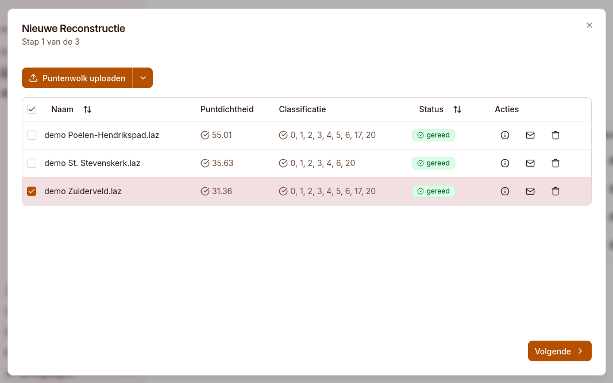
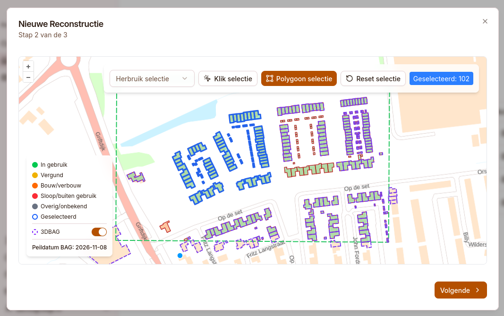
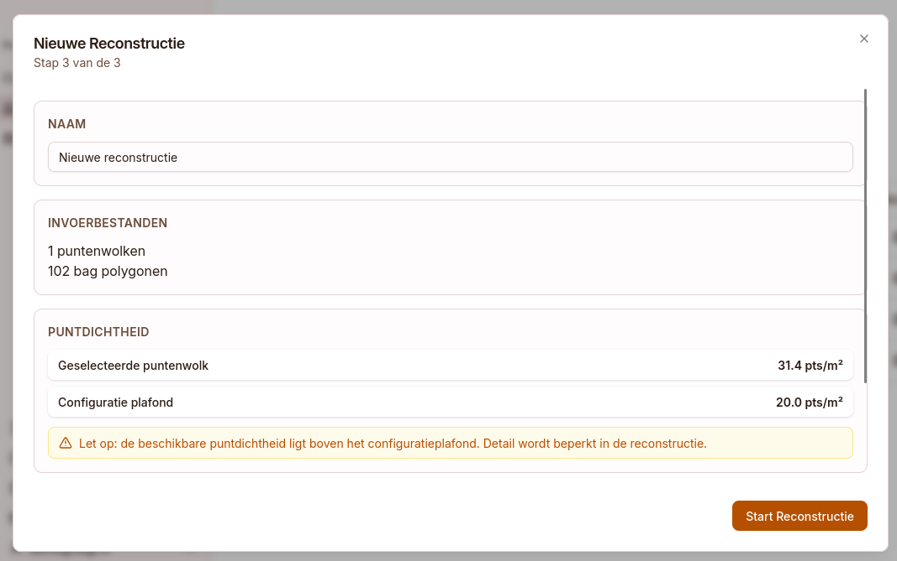
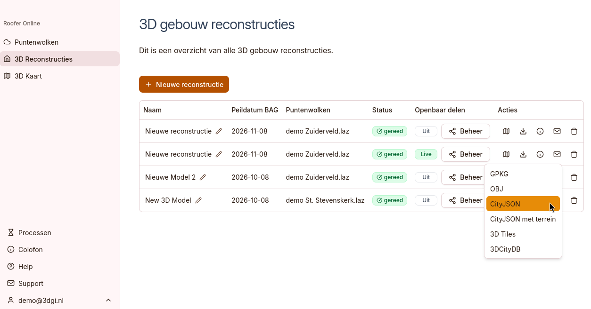

# 3D building reconstruction from point clouds and building polygons with Roofer Online

Geonovum DTaaS Testbed 2026 Phase 2. Adoption topic #1: Implement and validate an OGC API Processes service

## Summary

3DGI added an OGC API – Processes interface to [Roofer Online](https://roofer-online.nl), which reconstructs 3D buildings from point clouds and building footprints. The contribution addresses Topic 1: exposing an existing calculation module through the nLDT architecture and making it usable by other vendors' clients.

There are two versions of the Roofer Online processes API.

- `v1`: A public demo that was developed for the testbed, and it uses fixture data. Live at [https://processes.staging.roofer-online.nl/ogcapi](https://processes.staging.roofer-online.nl/ogcapi).
    - [process catalogue](https://processes.staging.roofer-online.nl/ogcapi/processes)
    - [Swagger UI](https://processes.staging.roofer-online.nl/ogcapi/docs)
    - [OpenAPI document](https://processes.staging.roofer-online.nl/ogcapi/openapi.json)
- `v2`: The client-facing live Roofer Online processes API, which requires a Roofer Online account and authentication. Live at  [https://roofer-online.nl/ogcapi](https://roofer-online.nl/ogcapi).

|                | v1: public testbed demo                                                       | v2: live Roofer Online API                                                      |
|----------------|-------------------------------------------------------------------------------|---------------------------------------------------------------------------------|
| Purpose        | Let participants test discovery, execution, job handling and process chaining | Run building reconstruction within Roofer Online                                |
| Processing     | Deterministic fixture results and sample CityJSON/GeoPackage files            | Point-cloud ingestion, BAG selection, reconstruction and export                 |
| Access         | Public, no access restriction                                                 | Public discovery; authenticated execution, jobs, results and artifact downloads |
| Processes      | Separate validation, reconstruction and conversion processes                  | One reconstruction process incorporating preparation and requested exports      |
| Execution      | Synchronous and asynchronous                                                  | Asynchronous only                                                               |
| Testbed status | Tested                                                                        | Not tested because authentication is required                                   |

## Roofer Online

[Roofer Online](https://roofer-online.nl) is a web service for creating 3D building models from LAS/LAZ point clouds and BAG building polygons.
Users upload their point clouds, select buildings from BAG data synchronised with Kadaster, and configure reconstruction.
Processing runs on the server, so users do not need to install reconstruction software.
Models can be viewed in 3D, downloaded or published as 3D Tiles.
The main goal of Roofer Online is to enable Dutch municipalities and provinces to generate up-to-date 3D building models from their local point clouds.

The service uses the open-source [Roofer](https://innovation.3dbag.nl/roofer/) reconstruction software, and the same parameters that are used for producing the [3DBAG](https://3dbag.nl).

Roofer Online has a React frontend, a FastAPI backend and a [Dagster](https://dagster.io) processing layer.
The frontend uses the service's existing internal application API to manage data, start jobs, poll their status and retrieve results.
A separate authentication handler manages user sign-in.
The API uses bearer-token authentication with JWT tokens and checks user roles and ownership to control access to processes and assets.
[Dagster]([Dagster](https://dagster.io)) orchestrates point-cloud preparation, BAG synchronisation, reconstruction, format conversion and database export, managing dependencies between processing steps.
The backend submits jobs through Dagster's GraphQL API and stores process records with their Dagster run identifiers in PostgreSQL.
When the frontend polls an active process, the backend queries Dagster, updates the stored process and asset statuses, and records output metadata when processing completes.
This job lifecycle existed before the OGC API interface was added.

A central question for us was how to layer an OGC API – Processes interface over the existing backend API so that external clients could invoke the processes already available through the UI.
The aim was to provide direct, controlled access for automation and integration with other software, while reusing Roofer Online's authentication, ownership checks and job lifecycle.

The Testbed proposal identified four Roofer Online capabilities to expose as OGC API processes:

| Proposed process        | Role in Roofer Online                                                                                                  |
|-------------------------|------------------------------------------------------------------------------------------------------------------------|
| `validate_point_cloud`  | Checks whether a point cloud is suitable for reconstruction, including its spatial extent, classification and density. |
| `reconstruct_buildings` | Reconstructs 3D buildings from the selected BAG polygons and point clouds, producing CityJSON models.                  |
| `convert_format`        | Converts CityJSON models to OBJ, GeoPackage or 3D Tiles for use in other software or publication.                      |
| `export_to_3dcitydb`    | Exports CityJSON models to a 3DCityDB database. *The 3DCityDB export process was not implemented in the testbed.*      |



*Figure 1. Select an uploaded point cloud after validation.*



*Figure 2. Select BAG buildings within the point-cloud extent, outlined in green.*



*Figure 3. Review the inputs and reconstruction settings before starting the job.*



*Figure 4. Access completed models and choose a download or export format.*


## Implementation

The API accepts LAS/LAZ URLs, a BAG building selection and processing options as JSON, and returns metadata and download links for building models.
We implemented two versions:

- [v1 demo](https://processes.staging.roofer-online.nl/ogcapi): three processes for validation, reconstruction and conversion, using fixed sample data. This version was tested during the testbed.
- [v2 live service](https://roofer-online.nl/ogcapi): one asynchronous process combining preparation, reconstruction and export of client data. It requires JWT bearer-token authentication and was not tested during the testbed.

Both versions reuse the `ogc-processes` protocol layer. 
The live integration adds process definitions from `roofer-processes-contracts` and adapters to Roofer Online's existing authentication, Dagster workflows and persistent job storage.

### Data

Clients submit inputs in the `inputs` object of a JSON body to `POST /ogcapi/processes/{processID}/execution`, with `Content-Type: application/json`.

- **Point clouds:** one or more LAS/LAZ files, supplied as HTTP(S) URL objects, for example `{"kind": "url", "url": "https://data.example/survey.laz"}`. The files are hosted by the client or a data provider, their contents are not embedded in the request, because point cloud data is usually very large. The live service downloads the data from the provided URLs. Their horizontal coordinates must align with the BAG footprints in EPSG:28992, the service does not reproject them.
- **Building selection:** BAG building identifiers (`identificatie` attribute), for example `{"kind": "buildings", "building_ids": ["0000000000000001"]}`, or a WKT Polygon/MultiPolygon with `"kind": "area"` and `"crs": "EPSG:28992"`. Roofer Online obtains the corresponding BAG footprints, clients supply the selection.
- **Settings and formats:** optional reconstruction settings in `config`, for example `{"ceil-point-density": 10}`, and an optional model `name`. The `formats` array selects downloads: v1 supports `cityjson` and `gpkg`, v2 also supports `obj`, `cityjson_terrain` and `3dtiles`, and defaults to CityJSON.
- **Validation results:** the v1 validation process returns a JSON readiness report with per-source readiness, CRS, bounds, point count and density. These are sample values in the demo.
- **Model outputs:** reconstruction and conversion return JSON metadata and download links in `artifacts`, keyed by format. Each link has an `href` and media `type`, clients download the files with HTTP GET. The live v2 outputs are ZIP archives (`application/zip`), and downloads require the client's JWT bearer token. For asynchronous execution, clients retrieve the result document from `GET /ogcapi/jobs/{jobID}/results` after the job succeeds.

For example, a v2 reconstruction request combines the source, selection and output formats in one JSON body. Send it to `POST /ogcapi/processes/roofer:reconstruct_buildings:v2/execution` with `Prefer: respond-async` and `Authorization: Bearer <JWT>`:

```json
{
  "inputs": {
    "point_clouds": [{"kind": "url", "url": "https://data.example/survey.laz"}],
    "bag": {"kind": "buildings", "building_ids": ["0000000000000001"]},
    "formats": ["cityjson", "gpkg"]
  }
}
```

### Processes

#### v1 - demo

The public demo exposes three Roofer Online processes:

| Process                           | Input                                              | Result passed to the next step              |
|-----------------------------------|----------------------------------------------------|---------------------------------------------|
| `roofer:validate_point_cloud:v1`  | Remote LAS/LAZ URL objects                         | Readiness report containing point-cloud IDs |
| `roofer:reconstruct_buildings:v1` | Point-cloud IDs and a BAG selection                | Model ID and artifact links                 |
| `roofer:convert_format:v1`        | Model ID and requested CityJSON/GeoPackage formats | Artifact links for the selected formats     |

An additional `echo` process supports the OGC compliance suite.
The proposed 3DCityDB export (`export_to_3dcitydb`) was not implemented, because it would require authentication with an external 3DCityDB service this complexity is outside the scope of the testbed.

Clients can discover input/output schemas, execute synchronously or request asynchronous execution with `Prefer: respond-async`, follow the returned job URL, poll status, list jobs and retrieve
results.
The demo does not download the supplied point clouds or run reconstruction: it returns fixed sample files.
Jobs and generated asset registrations are held in memory and disappear on restart.

#### v2 - live Roofer Online

The live v2 API exposes one process, `roofer:reconstruct_buildings:v2`, which combines point-cloud preparation, reconstruction and export. 
Clients submit remote LAS/LAZ URLs, a BAG building or area selection, optional reconstruction settings and requested output formats in one request, instead of passing asset IDs between the three v1 processes. 
The service downloads and processes the supplied data through Roofer Online's workflows and supports CityJSON, GeoPackage, OBJ, CityJSON with terrain and 3D Tiles outputs. 
Execution is asynchronous only, and jobs persist across restarts. 
Discovery remains public; execution, job monitoring, results and artefact downloads require JWT bearer-token authentication and follow Roofer Online's access rules. 
This authenticated v2 workflow was not tested during the testbed.

### Architecture

The architecture separates OGC protocol handling, Roofer Online process definitions and integration with the live service.
This allowed standards testing against the demo while keeping the protocol code independent of Roofer Online's database and Dagster.

The `ogc-processes` package implements the following resources from [OGC API – Processes Part 1: Core](https://docs.ogc.org/is/18-062r2/18-062r2.html), plus the Job list extension.
Paths are relative to `/ogcapi`.

| Purpose                                                         | OGC resource and operation                        |
|-----------------------------------------------------------------|---------------------------------------------------|
| Discover available processes and their input/output definitions | `GET /processes` and `GET /processes/{processID}` |
| Submit inputs to a process                                      | `POST /processes/{processID}/execution`           |
| List jobs and check an execution's status                       | `GET /jobs` and `GET /jobs/{jobID}`               |
| Retrieve the outputs of a completed job                         | `GET /jobs/{jobID}/results`                       |

The package parses execution requests, selects synchronous or asynchronous execution from the `Prefer` header, and constructs responses with the required status codes, headers, links and output structure. 
For example, an asynchronous submission returns HTTP 201 with a job description and a `Location` header pointing to the job's status URL.

To connect these operations to a host application, the `create_app` FastAPI application factory receives five adapters: Python objects implementing the interfaces below. 
This division allows us to separate the external OGC API from the internal interfaces.

| Adapter                    | Responsibility                                                                                          |
|----------------------------|---------------------------------------------------------------------------------------------------------|
| `ProcessCatalog`           | Supplies available processes, input/output schemas and supported execution modes.                       |
| `ProcessContractValidator` | Checks process-specific inputs before submission and backend outputs before returning them to clients.  |
| `Authenticator`            | Resolves the caller's identity using the host's authentication mechanism.                               |
| `ExecutionBackend`         | Submits work to the host's processing engine and retrieves execution status and outputs.                |
| `JobStore`                 | Stores each OGC job with its owner and backend execution identifier, and retrieves jobs for that owner. |

Dagster tracks workflow runs, the `JobStore` tracks the jobs exposed through the OGC API. 
It retains a public job ID, its owner and a mapping to the backend execution.
One OGC job can span several Dagster runs, such as point-cloud preparation followed by reconstruction, while clients follow one job and list only their own jobs.
The execution adapter obtains processing status and results from the backend. 
`JobStore` does not require a separate database: its implementation can use existing Roofer Online records where they provide the required information.
The demo stores jobs in memory, the live integration persists them in PostgreSQL.

Separating these responsibilities lets a host change its process definitions, authentication, workflow engine or storage without changing the HTTP implementation. 
In the demo, the adapters use predefined sample data, simulated execution, unverified demo identities and in-memory job storage. 
These are the “fixture adapters”: they let clients exercise the OGC interface without running against the live Roofer Online service.

The `roofer-processes-contracts` package supplies the live v2 process catalogue and validator using the interfaces and response models defined by `ogc-processes`.
Its Pydantic models define both the published input/output schemas and runtime validation rules.
Keeping these definitions separate from the database and workflow engine lets the production contract be tested without running Roofer Online.

`RooferCatalog` and `RooferContractValidator` fill the `ProcessCatalog` and `ProcessContractValidator` slots described above.
For `roofer:reconstruct_buildings:v2`, the catalogue supplies the process description returned by `GET /processes/{processID}`.
On an execution request, the validator checks the inputs against `ReconstructionInputs` and passes normalised values to the execution backend, invalid inputs are rejected before submission.
When results are retrieved, it checks the backend's `building_model` output against `BuildingModel` before the OGC layer returns it to the client.
The remaining three adapters connect this contract to Roofer Online's authentication, processing and storage.

Roofer Online installs both packages and mounts the OGC application at `/ogcapi` alongside its existing API.
It supplies adapters for JWT authentication, execution and persistent job storage.
The execution adapter calls shared Python application services behind the existing API, reusing ownership checks, asset management and Dagster workflows.
The job store links each public OGC job to its owner and backend execution, the execution adapter translates backend status and results into OGC responses.
External clients can therefore submit and monitor work through the standard interface while the existing backend retains control of access and processing.

Illustrative host integration, where `jwt_authenticator`, `execution_backend` and `job_store` are Roofer Online's adapters:

```python
from ogc_processes.router import create_app
from roofer_processes_contracts.catalog import RooferCatalog, RooferContractValidator

app.mount("/ogcapi", create_app(
    catalog=RooferCatalog(),
    validator=RooferContractValidator(),
    authenticator=jwt_authenticator,
    backend=execution_backend,
    store=job_store,
))
```

### Why not pygeoapi?

We wanted to separate OGC protocol handling from process definitions and the host application's authentication, storage and orchestration.
This let us test the protocol layer with demo adapters, then reuse it with the live process contracts and Roofer Online's existing services.
The same interfaces connect both versions without coupling the OGC implementation to Dagster or Roofer Online's database.

[pygeoapi supports custom process plugins and replaceable job managers](https://docs.pygeoapi.io/en/stable/publishing/ogcapi-processes.html), so a Dagster integration would also be possible.
We chose our own adapter interfaces because they directly express the separation we needed, while allowing the OGC routes to call the application services behind our existing FastAPI API and reuse its authentication and ownership rules.
We judged the required protocol surface: discovery, execution, job monitoring and results, are manageable to implement.


## Conformance

Conformance was tested on the v1 demo API.

### ogc-checker

We ran `@geonovum/ogc-checker` **1.3.1** as a local package, using the ruleset for the `ogc-api-processes` **2.0.0**:

```sh
npm exec -- ogc-checker validate \
  --standard ogc-api-processes --version 2.0.0 \
  --input "https://processes.staging.roofer-online.nl/ogcapi/openapi.json" \
  --fail-on warn
```

The run returned:

```
Ruleset: ogc-api-processes@2.0.0
Applied rulesets: http://www.opengis.net/spec/ogcapi-processes-1/2.0/conf/core, http://www.opengis.net/spec/ogcapi-processes-1/2.0/conf/job-list, http://www.opengis.net/spec/ogcapi-processes-1/2.0/conf/json, http://www.opengis.net/spec/ogcapi-processes-1/2.0/conf/ogc-process-description
Diagnostics: 0 (errors 0, warnings 0, info 0, hints 0)
No diagnostics.
```

### OGC TEAM Engine

We used **TEAM Engine 6.0.0-RC2** with version **1.3** of the OGC API – Processes Executable Test Suite (ETS), packaged in the Docker image `ogccite/ets-ogcapi-processes10:1.3-teamengine-6.0.0-RC2`.
The compliance profile is **OGC API – Processes – Part 1: Core, version 1.0.0 (OGC 18-062r2)**, exposed as suite `ogcapi-processes-1.0` ([suite documentation](https://cite.opengeospatial.org/teamengine/about/ogcapi-processes-1.0/1.0/site/)).

We run TEAM Engine in a local container and start validation through its REST API with a GET request to `/teamengine/rest/suites/ogcapi-processes-1.0/run`, using these parameters:

- `iut=https://processes.staging.roofer-online.nl/ogcapi`: the deployed v1 demo API under test.
- `echoprocessid=echo`: the process used for execution tests.

No additional test-selection parameters are supplied.
The runner treats failed or skipped tests as a failure. The run completed with **54 passed, 0 failed and 0 skipped**:

```text
OGC API - Processes ETS passed all 54 tests without skips. Report: artifacts/ogc-processes-ets.xml
```

## Findings

- **An OGC interface can reuse an existing service backend.** Roofer Online exposes its processing through standard endpoints while retaining its FastAPI application services, JWT authentication, ownership checks and Dagster workflows.
 
- **The protocol implementation was reused across different process interfaces.** The v1 demo and live v2 service share HTTP handling and OGC response construction while supplying different process definitions and backend adapters. Testing v1 exercised the shared protocol code, but it did not validate v2’s OGC-conformance or authenticated workflow.
 
- **A public process need not correspond to one internal workflow step.** The v1 demo exposes validation, reconstruction and conversion separately. The live v2 process combines these steps, allowing clients to submit source data and requested outputs without managing intermediate assets.
 
- **OGC jobs need a stable identity across backend workflows.** One client request can involve several Dagster runs. The job store maintains the public job identifier, ownership and execution mapping so clients can monitor the operation as one job.
 
- **Authenticated interoperability remains to be tested.** The live v2 API was excluded from testbed testing because it requires authentication. Further testing should cover authenticated submission, polling and downloads with participant clients and real input data.

