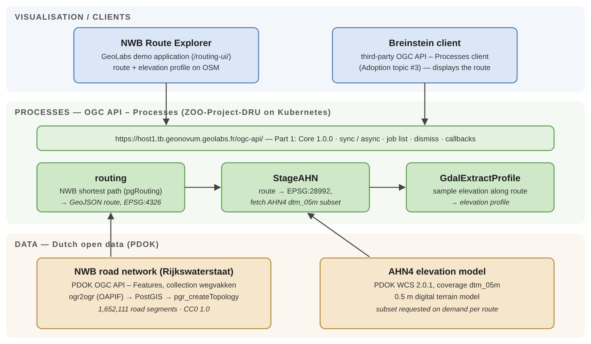
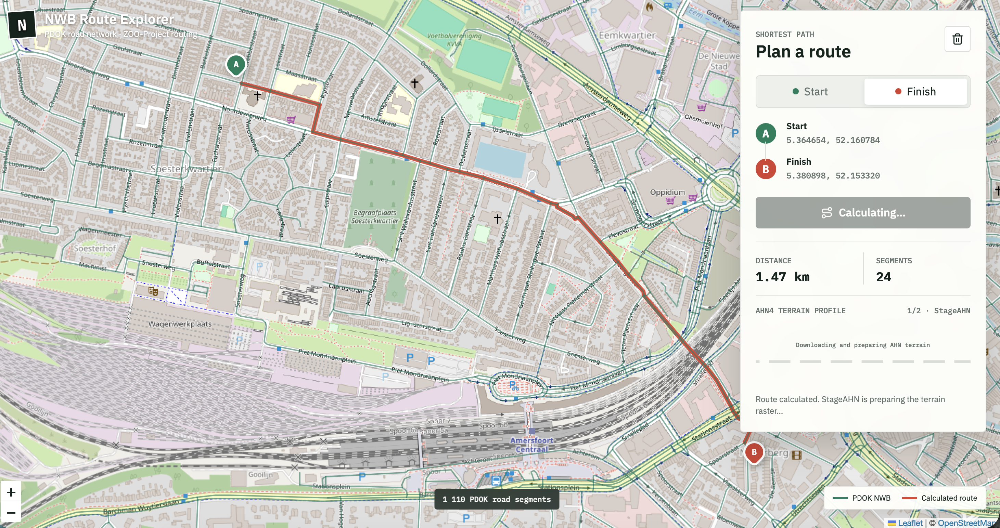
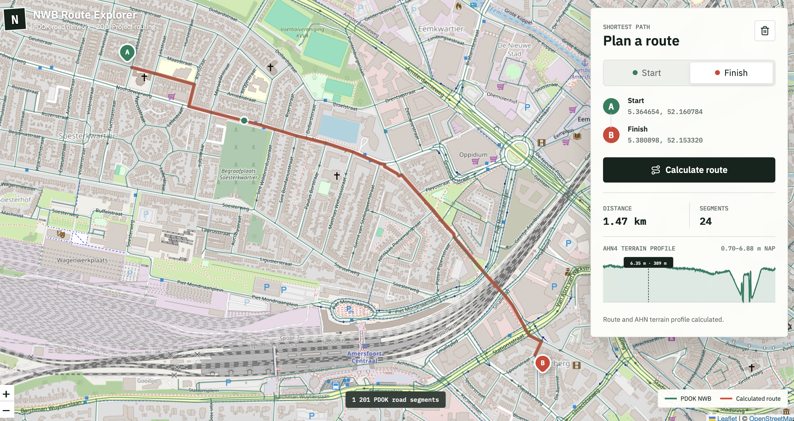
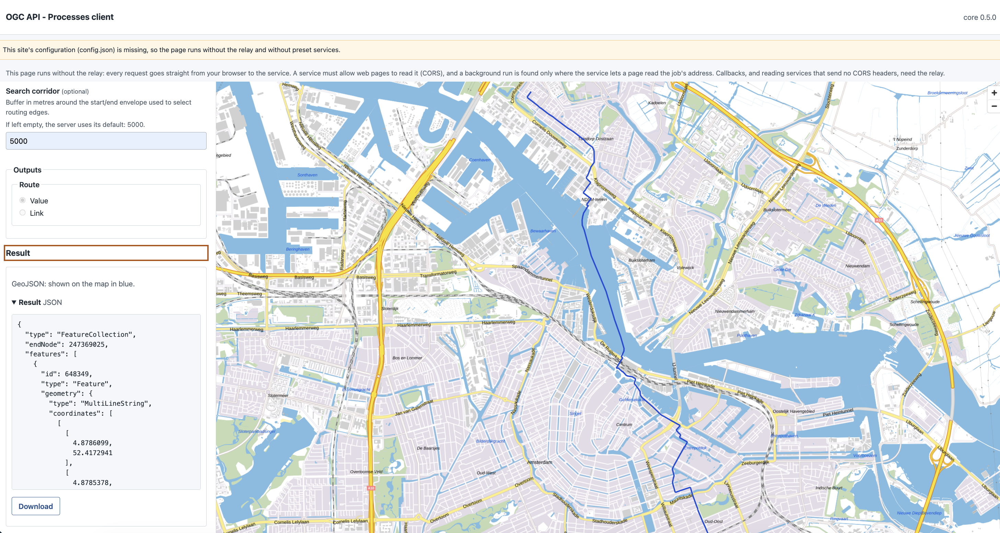
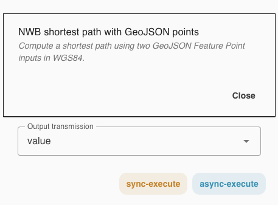
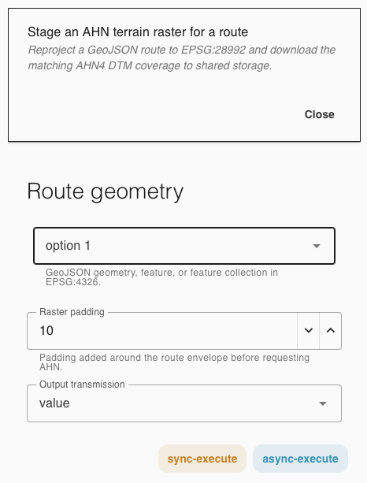

# From WPS to OGC API - Processes: the MapMint routing service on ZOO-Project-DRU

Geonovum Testbed 2026, phase 2. Adoption topic #2: Complete and validate an existing OGC API Processes service

Author: Gérald Fenoy, [GeoLabs SARL](https://www.geolabs.fr) (ORCID [0000-0002-9617-8641](https://orcid.org/0000-0002-9617-8641))

License: CC BY 4.0

## Table of contents

- [Results at a glance](#results-at-a-glance)
- [Summary](#summary)
- [1. Objective and scope](#1-objective-and-scope)
- [2. Implementation](#2-implementation)
- [3. Conformance](#3-conformance)
- [4. Interoperability with other participants](#4-interoperability-with-other-participants)
- [5. Findings: describing GeoJSON inputs and outputs](#5-findings-describing-geojson-inputs-and-outputs)
- [6. Proposal](#6-proposal)
- [7. Contributions to upstream projects](#7-contributions-to-upstream-projects)
- [8. Limitations](#8-limitations)
- [9. Observations and Recommendations](#9-observations-and-recommendations)
- [10. Next steps](#10-next-steps)
- [Appendix A. Reproducing the ogc-checker run](#appendix-a-reproducing-the-ogc-checker-run)
- [Appendix B. Resources](#appendix-b-resources)

## Results at a glance

| Question | Answer |
|---|---|
| Is the service available through OGC API - Processes? | Yes, at https://host1.tb.geonovum.geolabs.fr/ogc-api/ and https://host2.tb.geonovum.geolabs.fr/ogc-api/ |
| Does it pass the official OGC test suite (Part 1: Core 1.0)? | Yes: 3 of 3 conformance classes; 53 tests passed, 0 failed, 1 skipped for `host1` |
| Does it pass the Geonovum `ogc-checker`? | Yes: 0 diagnostics of any kind, with the version 1.0.0 rules on `host1` and with the version 2.0.0 rules on the second Server Instance `host2` |
| Does it support sync and async execution and job management? | Yes, on all three processes on the two server instances |
| Does it work with version 2.0 of the standard (draft)? | Yes, as far as the tools can tell: the `host2` Server Instance passes `ogc-checker` 2.0.0 with 0 diagnostics; available in the ZOO-Project-DRU Helm chart since version 0.10.5. Still, some endpoints are not implemented yet. |
| Can other participants’ clients use the service? | Partly, they can discover, describe, and run its processes. One client could also display the route on a map; another was having issue with detecting the inputs data-types / data-formats, as discussed in Section 5. |
| What did the testbed deliver beyond the service? | The routing service working as a process accessible from an OGC API - Processes - Part 1: Core Server Instance, three corrections merged into the official OGC schemas, Docker packaging merged into `ogc-checker`, two Server Instances for testing, and six recommendations (Section 9). |

## Summary

GeoLabs enabled the MapMint platform's shortest-path service for Geonovum DTaaS Testbed 2026 Phase 2 through OGC API - Processes - Part 1: Core Standard. Previously available only via OGC Web Processing Service (WPS) 1.0.0, the service now runs on ZOO-Project-DRU, deployed on Kubernetes using the official Helm chart, with small modifications to support the non DRU ZOO-Project version.

For the testbed, the service uses Dutch open data. The road network is the Nationaal Wegenbestand (NWB) from Rijkswaterstaat, comprising 1,652,111 road segments accessed via the PDOK OGC API - Features endpoint. Elevation data is sourced from AHN4 through the PDOK Web Coverage Service. Three chained processes compute the shortest path and its elevation profile. The public NWB Route Explorer web application allows anyone to use these processes.

The service is compliant, in the sense that it passes both the official OGC beta Executable Test Suite for Part 1: Core 1.0 and the Geonovum `ogc-checker` with no diagnostics reported.

However, compliance alone does not guarantee interoperability. While clients from other participants could list and execute processes, only one client was able to display the route on a map. The investigation identified three issues:

1. If the Server Instance passed every check / test, the output schema generated by the server could not be satisfied by any value;
2. A client decides what to display on a map from a keyword (`contentMediaType` on an object) that the standard does not define for that purpose;
3. The point inputs were literal plain strings; so no client was capable of offering a point picker, but was providing some field to use at least.

A second Server Instance exposes a corrected process and passed all `ogc-checker` tests with the version 2.0.0 of the OGC API - Processes - Part 1: Core. However, the input schema remained empty in the same client. This shows again that a process description can be valid yet unusable for clients.

This report proposes a standard-compliant method for describing GeoJSON inputs and outputs, and provides six recommendations to the OGC API - Processes Standards Working Group (SWG), tool maintainers, client implementers, and Geonovum.

Additionally, GeoLabs addressed gaps in the official OGC API - Processes schemas with three merged pull requests and contributed Docker packaging for `ogc-checker`.

## 1. Objective and scope

The Geonovum DTaaS Testbed 2026 Phase 2 aims to make the processes used by digital twins interoperable through OGC API - Processes, following the [nLDT reference architecture](https://geonovum.github.io/NLDT-Architectuur/). Adoption topic #2 asks for an existing implementation to be completed and validated.

The objective was to migrate the MapMint routing service from WPS 1.0.0 to OGC API - Processes, demonstrate compliance, and test interoperability with other participants’ software.

| In scope | Out of scope |
|---|---|
| Process description (version 1.0, and version 2.0 where possible) | Security layer (OAuth2 / API keys) |
| Synchronous and asynchronous execution, job management, callbacks | Other MapMint modules |
| Validation with the OGC test suite and the Geonovum `ogc-checker`, with zero errors | Recipes / CWL workflows (Topic #4) |
| Public demonstration service with Dutch data (at least 6 months) | |
| Written report and demonstration video | Geonovum_Testbed2026_GeoLabs_60s.mp4 |

GeoLabs is a French company specialized in open-source geospatial software, founded in 2007 and based in Lattes. It is a core maintainer of the [ZOO-Project](https://github.com/ZOO-Project/ZOO-Project), an OSGeo project and the OGC Reference Implementation of the OGC API - Processes - Part 1: Core Standard 1.0. GeoLabs also develops MapMint, a service-oriented GIS platform built on top of the ZOO-Project. The three most recent MapMint sales were to SNE (Chad), CEET (Togo) and NIGELEC (Niger).

## 2. Implementation

### 2.1. The routing service

The MapMint routing service computes shortest paths on a road network stored in PostGIS and prepared with [pgRouting](https://pgrouting.org/), an extension of PostgreSQL/PostGIS providing geospatial routing functionality. The service has been available in MapMint since 2012, through WPS only. It was also the service used in the ZOO-Project workshops until these moved to OGC API - Processes. It is described in Choosumrong, Humhong, Raghavan & Fenoy (2019), *Development of optimal routing service for emergency scenarios using pgRouting and FOSS4G*, Korean Spatial Information Society.

### 2.2. Architecture

The deployment follows the three layers of the nLDT reference architecture: data, processes, and visualization. Figure 1 illustrates this architecture.



*Figure 1. Architecture of the deployment. Clients call the OGC API - Processes endpoint; the processes use Dutch open data through the PDOK standard APIs. Source: [`media/architecture.svg`](media/architecture.svg).*

The Server Instance runs on a Kubernetes cluster and was deployed using the official [ZOO-Project-DRU Helm chart](https://github.com/ZOO-Project/charts). The deployment files, the data-loading scripts, and the demonstration application are available in the [GeoLabs/tb-geonovum-pgrouting](https://github.com/GeoLabs/tb-geonovum-pgrouting) repository.

| Component | URL |
|---|---|
| OGC API - Processes landing page | https://host1.tb.geonovum.geolabs.fr/ogc-api/ |
| Built-in web interface (ZOO-Project) | https://host1.tb.geonovum.geolabs.fr/ogc-api/index.html |
| OpenAPI document | https://host1.tb.geonovum.geolabs.fr/ogc-api/api |
| NWB Route Explorer (demonstration application) | https://host1.tb.geonovum.geolabs.fr/routing-ui/ |
| Second Server Instance (version 2.0 paths, `routing1` process) | https://host2.tb.geonovum.geolabs.fr/ogc-api/ |

Both Server Instances are deployed without authentication, as open access was required by the call for tenders. The [ZOO-Project nuxt-client](https://github.com/ZOO-Project/nuxt-client), a web client application for Part 1 and Part 2 of the standard, can also connect to the Server Instance.

### 2.3. Data

- Road network: the `wegvakken` collection of the Nationaal Wegenbestand, read from the [PDOK OGC API - Features endpoint](https://api.pdok.nl/rws/nationaal-wegenbestand-wegen/ogc/v1) using the GDAL `ogr2ogr` tool and loaded into PostGIS. It contains 1,652,111 road segments and is licensed CC0 1.0. The process consequently uses authoritative data through a standard API, with no file exchange.
- Elevation: the AHN4 terrain model (`dtm_05m`, 0.5 m resolution), read on demand from the [PDOK WCS 2.0.1 service](https://service.pdok.nl/rws/actueel-hoogtebestand-nederland/wcs/v1_0) for the area around each route.

### 2.4. Processes

| Process | Description |
|---|---|
| `routing` | Computes the shortest path between two points from the NWB network layer available in the PostGIS database, and returns a GeoJSON `FeatureCollection`, one feature per road segment. |
| `StageAHN` | Reprojects a route from EPSG:4326 to EPSG:28992 (RD New) and downloads the matching AHN4 terrain raster.  This process simply stages the elevation data using a trivial WCS request over the full road extent. Obviously, extracting a smaller extent along the line would have made this step more efficient than it is currently. |
| `GdalExtractProfile` | Reads the elevation values (relying on the staged data previously by StageAHN) along the route from that raster. |
| `routing1` (on `host2`) | Variant of `routing` that takes its two points as GeoJSON features (Section 5). |

All processes support synchronous execution, asynchronous execution with job monitoring, and job dismissal.

Below is an example of a request to execute the `routing` process.

```http
POST /ogc-api/processes/routing/execution HTTP/1.1
Host: host1.tb.geonovum.geolabs.fr
Content-Type: application/json

{
  "inputs": {
    "startPoint": "5.364654064178468,52.160783637972834",
    "endPoint": "5.380897521972656,52.1533195002279",
    "corridorMeters": 5000
  },
  "outputs": { "Result": { "transmissionMode": "value" } },
  "response": "raw"
}
```

The `startPoint` and `endPoint` inputs are `lon,lat` strings. The `corridorMeters` input defines the buffer around the two points for selecting candidate roads (default: 5000 m). The server returns the route as GeoJSON. If the `Prefer: respond-async` header is used, the server returns a job, which the client follows until the result is ready. The [article version](Topic2-article.md) provides the full job status document and result.

### 2.5. Demonstration application

The NWB Route Explorer is a lightweight browser client developed for the testbed based on years of experience and available source code from the MapMint Open-Source software. Users select two points, and the application invokes the three processes in sequence, displaying each result as soon as it is available.



*Figure 2. The route (red) is displayed as soon as `routing` finishes, on the NWB network (green), while `StageAHN` prepares the terrain raster.*



*Figure 3. The same route with its AHN4 elevation profile. Hovering over the profile shows the matching position on the map.*

In the example in Figures 2 and 3, the route in Amersfoort is 1.47 km long and consists of 24 NWB segments. The elevation profile ranges from 0.70 to 6.88 m NAP, with the lowest points in the Brouwerstunnel, where the road passes under the railway near Amersfoort Centraal. The link between the profile and the map uses a technique from the 2010 ZOO-Project demonstration.

## 3. Conformance

Two independent tools were used. The OGC Executable Test Suite (ETS) invokes the running Server Instance and checks its responses. The Geonovum `ogc-checker` validates the OpenAPI description of the Server Instance. They test different aspects, and both are needed.

### 3.1. OGC test suite, Part 1: Core 1.0

The official OGC beta ETS (`ogcapi-processes-1.0`, version 1.2) was run against `host1`. The full report is available in [s0051.zip](https://github.com/user-attachments/files/32463649/s0051.zip).

As expected from an official reference implementation, the three conformance classes pass, and the report confirms that the implementation meets the certification requirements. The skipped test requires an array input, which none of the deployed processes has.

### 3.2. ogc-checker

On the `host1` Server Instance, with all the demonstration processes deployed, the checker (version 1.0.0 rules) reports:

```
Applied rulesets: core, job-list, json, ogc-process-description (ogcapi-processes-1/1.0)
Diagnostics: 0 (errors 0, warnings 0, info 0, hints 0)
```

In this report, "zero errors" means zero diagnostics of any severity. Appendix A gives the commands to reproduce this run.

### 3.3. Version 2.0 (draft) and the second Server Instance

Version 2.0 of the standard is still a draft under public review when we write this report. Testing against this upcoming version of the Standard was instructive and revealed small gaps in the official schemas, which required corrections that were handled and submitted upstream (Section 7). Since version 0.10.5 of the official ZOO-Project-DRU Helm chart, a parameter (`zoo.processesv2`) makes the Server Instance publish a version 2.0 OpenAPI description.

A second Server Instance, `host2`, was deployed on 16 November 2026 to confirm this on a live server. With the version 2.0.0 rules, `ogc-checker` reports no diagnostics of any kind:

```
Ruleset: ogc-api-processes@2.0.0
Applied rulesets: http://www.opengis.net/spec/ogcapi-processes-1/2.0/conf/core,
  http://www.opengis.net/spec/ogcapi-processes-1/2.0/conf/job-list,
  http://www.opengis.net/spec/ogcapi-processes-1/2.0/conf/json,
  http://www.opengis.net/spec/ogcapi-processes-1/2.0/conf/ogc-process-description
Diagnostics: 0 (errors 0, warnings 0, info 0, hints 0)
No diagnostics.
```

This Server Instance declares the Core conformance classes of both version 1.0 and version 2.0, and its OpenAPI description includes the version 2.0 paths.

### 3.4. Points of attention

The OGC API - Processes - Part 2: Deploy, Replace, Undeploy draft specification is not supported by these Server Instances. Their OpenAPI descriptions list the DRU endpoints and conformance classes only to permit `ogc-checker` to validate the DRU schemas. The conformance declaration should consequently not be read as a capability to deploy processes.

The ZOO-Project-DRU Helm chart, versions lower than 0.10.5, failed validation using the `ogc-checker` because it referenced schemas that had been relocated, renamed, or were unavailable. One schema, `NotSupported.yaml`, still has no official location identified. Further details are available in the [discussion #4](https://github.com/Geonovum/DTaaS-Testbed2026-Phase2/discussions/4).

## 4. Interoperability with other participants

GeoLabs took part in the first plugfest (28 September 2026) remotely and in the second one (27 October 2026) in person.

The client applications developed by other participants could list the processes, read their descriptions, and execute them. Displaying the result on a map was another matter.

| Client | Executes `routing` | Displays the route on a map |
|---|---|---|
| Breinstein OGC API - Processes client (Topic #3) | Yes | Yes, from the first plugfest |
| Imagem PLANSPACE Simulator (Topic #3), `routing` on `host1` | Yes | No |
| Imagem PLANSPACE Simulator (Topic #3), `routing1` on `host2` | No: the form has no input field | No |

### 4.1. Breinstein client

The Breinstein client was able to both invoke `routing` and draw the route on its own map, with no change required on either side.



*Figure 4. The Breinstein client displaying a route computed by the `routing` process (6 October 2026).*

The client creates a form from the process description provided by the Server Instance. Depending on the schema found, it displays the optional search corridor and its default value, and lets users choose how they receive the result. No relay is involved: requests can go directly from the browser to the Server Instance, as it is configured to send the CORS headers browsers require.

### 4.2. PLANSPACE Simulator

During the second plugfest, the `routing` process was executed by typing the inputs in the form, but no result was displayed. The PLANSPACE team indicated that the output description needed at least the `application/geo+json` content type (`contentMediaType`). As this did not match the GeoLabs reading of the standard, it was investigated further (Section 5).

Later, a new test was run with `routing1` on `host2`, whose inputs and output are described with references to GeoJSON schemas. The result was worse: the form has no input field at all, as illustrated in Figure 5. On the same Server Instance, the form for `StageAHN` does show its inputs, but reduces the route geometry to a selector with "option 1", as illustrated in Figure 6.



*Figure 5. PLANSPACE Simulator, form for `routing1` on `host2`: no input field.*



*Figure 6. PLANSPACE Simulator, form for `StageAHN` on `host2`: the geometry is an option selector, the number is a normal field.*

## 5. Findings: describing GeoJSON inputs and outputs

Note that every description discussed in this section passes the OGC test suite and `ogc-checker`.

### 5.1. The output schema could not be satisfied

On `host1`, the processDescription generated by the ZOO-Kernel for the route output of `routing` has a schema that is defined as follows:

```json
"schema": {
  "oneOf": [
    { "type": "object" },
    { "type": "object" }
  ]
}
```

`oneOf` means "exactly one of these". A GeoJSON object matches both branches, so it is rejected, as is any other value. A JSON Schema validator confirmed that even the route returned by the service is not valid against this schema.

For this specific issue, the cause is internal to the ZOO-Kernel. As the process metadata declares two output formats, `application/geo+json` and `application/json`, the ZOO-Kernel then creates one branch per format, but as both are `"type": "object"`, they all become `"type": "object"`.

This was not noticed before, because client applications do not validate results against the schema. Nevertheless, the schema also tells a client nothing about the data. In the PLANSPACE Simulator, the same pattern used on an input produces the "option 1" selector shown in Figure 6.

### 5.2. A client convention that is not in the standard

Based on our understanding of the PLANSPACE Simulator and our discussion with the IMAGEM team present during the second plugfest, it seems the client application searches for a single top-level element: `contentMediaType` in the schema. If it is not found, the client disregards the inputs/outputs definition and any inputs/outputs following it.

| In the process description | What the client displays |
|---|---|
| output with `contentMediaType` = `application/geo+json` | a GeoJSON layer on the map |
| input with `contentMediaType` = `application/geo+json` | drawing on the map |
| `contentMediaType` = `image/tiff; application=geotiff` | a GeoTIFF layer on the map |

The client application does not look at `type` or `format`, and does not follow `$ref` references either. To know what the user may draw, it requires the GeoJSON type names to be directly available within the schema.

This differs from our understanding of the standard, where process descriptions use JSON Schema, in which `contentMediaType` applies to strings only and has no effect on objects. The examples of the standard use `contentMediaType` only on strings. For GeoJSON carried as a JSON object, they use the `format` key, with the `geojson-feature-collection`, `geojson-feature` and `geojson-geometry` values.

The schema that the client expects would pass validation, because the meta-schema of the standard accepts both keywords. Consequently, servers and clients in the testbed agreed on a convention that works between them, but not the one defined by the standard.

The test with `routing1` confirms it. Its description is valid and passes `ogc-checker`:

```json
"schema": {
  "oneOf": [
    {
      "type": "object",
      "$ref": "https://schemas.opengis.net/ogcapi/features/part1/1.0/openapi/schemas/featureGeoJSON.yaml"
    }
  ]
}
```

The client shows no input for this process, not even the plain number input that it displays correctly for `StageAHN`. The whole form fails. The likely cause is the reference to an external schema, which the form generator of the client does not resolve. This has not been verified inside the client.

### 5.3. The point inputs were plain strings

The `startPoint` and `endPoint` inputs were strings, and nothing in the description indicated that they had to follow the `lon,lat` format. A client application can only offer a point picker on a map if the input is described as GeoJSON.

## 6. Proposal

As a solution, GeoLabs would propose to describe GeoJSON values the way the standard intends, and to update the ZOO-Kernel accordingly, to provide a schéma containing:

- an object branch with the `format` key and a `$ref` to the official GeoJSON schema;
- a string branch with `contentMediaType`, where JSON Schema gives it a meaning.

The schema definition below for the route output is intended to make the process work with IMAEGEM’s PLANSPACE simulator. Providing such a schema definition from a process description generated by the ZOO-Project is out of scope from the testbed perspective.

```json
"schema": {
  "oneOf": [
    {
      "allOf": [
        { "format": "geojson-feature-collection" },
        { "$ref": "https://geojson.org/schema/FeatureCollection.json" }
      ]
    },
    { "type": "string", "contentMediaType": "application/geo+json" }
  ]
}
```

Below is the proposed schema for the two point inputs, which would take a GeoJSON point instead of a `lon,lat` string.

```json
"schema": {
  "oneOf": [
    {
      "allOf": [
        { "format": "geojson-geometry" },
        { "$ref": "https://geojson.org/schema/Point.json" }
      ]
    },
    { "type": "string", "contentMediaType": "application/geo+json" }
  ]
}
```

Both schemas were checked using a JSON Schema validator and the official GeoJSON schemas:

| Value | Current output schema | Proposed output schema | Proposed input schema |
|---|---|---|---|
| The route, as an object | Rejected | Valid | — |
| The route, as a string | Rejected | Valid | — |
| A GeoJSON `Point`, as an object | Rejected | Rejected | Valid |
| A GeoJSON `Point`, as a string | — | — | Valid |
| A GeoJSON `LineString`, as an object | — | — | Rejected |

In WPS, distinguishing between input and output formats/types was based on XSD schemas that we could associate with mimeType. Now, with OGC API - Processes - Part 1: Core, the metadata for a process must define the JSON schema for each input and output. This can be explained by the media type, which cannot, on its own, distinguish a feature collection from a feature or a geometry. The ZOO-Kernel must try to avoid producing identical branches, add the `format` value, and keep `contentMediaType` for strings. One can note that the following format choice supported by the input and output of a process is correctly exposed for binary data, where the binary data is transferred as a base64-encoded string and embedded in the `extended-schema` associated with the `schema` for a given input/output. The `routing1` process deployed on `host2` is a first step: it references GeoJSON schemas and has a single branch, but does not yet include the `format` key or the string branch.

Changes for client applications. Changing the inputs to GeoJSON breaks the current callers, including the NWB Route Explorer, which will have to send points such as `{"type": "Point", "coordinates": [5.364654, 52.160784]}`. The route itself does not change.

What is not proposed. The PLANSPACE Simulator would still not work with these schemas. A server could add `"contentMediaType": "application/geo+json"` at the top of the schema only for this client. As this keyword has no meaning on an object in JSON Schema, it is left out. It makes more sense for the client to recognise `format` and follow `$ref`, so that any description following the standard works.

## 7. Contributions to upstream projects

| Contribution | Where | Status |
|---|---|---|
| [#625](https://github.com/opengeospatial/ogcapi-processes/pull/625) "Add outputs schema" (Part 1: Core) | `opengeospatial/ogcapi-processes` | Merged, 8 September 2026 |
| [#626](https://github.com/opengeospatial/ogcapi-processes/pull/626) "Add the missing rPackage response" (Part 2: DRU) | `opengeospatial/ogcapi-processes` | Merged, 8 September 2026 |
| [#627](https://github.com/opengeospatial/ogcapi-processes/pull/627) "Add application/cwl media-type" (Part 2: DRU) | `opengeospatial/ogcapi-processes` | Merged, 8 September 2026 |
| [#857](https://github.com/Geonovum/ogc-checker/pull/857) Dockerfile and documentation | `Geonovum/ogc-checker` | Merged |
| Version 2.0 OpenAPI generation and corrected schema references | ZOO-Project-DRU Helm chart | Released in [0.10.5](https://artifacthub.io/packages/helm/zoo-project/zoo-project-dru?modal=changelog&version=0.10.5), 1 October 2026 |


## 8. Limitations

The OGC test suite runs its execution tests on an `echo` process and examines three processes only. It demonstrates that the Server Instance implements the standard, not that the `routing` process itself was tested. The beta instance of the test suite was used, not a certification run.

For version 2.0, the evidence is the `ogc-checker` validation of the `host2` OpenAPI description. The OGC test suite targets version 1.0 and was not run against `host2`.

The interoperability observations were made by a single participant during two plugfests, using the client applications that were accessible.

The proposed schemas were checked using a validator. They are not yet implemented in the ZOO-Kernel.

The quality and the performance of the routing itself were not measured.

## 9. Observations and Recommendations

As illustrated in this activity, a service that had only ever been offered through WPS can be made available through OGC API - Processes, on Dutch open data, and pass both the OGC test suite and the Geonovum `ogc-checker`. This fulfills the topic's primary objective.

More importantly, the findings show what compliance checks missed. One description passed every test despite containing a schema that no value could satisfy. Another, corrected description also passed every test, yet produced an empty form in a client. Current tools verify that descriptions are well formed, but not that clients can use them. Bridging this gap will require clearer guidance in the standard, more rigorous validation tools, and clients that interpret the standard’s defined keywords.

| | To | Recommendation |
|---|---|---|
| R1 | OGC API - Processes SWG | Version 2.0 should state explicitly how GeoJSON inputs and outputs must be described, and that `contentMediaType` applies to strings only. |
| R2 | OGC API - Processes SWG | Every schema reference in the specification and its examples should resolve, and the `NotSupported` response should be given an official location. |
| R3 | Compliance-tool maintainers | The tools should warn about identical `oneOf` branches, and about `contentMediaType` on an object used as the only indication that a value is GeoJSON. |
| R4 | Client implementers | Client applications should recognize the `format` key based on a predefined and referenceable vocabulary and/or follow `$ref` references in process descriptions. |
| R5 | Geonovum | An official, versioned `ogc-checker` Docker image should be published, so that anyone can run the same check with a single command and state which version of the rules was used. |
| R6 | Geonovum and OGC | A profile or Building Block defining richer descriptions of geospatial inputs and outputs should be considered. |

## 10. Next steps

- Update the ZOO-Kernel and the `.zcfg` format as proposed in Section 6, and describe the `routing` inputs as GeoJSON points.
- Test the result with the testbed client applications, and share Section 5 with the PLANSPACE team and with the OGC API - Processes SWG.
- Point the Helm chart to the official `outputs.yaml` and `rPackage.yaml` schemas now that they are merged upstream.
- Follow up on the `NotSupported.yaml` reference with the SWG.
- Keep the demonstration service online for at least six months after the testbed.

## Appendix A. Reproducing the ogc-checker run

Until an official image is available (recommendation R5), the image has to be built locally:

```bash
git clone https://github.com/Geonovum/ogc-checker.git
cd ogc-checker
docker build . -t ogc-checker:latest
curl -o test.json https://host1.tb.geonovum.geolabs.fr/ogc-api/api
docker run --rm -v "$PWD/test.json:/data/test.json:ro" \
    ogc-checker:latest validate --standard ogc-api-processes --input /data/test.json
```

To check the version 2.0 description of `host2`, the same image is used with the `--version 2.0.0` option:

```bash
curl -o test.json https://host2.tb.geonovum.geolabs.fr/ogc-api/api
docker run --rm -v "$PWD/test.json:/data/openapi.json:ro" \
    ogc-checker:latest validate --standard ogc-api-processes --version 2.0.0 --input /data/openapi.json
```

## Appendix B. Resources

- Demonstration video: provided with this report, in this folder.
- Scientific-article version of this report: [Topic2-article.md](Topic2-article.md)
- Informal account: [Topic2-blog.md](Topic2-blog.md)
- Live endpoints: https://host1.tb.geonovum.geolabs.fr/ogc-api/ and https://host2.tb.geonovum.geolabs.fr/ogc-api/
- NWB Route Explorer: https://host1.tb.geonovum.geolabs.fr/routing-ui/
- Deployment files and demonstration application: https://github.com/GeoLabs/tb-geonovum-pgrouting
- OpenAPI samples and configuration files: https://github.com/GeoLabs/geonovum-dedicated-schemas
- Testbed discussion on `ogc-checker` results: https://github.com/Geonovum/DTaaS-Testbed2026-Phase2/discussions/4
- OGC test suite report: [s0051.zip](https://github.com/user-attachments/files/32463649/s0051.zip)
- ZOO-Project: https://github.com/ZOO-Project/ZOO-Project — Helm chart: https://github.com/ZOO-Project/charts — nuxt-client: https://github.com/ZOO-Project/nuxt-client
- OGC API - Processes - Part 1: Core: https://docs.ogc.org/is/18-062r2/18-062r2.html
- GeoJSON schemas: https://geojson.org/schema/