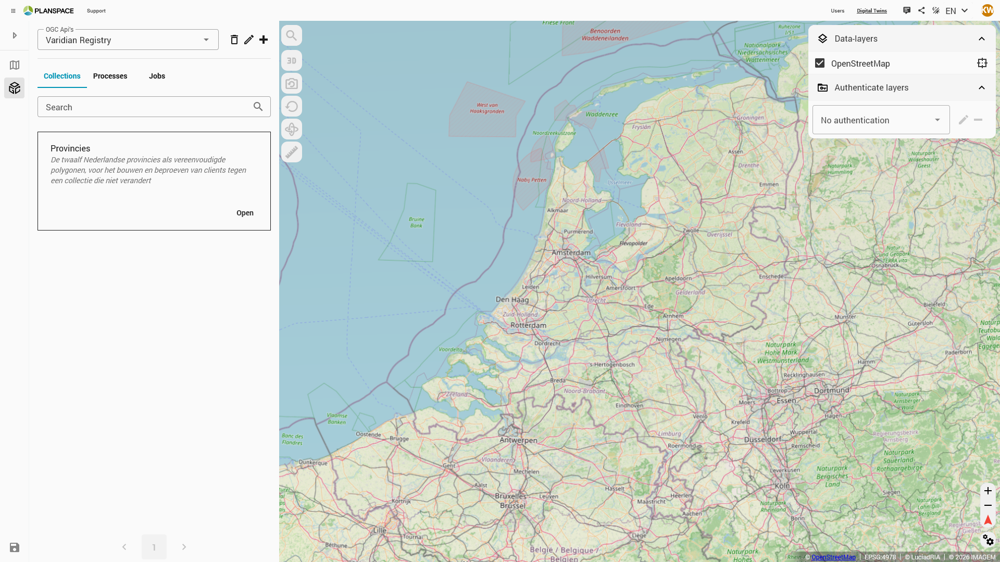
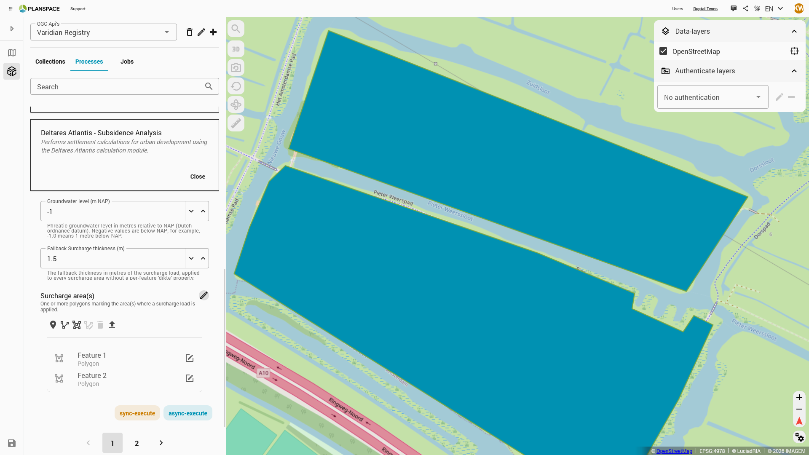
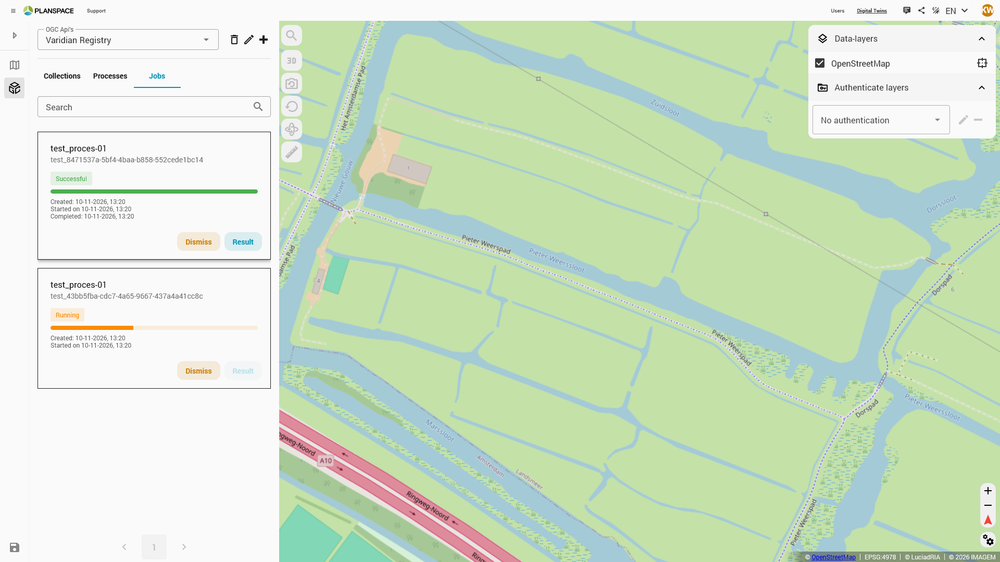
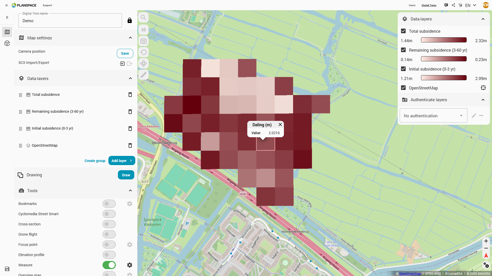

# Topic 3: Implement and validate OGC API Processes client

## Goal

Implement an OGC API Processes client, make it function within the nLDT ecosystem and have it interoperate with software from other software vendors.

## **Approach**

For IMAGEM, the approach was to continue to build on the progress made in the previous testbeds (2024 & 2025). In these testbeds, first explorations were done to work with OGC API Processes. Where it all  
started as a static implementation of OGC API Processes, a more complete implementation of the OGC API Processes (v2) was the aim for this testbed.

In this approach, some new features of the OGC API Processes were tested and implemented in the Digital Twin client (Planspace Simulator). On one side this meant an attempt to create a user interface based on the input and output descriptions of the OGC API Processes provided during this testbed. On the other hand a Job Management System had to be implemented to track the Async processes of this testbed (In previous testbeds, only Sync processes were part of the Adoption topics).

Going into detail, the approach can be divided in four steps:

- **Creating a catalogue with OGC API Processes**
- **Generating UI elements based on the process definition**
- **Creating the Job Management System in the client to manage the Async job executions**
- **Visualising the results of the OGC API Processes.**

## Client implementation

The client is the OGC API Explorer in the Planspace Simulator. It is not tied to specific processes: the user selects an OGC API endpoint (Varidian's registry is the default, other endpoints can be added) and the explorer uses the conformance declaration to enable the parts the endpoint supports:

- **Collections** (OGC API - Features): browse collections, filter on queryables and add a collection as a layer to the map.
- **Processes** (OGC API - Processes): the input form is generated from the process description (JSON Schema), including GeoJSON inputs that can be drawn, uploaded or edited. A process can be executed synchronously or asynchronously, depending on its `jobControlOptions`.
- **Jobs**: asynchronous executions are listed and polled until they finish, with status, progress and timestamps. Jobs can be dismissed when the endpoint supports it, and the results of a finished job can be opened.
- **Results**: outputs are rendered read-only from the output schema. GeoJSON, GeoTIFF and feature collection outputs can be added to the map as a layer.

### Try it yourself

https://nldt.imagem.nl (registration required)

**As part of the deliverables; this client will remain open till at least the 31st of May 2027.**

To use the client:

1. Register, activate the account and log in.
2. Create a digital twin.
3. Open the OGC API tab on the left side of the screen. Here the OGC API endpoints can be explored and processes can be started.

_Figure 1: The OGC API tab with the endpoint selector and the collections, processes and jobs tabs_

_Figure 2: An input form generated from the process description (subsidence process)_

_Figure 3: The job list with a running and a finished job_

_Figure 4: A process result added to the map as a layer_

### Client implementation video

<video controls src="videos/IMAGEM-TESTBED-2026-TEXT.mp4" width="100%">
  Your browser does not support embedded videos.
</video>

## Findings

**Inputs and outputs**

Implementing a client with support for every process including once added in the future is nearly impossible, while we tried to focus on supporting the given schemas by converting them to JSON schema for automatic form generation, while that worked fine for our own implementation, for processes by other providers it is really dependent on their implementation of the schema. Some only supplied a minimal schema, i.e. only requesting an object for GeoJSON inputs instead of requesting an object with its own schema.

This was also present at the output, because without an exact schema of what an output contains a client is never able to display it properly.

We followed the OGC schema for the process descriptions, inputs and outputs. Wherever a process description was valid according to the schema but not yet supported by the client, support for that case was added to the client.

**OGC Schema issues**

The OGC schema / documentation is written in such a way that a party can create an OGC schema compliant API. There is no such thing for clients, which results in clients implementing only the parts supplied to them by external APIs. This causes the client to always lack feature support until a developer adds support for that feature, this is present in basically every process input/output schema.

**Schema might be too complex to fully support in a single client implementation**

Because of the complexity and openness of the ogc schema implementing an “explorer“ client like we did is “impossible“ without a never ending list of test processes.

Even so, we are positive about our implementation: it already works with the processes of multiple providers. We do think that a client built for a few specific endpoints or processes, instead of a generic explorer, will result in a better experience for the user. It would also allow visualising a broader range of outputs, without the user needing to style the result themselves.

**Interoperability**

We were able to implement multiple different OGC API providers, both v1 and v2, in the same client without provider-specific code. The differences between providers were handled in a generic way (see Inputs and outputs), not by special cases per provider.

## Process implementation

Together with Varidian we developed a process calling our Deltares Atlantis subsidence API, while also simplifying and validating the user inputs. The process was originally created by IMAGEM and is hosted in Varidian's registry.

The process (`subsidence_subsidence`, "Deltares Atlantis - Subsidence Analysis") performs a settlement calculation for urban development with the Deltares Atlantis calculation module. It is available through Varidian's registry (https://registry.playground.planspace.nl/processes/subsidence_subsidence) and can be run from the OGC API Explorer, synchronously and asynchronously.

Simplifications compared to our existing subsidence module:

- The input areas are requested in EPSG:4326 instead of the Dutch RD coordinate reference system, so a client does not need to reproject.
- Multiple levels of `dikte` (surcharge thickness) can be given in one request, one per feature. This is not possible in our other implementation.

Inputs:

- **Groundwater level** (`gw`): phreatic groundwater level in m NAP (default -1.0).
- **Surcharge thickness** (`thickness`): fallback thickness of the surcharge in metres (default 1.5, minimum 0.1), used for every area without its own `dikte` property.
- **Surcharge areas** (`geojson`): a GeoJSON FeatureCollection of polygons, optionally with a per-feature `dikte` override.

Outputs: the run ID and three GeoTIFFs (initial subsidence 0-3 years, remaining subsidence 3-60 years, and total subsidence), which can be added to the map as raster layers.

## Recommendations for the OGC standard

- Make the schema of inputs and outputs more specific where a client needs it: a GeoJSON input should state its geometry types, and outputs should always have a schema, so a client can render them.
- Describe the unit and meaning of inputs and outputs in a machine-readable way, not only in free text. This allows clients to render the proper inputs.
- Provide more official examples of process descriptions, including inputs and outputs of different types (e.g. GeoJSON, GeoTIFF, units), so client developers know which parts of the schema they should support and how to render them. This should include more examples of geo related processes, such as processes that take and return geometries, features, rasters and coverages.

## Conclusions

- A generic OGC API Processes client is feasible: the explorer runs processes of multiple providers, both v1 and v2, with forms generated from the process description and results shown on the map.
- Its completeness depends on the quality of the process descriptions. With minimal schemas the client cannot show a good form or result, and the openness of the schema means support is never complete.
- A Job Management System is needed for asynchronous processes, and works with the optional parts the standard gives for it.
- The subsidence process, created by IMAGEM and hosted in Varidian's registry, runs from the explorer with simpler input than our own module (EPSG:4326, multiple `dikte` levels).
