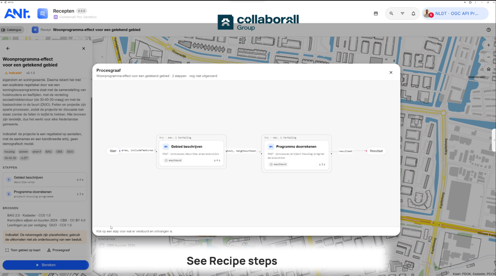
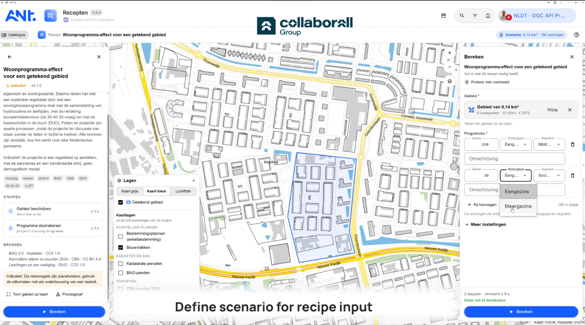
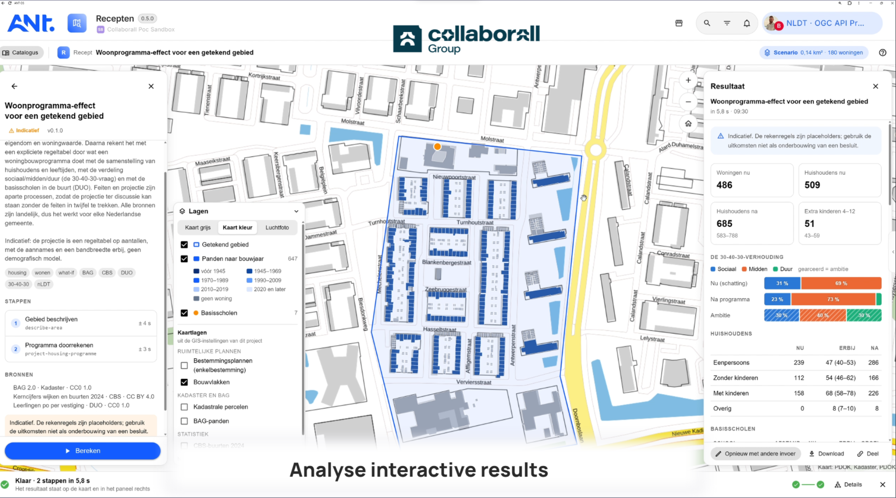

# Topic 4: App-Store / Recipes — Collaborall

*DTaaS Testbed 2026, phase 2 · research topic #4 · findings report*

## Summary

Collaborall investigated how a *recipe* — a combination of data sources and an ordered
list of processes — can be described, found and executed in a national digital-twin App
Store, using OGC API Processes, OGC API Records and DCAT-AP-NL. We built the answer on ANT,
our existing workflow platform, because that is the realistic case: an organisation adopts
these standards on the platform it already runs.

Our main findings and advice:

1. **A recipe needs its own place in DCAT-AP-NL.** It is neither a dataset nor a data
   service. We propose a small extension — two classes and six properties — that catalogues
   a recipe beside the datasets and services it uses, so a catalogue can answer *which
   recipes use this service or this dataset*. The extension validates against the published
   DCAT-AP 3.0 and DCAT-AP-NL 3.0 shapes.
2. **A process and a recipe differ in visibility, not in structure.** A process is a black
   box and is catalogued as an ordinary `dcat:DataService`; a recipe is a transparent
   composition whose steps can be inspected.
3. **Arazzo is not enough for recipes.** It describes a sequence of API calls and nothing
   else of a workflow. We moved to the Open Workflow Specification (OWS); another awardee
   independently left Arazzo as well. We advise Geonovum to choose one recipe language and
   the subset of it a recipe may use.
4. **No standard and no platform carries a value from one step to the next.** That wiring is
   described by the recipe language and has to be executed by whoever runs the recipe.
5. **A catalogue that conforms to the profile can still be rejected by a harvester.** The
   harvester behind data.europa.eu refuses our valid catalogue because of the links that
   make a recipe a recipe. An extension needs to be tested against real harvesters, not
   only against shapes.
6. **Several recipes ask for the same plan in different shapes.** A shared, published
   concept set for a *scenario* — an area and a building programme — would let one input
   serve many recipes. We built a proof of concept on an existing OGC keyword.

The recommendations are collected in chapter 9, and a field reference for the recipe
extension is in appendix A.

## 1. Introduction

### 1.1 The question

The testbed asked how ready-made solutions for real-world problems can be offered as
recipes in an App Store for digital twins. The topic names three mandatory standards — OGC
API Processes, OGC API Records and DCAT-AP-NL — and observes that DCAT-AP-NL can describe
datasets and services, but not yet recipes.

We split that into four questions:

- **Describe.** Which metadata does a recipe need, and how does it fit DCAT-AP-NL?
- **Find.** How are recipes, processes and data published so that they can be searched
  together, also across the catalogues of several parties?
- **Execute.** In which language is a recipe written, and what is needed to run one whose
  steps are OGC API Processes services?
- **Adopt.** What do these standards ask of an existing platform that was not built for
  them?

### 1.2 The use cases

We worked from questions a municipality asks when it plans housing:

- **What does a housing programme do to an area?** A user draws a plan area and enters a
  programme. The recipe first describes the area from national open data — the BAG and the
  CBS neighbourhood figures, read live from PDOK — and then projects the programme onto it:
  the effect on the household and age mix, on the split between price segments, and on the
  primary schools within reach. Facts and projection are two separate processes, so
  that the projection can be challenged without doubting the facts.
- **Is there room on the electricity grid?** The same area and programme are checked against
  the national grid-capacity map of Netbeheer Nederland: which feeding areas are affected,
  what their published congestion status is, and what the development adds to peak demand.
- **Which planned projects collide?** Project boundaries are filtered by area and period,
  and the remaining ones are tested for overlap in space and time. This two-step recipe was
  our first, on synthetic data.

Five recipes over five processes are published. Two of them chain more than one step.

### 1.3 The approach

Every part of the solution is exposed through the standards the topic names:

| Deliverable | What it is | Standard |
|---|---|---|
| Recipe metadata | A `recipe:Recipe` profile on DCAT-AP-NL 3.0 | DCAT-AP-NL, SHACL |
| Catalogue | Recipes, processes and datasets, searchable | OGC API Records, DCAT-AP-NL |
| Cookbook | Each recipe as an executable document | Arazzo, Open Workflow Specification |
| Processes | The steps a recipe calls | OGC API Processes |
| Client | *Recepten*: find, fill in, execute, show on the map | — |

The surface runs on ANT without changes to its core. Each endpoint is a configured
endpoint of the platform that returns the document the standard requires, and a small proxy
in front supplies the parts of HTTP the platform cannot set itself (chapter 6). The pattern
is not specific to ANT.

## 2. Recipe metadata in DCAT-AP-NL

### 2.1 Why a recipe is not a dataset

DCAT-AP-NL 3.0 describes a `dcat:Dataset`, which is data, and a `dcat:DataService`, which
is an endpoint that serves or processes data. A recipe is neither: it is an executable
composition over them.

A recipe can be catalogued today without any extension, by calling it a dataset with one
distribution. We advise against it. It tells every consumer that the resource holds data
it does not hold, it brings in mandatory dataset properties that mean nothing for a set of
instructions, and — most importantly — it hides what a user searches on: **which services
does this chain call, and which data does it need?** The practical reason to catalogue
recipes is to answer *which recipes depend on this service* and *which recipes work on this
dataset*. A recipe typed as a dataset cannot answer either without the consumer fetching
and parsing the recipe itself.

### 2.2 The choices

**A recipe is a `dcat:Resource` with its own class.** `dcat:Resource` is the class DCAT
provides for catalogued things that are not datasets. It carries identification, rights and
themes without claiming anything about data. A recipe therefore sits in the catalogue
beside datasets and services, not disguised as one of them.

**A step points at the service it calls, as a `dcat:DataService`.** This is the choice that
matters most. It makes an OGC API Processes endpoint a catalogue entry in its own right
rather than a URL hidden inside a document, and it creates the link that answers both
search questions above.

**The metadata says that steps depend on each other, not how.** We considered typed inputs
and outputs per step in the metadata and left them out. The recipe document already states
how one step's output feeds the next, and a second copy in the metadata can disagree with
it. The metadata records only *that* a step uses another step's output; the recipe document
stays the authority on the wiring.

**The language of the recipe is a metadata value, not part of the model.** `dct:conformsTo`
on each distribution names the language the recipe is written in. This was tested by
events: when we moved from Arazzo to OWS (chapter 4), the model did not change. Each recipe
now has two distributions, one per language, and a client reads `dct:conformsTo` to choose
the one it can run.

The extension is two classes and six properties. Appendix A lists them with their
cardinalities.

### 2.3 Process and recipe

At the first plugfest the participants discussed what distinguishes a process from a
recipe. A workflow can contain a workflow, so from the outside every recipe is a process.
We therefore draw the line at **visibility**:

| | Process | Recipe |
|---|---|---|
| What it is | The deepest level a party offers | A combination of processes |
| Visibility | A black box: inputs and outputs only | Transparent: its steps can be inspected |
| Supplied by | Anybody, including other parties | Composed from what is in the catalogue |
| In DCAT | `dcat:DataService` conforming to OGC API Processes | `recipe:Recipe` |

A process is catalogued as a plain `dcat:DataService`, not as a class of our own. A class
of our own would make every process invisible to a catalogue that does not know our
vocabulary. With a plain data service, a recipe can call another party's process, and a
harvester that has never heard of recipes still finds the process.

One further rule follows. The housing recipe reads national open data that we do not
publish. Our catalogue does not describe those datasets, because describing a dataset in a
catalogue presents the catalogue's publisher as its publisher. The sources are named in the
output of each process instead.

A recipe, as we use the word, combines API processes into one answer and runs in seconds
to minutes. When a person has to decide how the work proceeds, the chain becomes an
organisational workflow, which depends on how an organisation works rather than on which
services exist. That belongs in the organisation's own workflow tooling, which can call a
recipe as one of its steps.

### 2.4 What is not covered yet

- **Typing of ingredients.** The extension has no terms for the object type, units,
  coordinate reference system or temporal validity of an ingredient. Existing vocabularies
  are the likely source (`qudt:unit`, `dct:conformsTo`, `dct:temporal`), and we did not want
  to invent terms that already exist. In practice the client takes its typing from the
  input schema of the recipe, not from the catalogue.
- **Nesting, execution mode and short human input.** For the plugfest we proposed, as a
  basis for discussion, to let a step be a recipe itself, to state whether a recipe
  completes within the caller's session, and to model a short input from a person during a
  run — a confirmation, a choice between two results — as an asynchronous process. P-Plan,
  a W3C community vocabulary, has terms for plans and nested steps. None of this is built.
- **Other vocabularies.** The topic description names DPROD and APKG. We read both and used
  them as inspiration, but adopted neither.
- **A media type for the recipe document.** DCAT-AP requires the format of a distribution
  to come from an authority list. Neither Arazzo nor OWS is in it, so the distribution can
  only state `application/json`.
- **The namespace.** Our vocabulary's namespace does not resolve. For this research that
  made no difference. It matters once several parties publish recipes — see below.

### 2.5 One vocabulary, many publishers

Two kinds of namespace are easily confused. The **vocabulary** — the recipe class and its
properties — should exist once. If every publisher defines the same class under its own
namespace, there are as many classes as publishers, and no catalogue can search across
them. The **identifiers of what is catalogued** — a recipe, a process record — belong to
the publisher, and a platform can provide a namespace for those to each of its customers,
so that nobody has to set one up in order to take part.

### 2.6 Advice from validating

We validate the catalogue that is actually served — not only an example file — against
both the DCAT-AP 3.0 and the DCAT-AP-NL 3.0 shapes, automatically on every change. Three
things are enforced by the shapes and easy to miss in the text of the profile:

- `dcat:contactPoint` is mandatory on a catalogue;
- a catalogue must contain at least one dataset;
- every referenced term — licence, standard, theme, language — must carry a type; a bare
  URI is a violation.

Validating only against the national shapes misses the European rules that come with them.

## 3. Catalogue and Cookbook

### 3.1 What is published

| Endpoint | Standard | Content |
|---|---|---|
| Records collection | OGC API Records | One record per released recipe, with its spatial extent and links to the recipe document and its DCAT description; search on text, bounding box and limit |
| DCAT catalogue | DCAT-AP-NL 3.0, JSON-LD | Recipes, the processes they call and the datasets they use |
| Cookbook | — | The list of recipes, and each recipe as an Arazzo or an OWS document |
| Federated catalogue | DCAT-AP | The records harvested from other catalogues (3.4) |

Recipes, processes and datasets are together in the DCAT catalogue. The Records collection
holds the recipes only, so one search across all three exists as one DCAT document and not
yet as one Records search.

### 3.2 A recipe is data, not code

A recipe is stored as rows in two tables: one row per recipe and one per step. All
documents — the Records item, the DCAT description and the recipe document in both
languages — are generated from those rows. Publishing a recipe is therefore adding rows and
setting its status to *released*; no code is written and nothing is deployed. Because every
document comes from the same rows, the metadata and the recipe cannot disagree.

We consider this the right shape for an App Store: someone who is not a developer can
publish a recipe, and the store can list and manage what it holds. It asks one discipline
of the publisher: a released recipe is replaced by a new version, never edited, because
clients may already depend on it.

### 3.3 What a persistent identifier has to be

A catalogue entry promises that what it names will be the same tomorrow. That rules out
pointing at something its owner can still edit. What a catalogue cites, and what a recipe
step binds to, has to be a **released, immutable version** with its own stable address.

ANT already had such a unit, because a released version is what its store offers to
customers. This was the most useful match we found between an existing platform and the
standards: a store that versions what it offers has already done most of the work of
persistent identification.

### 3.4 One catalogue over several

An App Store with recipes from several parties needs one place to search, without one party
becoming the authority over the records of the others. We followed the pattern that data
spaces and data.europa.eu use: every party publishes its own catalogue, and a federated
catalogue harvests them.

- A register lists the catalogues to harvest. Three kinds of source are read: a DCAT
  catalogue, an OGC API Records collection, and an OGC API Processes server, whose processes
  are recorded as `dcat:DataService`.
- A harvested record keeps its original identifier and its publisher. A record that
  disappears at the source is marked as gone only after a complete read of that source.
- Personal contact details are removed before a record is stored.

It was exercised against a public OGC demo server: its processes and a collection of about
three hundred metadata records.

### 3.5 A harvester refuses the catalogue

If recipes are to travel as open data does — from a store to a national portal and on to
data.europa.eu — the harvester behind data.europa.eu, piveau, must be able to read them. We
ran it against our catalogue:

| Catalogue variant | Result in piveau |
|---|---|
| As served | Refused as a whole; nothing is imported, not even the datasets and services |
| Without the recipes | Datasets and services imported |
| With recipes, without their links to steps and ingredients | Everything imported |

The recipe class is not the problem. The two links that make a recipe a recipe — to its
steps and to its ingredients — each stop the whole import. Our catalogue is valid
DCAT-AP-NL and unusable for the harvester that matters most.

**Advice.** Conformance to a profile does not predict what a harvester does with an
extension of it. A store that wants its recipes harvested should keep the catalogue entries
to DCAT-AP properties and offer the structure of the recipe behind a distribution — the
recipe document already is one. How an extension should carry structure is a question the
profile should answer once, rather than each publisher discovering it.

## 4. Recipe language and execution

### 4.1 From Arazzo to the Open Workflow Specification

We started with Arazzo, one of the three languages the topic proposes. An Arazzo step names
an operation in an OpenAPI description and passes values between steps with expressions.
For a simple chain of OGC API Processes calls that works well, and our first recipe ran end
to end this way.

It stops there. Arazzo describes a sequence of calls and nothing else of a workflow: no
branching, no iteration, no parallel steps, no structured error handling and no nested
workflows. This was also the conclusion of the first plugfest, and Varidian reports the
same experience and likewise chose another language. Two alternatives were raised there.
CWL is built around command-line tools and containers, and openEO around the predefined
processes of one back-end. A recipe step is neither: it is a call to a service of another
party.

We chose the **Open Workflow Specification** (OWS 1.0.3, the CNCF workflow language
formerly called Serverless Workflow) for three reasons:

- calling an external HTTP or OpenAPI service is a first-class step;
- it describes a whole workflow, including branching, iteration, parallel steps, error
  handling and nested workflows;
- a check on the result of a step is a schema on its output, which is stricter than a
  comparison and fails with a typed error.

The choice of language did not affect the metadata (2.2), and the Cookbook serves every
recipe in both languages.

Recipes from parties that use Arazzo can be translated to OWS when they are imported: a
sequence becomes a list of tasks, each step a call and each expression a jq expression. CWL
and openEO do not translate this way. Such an import is proposed, not built.

**One gap in OWS concerns OGC API Processes directly.** A call bound to an OpenAPI
operation takes an operation name and parameters; the specification does not say how a
request body is passed. Every OGC process execution is a `POST` with a body. An OWS recipe
over OGC processes therefore has to call a URL directly, and loses the binding through the
API description that lets a stranger execute it.

### 4.2 The missing mechanism: from one step to the next

OGC API Processes describes and executes each step. The recipe language says how steps are
connected. A workflow platform can order tasks, start them and record each run. **None of
them executes the connection itself**: taking the output of one step and making it the
input of the next.

In our solution the executor does this — the client, in its own memory. That is faithful
to the recipe, and it has consequences:

- **How a recipe runs depends on the client.** Two clients that implement the expression
  language differently can run the same recipe differently. This is the strongest reason to
  agree on one language and the subset a recipe may use.
- **An executor should refuse what it does not implement, before the first call.** Our
  client implements the part of OWS a recipe needs and refuses the rest up front. A
  half-executed recipe is worse than a refused one.
- **A binding that does not resolve is an error.** A misspelled reference between steps
  must stop the recipe. Treated as an absent optional value, it produces an empty result
  that looks like a valid answer.
- **Asynchronous execution is a property of a process, not of a recipe.** A recipe language
  can wait for an asynchronous step, or run two steps in parallel and continue when both
  are finished. Whether a step can run asynchronously is decided by the process server.

### 4.3 Binding through the API description

A recipe step should name an operation in a published API description, not a hard-coded
address. Only then can someone who did not write the recipe execute it. This is easy to
skip: our own executor knew where the processes were, so the recipe ran while the
description it referred to was not yet published. We now publish the OpenAPI description,
generated from the process descriptions, and the executor refuses a step whose operation
the description does not declare.

### 4.4 Calling the processes of other parties

The client can connect to any OGC API Processes server and run each of its processes as a
recipe of one step. Tested against a public demo server, this showed a practical obstacle:
the server's CORS settings did not allow the `Content-Type` header, so a browser cannot
send it a JSON execute request in the normal way.

**Advice.** A process server that is to be called from a browser-based client must allow
`Content-Type` in its CORS preflight. OGC API Processes does not mention it, and most
servers are configured for server-to-server use.

## 5. The client and the demonstration

*Recepten* is the client shown in the demo video. It follows the flow the topic asks for:
find the metadata, bind the recipe, execute it, and show the result in the viewer.

1. **Find.** The catalogue lists the recipes, including those from federated sources.
2. **Fill in.** The input form is built from the input schema of the recipe. Areas are
   drawn on the map.
3. **Execute.** The recipe runs step by step, with the progress of each step shown.
4. **Show.** Results appear as map layers, key figures and tables, as the recipe declares.

### 5.1 One scenario for several recipes

A user who has checked grid capacity for a plan wants to run the housing recipe on the same
plan. Without further agreement that means drawing the area again and entering the
dwellings again, in a different shape, because each process describes the same programme
with its own fields.

We found that the same building programme is collected at least three times in the
Netherlands — for the housing monitor, for the grid operators, and now by recipes — and
that, as far as we could find, none of these is published as an open information model with
resolvable concepts.

As a proof of concept we annotated the inputs of our processes with `x-ogc-definition`, a
keyword from an approved OGC standard (OGC API – Features – Part 5: Schemas) that points an
input at the concept it carries. With that annotation:

- one scenario — an area and a programme — fills the housing recipe and the grid recipe,
  and the client asks only for what a recipe still lacks;
- a fictitious third party with its own field names and its own words for values is filled
  from the same scenario without mapping code.

The mechanism works on standards that exist today. The content does not exist yet: the
concepts are ours, and they have not been agreed with the parties that own the definitions.

## 6. The standards on an existing platform

### 6.1 Where the standards and the platform meet

Producing the documents the standards require was not difficult. What an existing platform
often cannot express is the HTTP around the document:

| The standard needs | Typical platform | How we bridged it |
|---|---|---|
| Query parameters (`limit`, `bbox`, `q`) | Only a request body reaches the logic | A proxy rewrites the request |
| A specific media type (`application/geo+json`) | Always `application/json` | The proxy sets it |
| Status codes (`201`, `400`, `404` with an exception document) | `200` or `500` | Partly by the proxy; a refusal is a `200` with an exception document, declared as a deviation |
| A `Location` header for a new job | Not available | Not bridged; the job document carries its own link |
| Deferred, asynchronous execution with job resources | Every request runs to completion | Synchronous execution only is declared |

A platform that can declare a media type and a status code per endpoint needs no proxy. One
that cannot, can still offer the full surface, at the cost of a proxy that is part of the
conformant surface and needs tests of its own.

For a platform to carry recipes natively, three things are needed: a released, immutable
version of each endpoint (3.3), a read path for discovery documents that is cheap, and a way
to pass the output of one step to the next (4.2).

### 6.2 Conformance

We claim no OGC conformance class as passed.

- **OGC API Processes.** The OGC test suite (TEAM Engine, Processes 1.0) was run once
  against the surface behind the proxy: 29 of 54 tests passed, 13 failed and 12 were
  skipped, most of the skipped ones because asynchronous execution is not declared. The
  failures are known and listed in our compliance statement: the error document for an
  unknown process, `limit`, the raw response for a single output, and the job resources.
- **OGC API Records.** No suite has been run.
- **DCAT-AP-NL 3.0.** The served catalogue validates against the published DCAT-AP 3.0 and
  DCAT-AP-NL 3.0 shapes.

One observation about the test suite: it appends `/processes` and `/jobs` to the address it
is given and does not follow the links in the landing page. Without the proxy it found
almost nothing, although every link was correct.

We used OGC API Processes 1.0. Each deviation is declared in our compliance statement
rather than left implicit.

## 7. Collaboration and plugfests

The plugfests changed our design more than any other input.

- **Plugfest 1 (28 September).** The discussion on Arazzo led to our move to OWS (4.1). The
  discussion on what a process is, as opposed to a recipe, gave the distinction by
  visibility (2.3). And the wish to search several stores as one led to the federated
  catalogue (3.4). We had prepared a public surface, a Postman collection and a worked
  example for the other participants.
- **Plugfest 2 (27 October).** In preparation our processes were extended to accept inputs
  as a value, as a qualified value and by reference, as OGC API Processes allows, and the
  client was extended to run the processes of other servers (4.4).

**No recipe was exchanged between the topic 4 participants.** Our client can run the
processes of another server and our catalogue can harvest another catalogue, but both were
exercised against a public demo server and not against another participant. Three things
stood in the way, and they would stand in the way again:

- we did not receive the endpoints of another participant's recipes or catalogue, and our
  own surface was not yet on a stable public address;
- the participants did not settle on one recipe language — we use OWS, Varidian reports
  WDL — so there was no recipe both sides could run;
- each participant's own chain had to be finished first, and nothing in the schedule
  required both sides to be ready at the same moment.

A jointly written description of the interface between a recipe step and an OGC API
Processes service was not produced. From our findings its content would be: how an input is
passed, how a refusal is recognised, what a browser client needs (4.4), and how an input
states what it means (5.1).

## 8. Conclusions

A recipe can be described in DCAT-AP-NL with a small extension, found through OGC API
Records and executed over OGC API Processes services. The three mandatory standards are
sufficient for the parts they cover. What they leave open is what lies between them:

- **Between catalogue and recipe:** DCAT-AP-NL has no place for a composition of services,
  and an extension that adds one is not automatically readable for harvesters.
- **Between the steps of a recipe:** no standard executes the passing of a value from one
  step to the next. A recipe language describes it, and the three participants in this
  topic ended up with at least two different languages.
- **Between recipes:** each recipe defines its own inputs, so the same plan has to be
  entered again for each one.

An existing platform can offer all of this without changes to its core, with a small proxy
for the parts of HTTP it cannot set.

## 9. Recommendations

### For Geonovum

1. **Choose one recipe language and the subset of it a recipe may use.** Today the way a
   recipe runs is defined by whichever client executes it. We recommend the Open Workflow
   Specification, with Arazzo recipes translated on import (4.1, 4.2).
2. **Keep the recipe vocabulary in one shared namespace.** The classes and properties
   should exist once, kept by a party that outlives any single participant. Identifiers of
   recipes and processes belong to their publishers, and a platform can provide those to its
   customers (2.5).
3. **Make the scenario — an area and a programme — a building block of the nLDT.** Publish
   the concept set for a building programme, with the parties that collect it today as
   owners, and derive an exchange format from it that an OGC process can refer to. A
   catalogue can then answer *which recipes can run on my scenario?* (5.1).
4. **Test a recipe store against a real harvester.** Conformance to the profile is necessary
   and not sufficient (3.5).
5. **Make exchange between participants a planned milestone**, with a date, endpoints
   exchanged beforehand and a stable public address for each participant (chapter 7).
6. **Have the interface between a recipe step and a process service written down**, jointly
   by the builders of services, clients and recipes (chapter 7).

### For the DCAT-AP-NL working group

1. **Give compositions of services a recognised place in the profile.** A recipe is neither
   a dataset nor a data service (2.1). Appendix A is our proposal.
2. **State how an extension should carry structure**, so that harvesters do not refuse the
   whole catalogue (3.5).
3. **Mention in the text what the shapes enforce**, and advise publishers to validate the
   catalogue they serve against both the European and the national shapes (2.6).
4. **Provide for the media types of workflow documents** (2.4).

### For the OGC

1. **Describe what an existing platform minimally needs to offer OGC API Processes**, and
   what a proxy may supply (6.1).
2. **Let a server declare that a client can poll a job without the work being deferred**,
   so that platforms that run every request to completion can state honestly what they do
   (6.1).
3. **Recommend that process servers allow `Content-Type` in their CORS settings** (4.4).
4. **Let the test suite follow links** instead of assuming a path layout (6.2).

### For the Open Workflow Specification

1. **Specify how a call bound to an OpenAPI operation passes a request body** (4.1).
2. **Register a media type**, so that a catalogue can tell a workflow document from other
   JSON (2.4).

## Appendix A. Field reference of the recipe extension

Prefix `recipe:`. The extension is layered on DCAT-AP-NL 3.0; everything not listed here is
used as the profile defines it.

| Term | Kind | From → to | Cardinality | Purpose |
|---|---|---|---|---|
| `recipe:Recipe` | Class, subclass of `dcat:Resource` | — | — | A recipe: instructions, not data |
| `recipe:Step` | Class | — | — | One call within a recipe, at a position |
| `recipe:ingredient` | Property | Recipe → `dcat:Resource` | 1..n (recommended) | The datasets and services a recipe depends on; makes recipes searchable by what they use |
| `recipe:step` | Property | Recipe → Step | 1..n | The steps of the recipe |
| `recipe:stepId` | Property | Step → text | 1 | The name of the step in the recipe document, so metadata and document can be matched |
| `recipe:order` | Property | Step → integer ≥ 1 | 1 | The position of the step; the order of statements in RDF is not an order |
| `recipe:invokes` | Property | Step → `dcat:DataService` | 1 | The service the step calls, as a catalogue entry |
| `recipe:consumesOutputOf` | Property | Step → Step | 0..n | States that a step uses the output of another; the recipe document says how |

Existing terms that the extension makes mandatory on a recipe:

| Term | On | Purpose |
|---|---|---|
| `dcat:distribution` | Recipe | The executable recipe document, retrievable separately from the metadata |
| `dct:conformsTo` | Each distribution | The language of the recipe document (Arazzo 1.0, OWS 1.0.3) |

A process is described with existing terms only:

| Term | Value |
|---|---|
| Type | `dcat:DataService` |
| `dcat:endpointURL` | The execution endpoint of the process |
| `dcat:endpointDescription` | The OGC process description |
| `dct:conformsTo` | OGC API Processes |

Given the finding in 3.5, `recipe:step` and `recipe:ingredient` are best offered behind a
distribution rather than in the catalogue entry itself, until the profile states how an
extension should carry structure.
