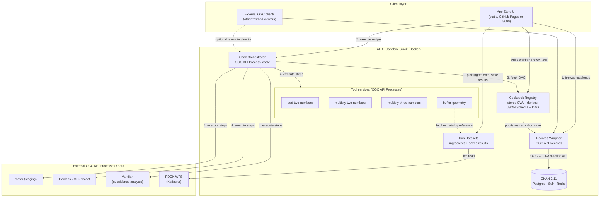
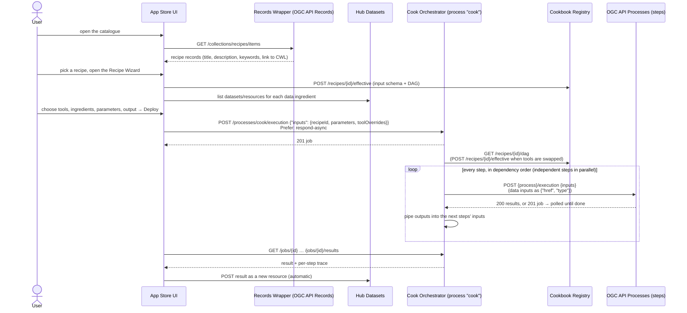

# nLDT Sandbox Stack — Geonovum Testbed 2026, Research Topic #4: App-Store / Recipes

> - **Final report:** [PDF](NLDT-TB2%20Final%20Report.pdf) · [Markdown](NLDT-TB2%20Final%20Report.md)
> - **Demo video:** [`future_insight_demo.mp4`](future_insight_demo.mp4)

This repository contains the software built for **Research topic #4 "App-Store / Recipes"** of
Geonovum's Testbed 2026 phase 2. It is a working, end-to-end prototype of an App Store for Digital
Twins of the physical living environment (nLDT). A **recipe** combines data sources (the
*ingredients*) with an ordered set of OGC API Processes (the *cooking instructions*). The recipe can
be found in a catalogue, bound to a hub's own data, and executed.

- **Live client (App Store UI):** <https://fi-group.github.io/nldt-tb2/>
- **Live backend stack:** <https://nldt-tb2.clearly.app> (all services behind one gateway, under `/api/*`)

Recipes are written in **CWL (Common Workflow Language) v1.2**, one of the three recipe formats the
tender proposes (CWL, Arazzo, roll-your-own). The design decisions behind it are logged, dated, in
[`DECISIONS.md`](DECISIONS.md).

---

## 1. The recipe concept, mapped to the tender

A recipe answers one real-world question by chaining processes over data:

```
recipe = data ingredients  +  parameters  +  ordered OGC API Processes (a DAG)
```

| Tender term (§7.3) | What implements it here | Standard |
|---|---|---|
| Recipe | A CWL `Workflow` document; each step is an OGC API Process | CWL v1.2 (+ 3 small extensions, see §4) |
| Catalogue with recipe metadata | **Records Wrapper**: an OGC API Records façade in front of a real **CKAN** | OGC API Records Part 1: Core |
| Cookbook ("a collection of recipes served over an API") | **Cookbook Registry**: stores each recipe's CWL, derives its input JSON Schema and execution graph | REST API (purpose-built) |
| Cook ("reads the recipe, graph traversal, executes, links output a to input b") | **Cook Orchestrator**: itself an OGC API Process called `cook` | OGC API Processes Part 1: Core 1.0 |
| Processes | Our own tool services, plus external testbed processes (roofer, Geolabs ZOO-Project, Varidian) | OGC API Processes Part 1: Core |
| Client ("find recipes and bind/execute") | **App Store UI**: catalogue, Recipe Wizard, Status/Deploy, CWL editor | — |
| Data ingredients | **Hub Datasets**: a small dataset/resource store for the hub (live PDOK data, sample data, saved results) | — (plain REST) |
| Recipe metadata in extended DCAT-AP-NL | **Not implemented**, see §5 | DCAT-AP-NL (open item) |

---

## 2. Architecture

Nine small services run in their own Docker containers on one private network. Each publishes a port
on the host, or all of them sit behind a single nginx gateway (path routing, used behind TLS and
Cloudflare). CKAN brings its own Postgres, Solr and Redis.



| Service | Port | Role | Standard |
|---|---|---|---|
| `ui` | 8000 | App Store UI, static files only; the browser calls the services itself | — |
| `records-wrapper` | 8001 | Recipe catalogue; translates OGC API Records ↔ CKAN | OGC API Records Part 1: Core |
| `cookbook-registry` | 8002 | Stores recipes (CWL), derives input schema and DAG, validates | REST (purpose-built) |
| `cook-orchestrator` | 8003 | Executes a recipe: process `cook`, jobs, sync/async | OGC API Processes Part 1: Core 1.0 |
| `tool-add`, `tool-multiply`, `tool-multiply3` | 8010–8012 | Trivial numeric processes (one image, three operations) | OGC API Processes Part 1: Core |
| `tool-geo-buffer` | 8013 | Buffers a GeoJSON geometry by N metres (via RD New, EPSG:28992) | OGC API Processes Part 1: Core |
| `hub-datasets` | 8014 | Datasets/resources of the hub: ingredients and saved run results | plain REST |
| `ckan` (+ db, solr, redis) | 8020 | The real catalogue store behind the Records Wrapper | CKAN Action API |
| `gateway` (optional overlay) | `GATEWAY_PORT` (8080) | One origin: UI at `/`, services at `/api/records`, `/api/cookbook`, `/api/orchestrator`, `/api/hub`, `/api/tools/*` | — |

All services are open (no authentication) and allow any CORS origin; this is a sandbox.

The OGC API Processes services (the Cook Orchestrator and the tools) were checked with OGC's TEAM
Engine test suite `ets-ogcapi-processes10` and adjusted to it: OGC exception responses,
`service-desc`/`service-doc` links, a job list on every service, and correct public links behind the
gateway. Most remaining failures are the suite's execute tests, which need OGC's own `echo` test
process (DECISIONS.md, D28).

---

## 3. One "cook" run, step by step



Notes:
- **The Cook is non-agentic.** It walks the DAG; it decides nothing. A step starts as soon as every
  step it takes input from has finished. At most `COOK_MAX_PARALLEL` (4) steps run at once, and the
  first failure stops the run.
- **Every step is requested asynchronously** (`Prefer: respond-async`). A process that answers
  synchronously is used as-is; one that returns a job is polled (every 2 s). This is needed for long
  processes such as roofer's building reconstruction. Time limits are configurable per call, per job
  and per run (`TOOL_REQUEST_TIMEOUT`, `TOOL_JOB_TIMEOUT`, `COOK_TIMEOUT`).
- **Where a step is executed** is taken from the step's own `nldt:processLink` in the recipe (§4).
  Changing a recipe to call another OGC API Process therefore needs no change to the Cook.
- **A failed job says where the failure came from.** Besides OGC's `message`, its status carries
  `errorSource`: `source` is `tool` (a step's process answered with an error, its job failed, or it
  was unreachable), `registry` (the Cookbook Registry) or `cook` (the Cook itself, e.g. a missing
  parameter or a time limit), with the step and process concerned.

---

## 4. The recipe format: our CWL profile

### What standard CWL we use

| CWL construct | Used for |
|---|---|
| `class: Workflow`, `cwlVersion: v1.2` | The recipe itself; `id`, `label` and `doc` become the catalogue id, title and description when it is first loaded |
| `inputs` | What a hub supplies: **parameters** (`float`, `string`, `enum`, `Any`, …) and **data inputs** (`File` + `format`) |
| `outputs` + `outputSource` | What the recipe returns |
| `steps`, mapping form, each with an inline `run: {class: Operation, id: <process id>}` | One step = one OGC API Process. CWL's `Operation` is an abstract, non-executable step, which fits a remote process |
| step `in:` / `out:` | Wiring: a workflow input, or another step's output (`step/output`), feeds a process input. This is how output of process *a* becomes input of process *b* |
| `format` (IANA media types via `$namespaces`) | Media type of a data input, or of a process input/output (sent as OGC qualified values) |
| `valueFrom` (small subset) | Reshaping a value for a specific process, e.g. picking a field from a previous step's output |

The Cookbook Registry uses a **purpose-built CWL reader**, not a general CWL engine. Things it does
not support: `scatter`, `when`, list-form steps, `CommandLineTool`/`ExpressionTool`, `$import`.
**CWL expressions are JavaScript.** The reader recognises only a few `valueFrom` patterns (field
paths, `map` over a list, small object templates) by pattern-matching. It never executes them.

### Extensions we needed, and why

CWL describes *what* to run, not *where*. Three small extension fields fill the gaps a recipe has in
an App Store. As CWL requires for extensions, they live in our own namespace, declared in each
recipe (`$namespaces: {nldt: https://fi-group.github.io/nldt-tb2/ns#}`). The namespace IRI serves
as an identifier only; no vocabulary document is published at it.

| Field | Where | Why it is needed |
|---|---|---|
| `nldt:processLink` (`href`, `internalHref`) | on a step's `run` | Binds an abstract `Operation` to a concrete OGC API Process URL. Without it, the Cook would need a central registry of every process. `internalHref` is the address used inside the Docker network |
| `nldt:compatibleTools` | top level, `{stepId: [toolId, …]}` | The recipe owner's allowlist of which alternative processes a hub may swap in for a step (the Wizard's "Tool & Engine" step) |
| `nldt:jsonSchema` | on a workflow input, optional | The exact JSON Schema of a parameter when CWL's types can't express it (e.g. a `oneOf` selection). See below |

### Parameters: CWL types vs the processes' JSON Schema

`nldt:jsonSchema` is not specific to any one process. It exists because CWL and OGC API Processes use
**different type systems**:

- OGC API Processes describes every input and output of every process with a `schema` in **JSON
  Schema** (an OpenAPI 3.0 Schema Object in v1.0, JSON Schema in v2.0). Roofer, the Geolabs
  ZOO-Project processes and our own tools all do.
- A CWL recipe describes its inputs in **CWL types** (`float`, `string`, `enum`, arrays, `File`,
  `Any`, records).

For most inputs the CWL type is enough, and the Cookbook Registry derives the JSON Schema from it by
itself:

| Process input (JSON Schema) | Recipe input (CWL) | `nldt:jsonSchema` needed? |
|---|---|---|
| `{type: number}` | `float` | no |
| `{type: string, enum: [gpkg, cityjson]}` | `enum` | no |
| a GeoJSON or LAZ file | `File` + `format` | no |
| `{oneOf: [by asset / by building ids / by area]}`, with `const`, `pattern`, `minItems` (roofer's `bag`) | only `Any` | **yes**, otherwise the shape is lost |

CWL has no discriminated unions, constants, string patterns or value constraints. Where a process
input needs them, the recipe carries the process's own JSON Schema in `nldt:jsonSchema`. It is
**descriptive only**: the Registry publishes it as the recipe's input schema and the client builds
the parameter form from it, while the Cook Orchestrator does not validate against it. A recipe
without it is still complete and executable; it is just less helpful to fill in.

One weakness remains: the schema is a **copy** of the process description, pasted in by the recipe
author, so it goes stale if the process changes. Referencing the process's own schema, or having the
editor fill it in when a step is added, would avoid that.

### Extension naming

CWL allows extra fields on any object, but **only with a namespace prefix declared in
`$namespaces`** — the same mechanism CWL documents use for `s:author` (schema.org) or `edam:` formats.
The prefix tells CWL tooling the field belongs to another vocabulary and must be passed over, not
checked as CWL. Our fields therefore carry the `nldt:` prefix:

```yaml
$namespaces:
  nldt: https://fi-group.github.io/nldt-tb2/ns#
nldt:compatibleTools: {multiply: [multiply-two-numbers, multiply-three-numbers]}
steps:
  buffer:
    run:
      class: Operation
      nldt:processLink: {href: ..., internalHref: ...}
```

The first version used OpenAPI-style `x-process-link` / `x-compatible-tools` / `x-json-schema`
names. CWL does not recognise `x-` as "extension": the reference validator (`cwltool --validate`)
read the contents of those fields as CWL and rejected every recipe. With the namespaced names all
bundled recipes pass `cwltool --validate` (only warnings, about `type:` keys inside our own fields
and roofer's `roofer:`-style process ids). The Cookbook Registry rejects the old `x-` names with an
error naming the field to use instead (DECISIONS.md, D22).

### Data inputs vs parameters

**A recipe says which of its inputs are data with standard CWL, not with an extension.** A data
input is `type: File` (or `File[]`) with a `format`. Every other input is a parameter.

- **The value is a reference, never inline content:**
  `{"class": "File", "location": "https://…", "format": "…/application/geo+json"}`.
- **The Cook passes it on as an OGC API Processes by-reference input,**
  `{"href": "<location>", "type": "<media type>"}`. The process fetches the data itself. This maps
  CWL's File concept directly onto OGC's href inputs.
- **Where a process expects its own shape** (roofer wants `[{"kind": "url", "url": …}]`), the recipe
  adapts the File with a standard `valueFrom` on that step.
- **The client derives the Wizard's "Data Ingredients" step from these declarations.** The Cookbook
  Registry lists them as `data_inputs` in the DAG, so any recipe, including one a user just edited,
  shows its data needs.

Minimal annotated example (the bundled "Rotterdam Boundary Buffer" recipe, shortened):

```yaml
cwlVersion: v1.2
class: Workflow
id: recipe-rotterdam-buffer-demo
label: "Rotterdam Boundary Buffer"
$namespaces:
  iana: https://www.iana.org/assignments/media-types/
  nldt: https://fi-group.github.io/nldt-tb2/ns#
inputs:
  geometry:                          # DATA input → Wizard "Data Ingredients"
    type: File
    format: iana:application/geo+json
    label: "Input boundary"
  bufferDistance:                    # PARAMETER → Wizard "Parameters"
    type: float
    label: "Buffer distance (meters)"
outputs:
  bufferedOutline:
    type: Any
    outputSource: buffer/bufferedGeometry
steps:
  buffer:
    run:
      class: Operation
      id: buffer-geometry            # the OGC API Process identifier
      nldt:processLink:              # extension: where that process lives
        rel: process
        type: application/json
        href: "https://nldt-tb2.clearly.app/api/tools/geo-buffer/processes/buffer-geometry"
        internalHref: "http://tool-geo-buffer:8000/processes/buffer-geometry"
      inputs:
        geometry: { type: File, format: "iana:application/geo+json" }
        distance: { type: float }
      outputs:
        bufferedGeometry: { type: Any }
    in:
      geometry: geometry             # File → {"href": …, "type": "application/geo+json"}
      distance: bufferDistance
    out: [bufferedGeometry]
```

And the roofer adaptation (from `playground-1.cwl`):

```yaml
inputs:
  point_clouds:
    type: File[]
    format: iana:application/vnd.laszip   # common, but not IANA-registered
steps:
  validate:
    in:
      point_clouds:
        source: point_clouds
        valueFrom: '$(self.map(function(f){ return {"kind": "url", "url": f.location}; }))'
```

### Bundled recipes

| Recipe | What it shows |
|---|---|
| `recipe-rotterdam-buffer-demo` | Real geodata: buffers Rotterdam's municipal outline, read live from PDOK (data input + parameter) |
| `recipe-add-multiply-demo` | The orchestration plumbing on a trivial example, `(a + b) × c`, including a tool swap via `nldt:compatibleTools` |
| `playground-1` | Starter: roofer pipeline (validate point clouds → reconstruct buildings → convert format) against roofer's staging processes |
| `playground-2` | Starter: Geolabs sampler, several ZOO-Project processes side by side, one chained (Buffer → GetArea) |
| `playground-3` | Starter: Varidian's external Subsidence Analysis process (where subsidence stays below a threshold); its area input is pasted GeoJSON, a parameter rather than a data input |

The playgrounds are **shared slots** for testbed participants to try their own processes. Saving is
persistent and shared: everyone sees the last saved version, and there is no per-user copy. **Reset**
in the editor reloads the slot's bundled starter.

---

## 5. Catalogue and metadata

- **What is implemented:** the Records Wrapper implements OGC API Records Part 1: Core (landing
  page, conformance, collections, items, a single item, free-text `q`). It has one collection,
  `recipes`.
- **Storage:** records are stored in a real CKAN instance (one CKAN organisation `recipes`), not by
  the wrapper itself.
- **What a record contains:** catalogue metadata only. A recipe record has a title, description,
  keywords, created/updated timestamps and `type: recipe`, plus a link to the recipe's CWL in the
  Cookbook Registry. That link uses a custom relation, `…/rel/ogc/1.0/recipe-source` (not registered
  by OGC, see finding 13), with media type
  `application/cwl+yaml`. The CWL itself lives only in the Cookbook Registry ("catalogue vs. the
  thing catalogued").
- **How records get there:** the Cookbook Registry publishes the record every time a recipe is
  saved. The description is stored separately from the CWL, so editing the CWL does not change it.

**DCAT-AP-NL: open item.** The catalogue does not yet express recipe metadata in (extended)
DCAT-AP-NL, and no DPROD/APKG mapping exists. Some richer facets (theme, location, project phase,
target roles, licence, data protocols) are currently shown by the UI from client-side metadata, not
from the catalogue. Deciding which facets a recipe needs, and how to express them in DCAT-AP-NL, is
the main remaining research task for this topic.

---

## 6. The client: App Store UI

A static, no-build ES-module web app (`UI/`). It is published to GitHub Pages from `main`, or served
by the `ui` container. It talks to the services directly from the browser.

- **Catalogue:** recipes from the Records Wrapper, filterable by facets. Separate pages list
  **Data** (Hub Datasets) and **Apps** (this stack's own tool services, each from its own process
  description).
- **Data preview:** a dataset's **Preview** shows its resources, including saved recipe results, on
  a Leaflet map, one layer each: GeoJSON as-is, and for a result that links to a CityJSON model
  (roofer's reconstruction) its building footprints (`UI/js/hubPreview.js`, `UI/js/cityJson.js`).
- **Recipe detail:** metadata, the recipe's graph, compatible data and apps.
- **Recipe Wizard:** binding a recipe to a hub, in four steps:
  1. **Tool & Engine:** per step, the process to use, optionally an allowed alternative.
  2. **Data Ingredients:** for each `File` input, pick a resource from Hub Datasets, filtered by
     media type.
  3. **Parameters:** a form generated from the recipe's JSON Schema. Where the recipe leaves them
     out, a parameter's title, description, default and limits are filled in from the OGC process
     description of the step it feeds.
  4. **Output:** where the result is saved.
- **Status / Deploy:** starts the `cook` job, shows per-step progress and the trace, can cancel a
  running job, shows whether a failure came from a tool, the Cookbook Registry or the Cook, and
  saves every successful result to Hub Datasets automatically.
- **Orchestrator editor:** the recipe's CWL as text, as a diagram, and as a guided builder (add a
  process by URL, connect inputs, mark an input as data, choose alternative tools). **Validate**
  (structure only; it never calls the processes), **Save Recipe** (only after a successful
  validation) and **Reset**.

---

## 7. Findings

1. **CWL works as a recipe format, but not unextended.** CWL can describe the ingredients, the order
   and the wiring. It has no way to say *which* OGC API Process a step is (`nldt:processLink`) or
   *which* alternatives a hub may choose (`nldt:compatibleTools`).
2. **CWL's `Operation` class fits remote processes.** An abstract, non-executable step maps
   one-to-one onto an OGC API Process, with no `CommandLineTool` involved.
3. **Data inputs need no extension.** CWL's own `File` + `format` separates data ingredients from
   parameters. A File, being a reference, maps cleanly onto OGC API Processes by-reference
   (`href`) inputs.
4. **OGC API Processes descriptions don't say which inputs are datasets.** Roofer describes its
   point-cloud input as "Public HTTP(S) URL for a LAS or LAZ file" only in prose. A platform
   therefore cannot infer data ingredients from a process; the recipe has to declare them.
5. **Media types are a gap for 3D/point-cloud data.** LAZ has no IANA-registered media type, and
   `application/vnd.laszip` is a convention.
6. **CWL expressions are JavaScript.** A lightweight cook either embeds a JavaScript engine or, as
   here, supports a pattern-matched subset of `valueFrom`. Processes with their own input shapes
   (roofer) depend on that subset.
7. **Async execution is mandatory in practice.** Long-running processes outlive any HTTP or proxy
   timeout, so the Cook always requests async and polls jobs; dismissing remote jobs on failure
   needed explicit handling.
8. **Catalogue and recipe metadata are not yet aligned.** OGC API Records carries discovery
   metadata well. DCAT-AP-NL has no recipe concept, and the richer recipe facets are still
   client-side (§5).
9. **Editing is shared and unversioned.** Saving a recipe overwrites it in place for everyone.
   There is no versioning, ownership or authentication, which is fine for a sandbox and not for an
   App Store.
10. **Standards version:** the tender encourages OGC API Processes v2.0. The stack implements
    Part 1: Core **1.0** on the wire, and recipe chaining is done through CWL, not Part 3
    (Workflows) nested execution (DECISIONS.md, D6).
11. **CWL and OGC API Processes describe inputs in different type systems.** Processes use JSON
    Schema; CWL has its own, weaker types. CWL is enough to define a recipe's structure and
    execution, but not to describe a process's inputs as precisely as the process does. A
    CWL-based recipe format needs a bridge (`nldt:jsonSchema`), ideally a reference rather than a
    copy (DECISIONS.md, D21).
12. **CWL has its own extension rule, and strict tooling enforces it.** Extension fields must carry
    a namespace prefix declared in `$namespaces`. Our first, OpenAPI-style `x-…` names made every
    recipe invalid for `cwltool --validate`; namespaced (`nldt:…`) they pass.
13. **There is no standard link relation for "this record's executable recipe".** The catalogue
    record links to its CWL with `…/rel/ogc/1.0/recipe-source`, which sits in OGC's register
    namespace but is not registered there. A registered relation (`describedby`, or `alternate`
    with `type: application/cwl+yaml`) or a relation in our own namespace would be correct; a
    registered recipe relation could be proposed to OGC.
14. **A purpose-built cook checks less than a CWL validator.** `cwltool` also caught a real type
    error our own Registry had accepted: the roofer recipe fed an `enum` list into a `string[]`
    process input. Our reader validates structure and wiring, not types; running the reference
    validator alongside it is cheap and worth doing.

---

## 8. Running it

Local, one port per service:

```bash
docker compose up --build
python services/records-wrapper/scripts/bootstrap_ckan.py           # once: CKAN org + API token
python services/cookbook-registry/scripts/seed_demo_recipe.py http://localhost:8002   # load bundled recipes (re-runnable)
# open http://localhost:8000/#/recipes   (CKAN's own UI: http://localhost:8020)
```

Behind TLS or Cloudflare, use the single-origin gateway overlay:

```bash
docker compose -f docker-compose.yml -f docker-compose.gateway.yml up -d --build
```

- Both scripts run on the Docker host (the bootstrap script calls `docker compose exec`); the seed
  script needs PyYAML (`pip install pyyaml`).
- Hub Datasets seeds its own datasets at startup.
- Seeding recipes **overwrites** the stored versions, including anything saved into the playground
  slots.
- Per-deployment settings (`PUBLIC_HOST`, `GATEWAY_PORT`, …) go in `.env`; see `.env.example`.
- More detail: [`deploy/README.md`](deploy/README.md), [`UI/README.md`](UI/README.md) and each
  service's own README.

---

## 9. Repository layout

```
.
├── DECISIONS.md                 dated log of every architecture/scope decision
├── LICENSE                      licence of the code (EUPL-1.2)
├── NLDT-TB2 Final Report.pdf    the written testbed report
├── NLDT-TB2 Final Report.md     the same report, as Markdown
├── future_insight_demo.mp4      demo video
├── docker-compose.yml           the whole stack, one port per service
├── docker-compose.gateway.yml   overlay: single-origin nginx gateway (TLS/Cloudflare)
├── .env.example                 per-deployment settings
├── deploy/                      gateway config + deployment notes
├── .github/workflows/pages.yml  publishes UI/ to GitHub Pages
├── UI/                          App Store client (static ES modules, no build)
└── services/
    ├── records-wrapper/         OGC API Records façade over CKAN (+ CKAN bootstrap script)
    ├── ckan/                    Postgres init for CKAN
    ├── cookbook-registry/       recipe store, CWL parser, bundled recipes (recipes/*.cwl), seed script
    ├── cook-orchestrator/       the Cook: OGC API Process "cook", DAG execution, jobs
    ├── tool-service/            add / multiply / multiply3 OGC API Processes (one image)
    ├── tool-geo-buffer/         buffer-geometry OGC API Process
    └── hub-datasets/            hub datasets/resources: ingredients, PDOK live data, saved results
```

---

## 10. Open items and limitations

- **DCAT-AP-NL recipe metadata** (extended profile, DPROD/APKG evaluation) is not implemented. See §5.
- **No authentication, ownership or versioning** anywhere, and no SSRF protection on process URLs.
  This is not suitable for untrusted recipe authors.
- **The CWL subset is fixed:** no `scatter`, `when` or general JavaScript expressions.
- **Validation is structural only:** a recipe can validate and still fail at run time if a process
  is unreachable or answers in an unexpected shape.
- **Processes must be unauthenticated** OGC API Processes Part 1 servers. There is no per-step
  credential.
- **Data inputs by reference** require the process to fetch the `href` itself. Locations on the
  internal network are rewritten only for tools inside the stack.

---

## 11. License

The code is published under the [EUPL-1.2](LICENSE), the licence of the Geonovum testbed
repository. The report and other testbed outcomes are published under
[CC BY 4.0](https://creativecommons.org/licenses/by/4.0/), as the tender requires. Vendored Leaflet
keeps its own licence ([`UI/vendor/LICENSE`](UI/vendor/LICENSE)).
