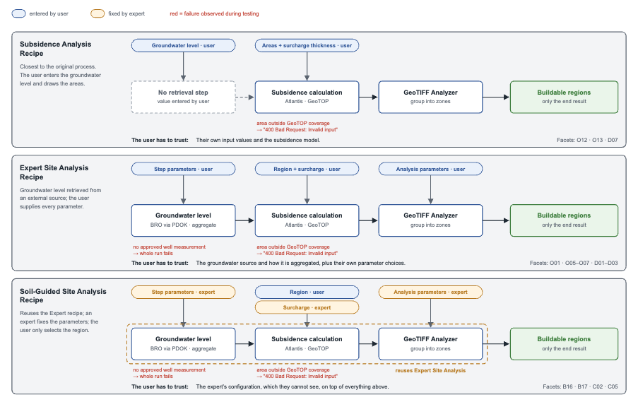
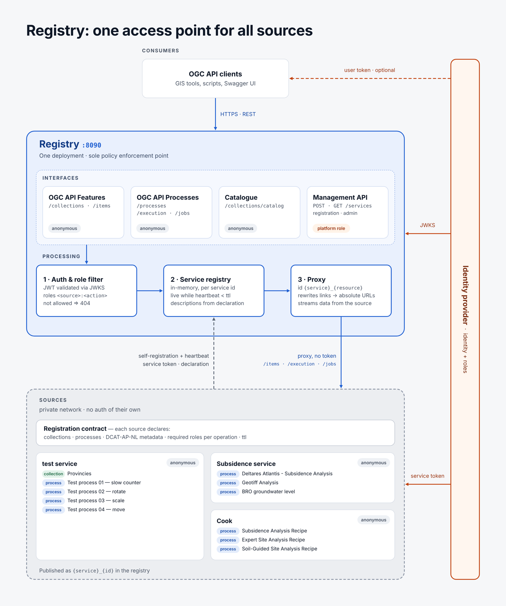

# Testbed 2026 – Phase 2 | Varidian

### *Research topic #4: App-Store / Recipes*

# Table of Contents

- [Introduction](#introduction)
    - [Research question](#research-question)
    - [Use case](#use-case)
- [Approach](#approach)
    - [The platform](#the-platform)
    - [Recipe definition language](#recipe-definition-language)
        - [Language selection](#language-selection)
        - [Requirements](#requirements)
        - [Best suited: WDL and Sprocket runner](#best-suited-wdl-and-sprocket-runner)
    - [Created recipes](#created-recipes)
        - [Subsidence Analysis Recipe](#subsidence-analysis-recipe)
        - [Expert Site Analysis Recipe](#expert-site-analysis-recipe)
        - [Soil-Guided Site Analysis Recipe](#soil-guided-site-analysis-recipe)
    - [Platform expanded with recipes](#platform-expanded-with-recipes)
- [Results](#results)
    - [Facet analysis: what does an end user need to trust a workflow result?](#facet-analysis-what-does-an-end-user-need-to-trust-a-workflow-result)
        - [Recommendations](#recommendations)
- [Discussion](#discussion)
    - [How do we see the lifecycle of a recipe](#how-do-we-see-the-lifecycle-of-a-recipe)
        - [Writing a recipe](#writing-a-recipe)
        - [Installation](#installation)
        - [Usage](#usage)
    - [From recipes to triggered workflows](#from-recipes-to-triggered-workflows)
        - [Workflows as the design, triggers as the mechanism](#workflows-as-the-design-triggers-as-the-mechanism)
        - [Context conditions](#context-conditions)
        - [Outcomes](#outcomes)
        - [Joining paths](#joining-paths)
        - [Records as the basis for trust](#records-as-the-basis-for-trust)
- [Conclusions](#conclusions)
    - [Plugfests](#plugfests)
    - [OGC standards](#ogc-standards)
- [Appendices](#appendices)
    - [Appendix A: Recipe definition language](#appendix-a-recipe-definition-language)
    - [Appendix B: Registry playground](#appendix-b-registry-playground)
    - [Appendix C: Facet analysis](#appendix-c-facet-analysis)
    - [Appendix D: Sources](#appendix-d-sources)

# Introduction

Varidian started in May 2026 with creating a registry. The initial goal of this registry was to provide a standardized
interface for connecting with multiple data sources. All communication would go through the registry and data
source-specific logic only has to exist inside this registry and its connected microservices instead of inside every
individual client. Quickly after the initial working version, the need arose to also be able to execute processes using
a standardized interface. Both registry implementations for these features were based on the OGC Features and OGC
Processes API’s; and after finalizing the initial implementation for the processes interface in the registry the need
for chaining processes became abundantly clear. This is when the overlap between the registry’s roadmap and *Research
topic #4: App-Store / Recipes* of the testbed was observed. We are building a catalog of collections and processes to
fill the gaps in information and analysis that our own solutions run into. This testbed lets us find out whether recipes
can be added to this catalog, where recipes are a combination of data-sources (ingredients) and operations in the form
of an ordered list of processes (like cooking instructions. An important aspect of experiencing whether recipes fit in
our catalog is to determine whether stating requirements about a recipe up front makes it possible to say something
about the quality of the results that come out. Without reliable outcome, the selection of the most applicable or
trustworthy recipe comes down to luck or expertise. Since we want to be able to use the results as information source
for our own solutions, needing either luck or expertise means it is not ready to be integrated. By researching which
metadata is required to enrich both the source data and the process’s inputs and outputs we hope to find a way to make a
recipe’s results readable and trustworthy, which is exactly the focus of this research topic.

## Research question

To understand our research question, some background knowledge is required. Data sources, processes and recipes all
describe themselves using metadata facets. There are roughly two different types of facets:

1. Properties which the provider sets, like the provider’s name, how old the data is, when the data is updated, etc.
2. Properties which can’t be set by the provider, but come from the system which hosts the data, for example an
   App-Store. Think of how many times a data source is used or an average rating based on a review system.

The OGC standard relies on the DCAT-AP-NL 3.0 standard for the definition of the metadata. Like the OGC standard it
allows a great deal of flexibility, only a handful of properties are required to comply. At the start of the project,
the focus of our research was on how the following questions could be answered:

- Which metadata facets does an App-Store need beyond DCAT-AP-NL 3.0?
- Which of these facets can a publisher simply write down, and which can only be observed once the system runs?
- Can the quality of a composed answer be judged before, and/or after it is generated?

These three questions are all based on missing facets and this was a big part of the research. The remaining two are
focused on the recipe:

- Can a recipe be generated or does it need to be created by an expert?
- Where does Arazzo fit into the OGC API Processes idiom, and where doesn’t it fit in?

The idea was that you could specify additional properties which would make it possible for a user to select and connect
processes and data sources to configure a recipe. However, we quickly discovered that since a recipe is a black box and
only the end-result is sent to the user, the actual question we want to answer is:

- What information is needed for an end user to validate and ultimately trust the result they receive from a recipe?

## Use case

To find an answer to the research question, it was important for us to work on a real-world scenario where a recipe
could be implemented. We started out with the idea of creating a recipe which could answer the question “What does a
cloudburst do to a city's accessibility?”. A question that can only be answered by combining data and calculations that
belong to different parties. In this case we would be using two models, a hydrological model which computes where water
collects and how deep it stands, and a mobility model which computes what happens to traffic once the affected road
segments become impassable. A recipe would combine both models to answer the question.

Unfortunately, we were unable to use the two models for a variety of reasons, so we shifted to another use case which is
a very pressing issue in the Netherlands. That is, the question “Can I construct buildings here?”, focusing on the issue
of subsidence. For the recipe to answer this question, three processes were required; one to gather the groundwater
level(s) of the provided area, a second to calculate the subsidence of this area, and a third to analyze the subsidence
result and validate its values against a provided threshold value.

The subsidence process was mainly developed by IMAGEM, which uses the Deltaris Atlantis API. We tuned the inputs so we
could use it for our research topic. The other two processes we build ourselves; for the groundwater level we used the
dataset from [BRO](https://api.pdok.nl/tno/bro-grondwatermonitoring-in-samenhang-karakteristieken/ogc/v1), while we
build the GeoTIFF analyzer from scratch.

# Approach

To formulate an answer to the research question, we started from our existing platform. To evaluate the new concept of
recipes, we integrated the recipes by wrapping them in processes within a newly created Cook service. To avoid having to
create a custom recipe language or a workflow runner, the initial focus was on finding a recipe language that would be
mature and expressive enough to define a useful recipe flow. Using the integrated recipes allowed us to test and
experience what parts do and do not work when defining and using a recipe, and how its metadata can be used to determine
both the recipe’s usefulness for a specific use case and the credibility of its outputs. The resulting insights gave us
the set of data points required to do so, allowing us to suggest how the DCAT-AP-NL 3.0 can be improved upon.

## The platform

We chose our platform as a starting point, since it already consisted of a registry component to which microservices can
make themselves known and available. On top of the registered services this registry component behaves as a proxy when
fetching feature collections and executing processes, it also serves all collections and processes’ metadata and adds an
auth layer validating a user’s roles whenever required. A single service can handle multiple collections as well as
processes. After self-registration of a service, all its collections and processes’ metadata are registered inside the
registry’s catalog. For each collection and process there is granular control over which user roles can view the
resource and which user roles can access its contents. This also means the collections and processes visible to a caller
are generated upon request.

Our motivation for expanding the platform with recipes is trifold.

First, reusability. Our aim is to have collections and processes in terms of reusable building blocks for data sources
and functionalities; thus, ensuring that work done for project A can also be used for project B. Each building block is
usable inside a recipe, no matter whether the recipe for project A answers a different question than the recipe for
project B. Because the communication layer and its definitions always adhere to the recipe’s (and OGC’s) standards,
these building blocks are interchangeable.

Second, abstraction. Allow business engineers and domain experts to develop and configure solutions based on customer
needs without the help of a developer. This could support defining customer-specific functionalities by deploying a
process which is defined by a recipe, without having to create a new build of the registry or a service.

And third, runtime flexibility. Support use cases where, for instance, user A wants to perform sequential steps where
data source X is used, and user B wants to perform the same sequential steps but with data source Y. Being able to
define a recipe where one or more data sources can be determined during runtime and/or during an installation phase
means that the recipe only has to be created once; but would still allow for enough flexibility to support both
individual user’s and multiple customer’s needs.

## Recipe definition language

To define a recipe and its steps, it mattered to determine upfront whether there are already existing workflow
definition languages available that would be feature-rich enough for the initial research phase. This would ensure that
there was no need to develop such a language ourselves, and that we could focus on answering the research question.

### Language selection

Initially, we started out with the suggested Arazzo as the language for creating a recipe. However, the more we worked
towards implementing the envisioned recipe, the more we struggled in creating a working version. This led to us creating
a list of requirements the language should support based on the recipe implementation flow we were trying to create.
Allowing us to determine which language and its runner(s) were the best match based on the language with its highest
score. We scored four different languages: Arazzo, CWL, OpenEO and WDL. This shortlist was created based on the proposed
standards from the Testbed’s engineering report document, as well as on input from other testbed participants during the
first plugfest, and our own research into workflow definition languages.

### Requirements

To find the language most fit for our research, we applied the following criteria:

**Control flow**: Being able to define a control flow was a must-have. This meant the language needs to support
if-statements and iterations such as a for-loop or a scatter-gather pattern.

**Parameter linking:** The recipe we had envisioned executes multiple OGC processes sequentially, chaining the output of
one request to the inputs of the following request. This meant that we wanted to be able to reference one process and
its outputs when executing a second process.

**Multiple output parameters:** Since an OGC process can have multiple output parameters, the language has to support
defining and using all these outputs; so that they can be referenced individually at a later stage in the recipe.

**Reading a recipe’s output**: After successfully executing a recipe with a runner, the recipe’s result must be able to
be read by whatever process triggered the recipe run. This ensures the recipe’s result can be used outside a recipe
runner, for example to send the recipe’s results as API response or save them as an executed OGC process its job’s
results. For this to be as transparent as possible, it was desired that we can also define the recipe’s result outputs.

**Reusable components:** Because there are functionalities which follow a shared pattern or are very similar in their
core, it is desirable to have a recipe language with support for reusable components or modules. This helps in defining
a flow like executing an OGC process and fetching its results whenever it’s finished successfully in a uniform way. And
it eliminates the need to keep reimplementing the same three blocks for job execution, polling for success and results
fetching.

**Intermediate logging & updates:** Recipes consist of multiple steps performed sequentially or in parallel. To be able
to follow the workflow’s progress and understand each individual step, support is needed for keeping track of logs and
updating the status of each of these steps. This makes developing and debugging a recipe easier but also allows for
visualizing a recipe and its progress.

**Machine Readable:** Ideally, a recipe definition should be machine-readable. This means a computer can analyze a
recipe and determine its relevance to use cases, as well as read, execute, alter, or work with a recipe in other ways.
Another important use case for machine readability is the use inside AI agents and/or automations.

**Error Handling:** Chaining processes means we need to be aware of failures and where they happened. This also means
the recipe is not only a happy flow, describing which processes and data sources are chained if everything goes well,
but it also needs to describe what is passed on to the end-user whenever a failure occurs.

### Best suited: WDL and Sprocket runner

After considering four different workflow languages and their runners, it was ultimately decided that WDL with the
Sprocket runner was best suited to implement the recipe we had envisioned. The three other languages had their
shortcomings which could not be worked around, whereas WDL was most flexible in what we were trying to achieve. See our
considerations in the scoring sheet from [Appendix A](#appendix-a-recipe-definition-language).

## Created recipes

*Figure 1: The three created recipes*

After picking WDL as the recipe definition language for our research, we created three WDL files that each represented a
recipe. These recipes all have the same output definition but differ in their input definitions and underlying OGC
processes usage. Instead of having to analyze the subsidence result output for oneself, the recipes will return only the
areas where the subsidence results are below a threshold value. This means the question “Can I construct buildings
here?” is answered by each recipe with a simple “Only in these areas” when executed.

### Subsidence Analysis Recipe

The Subsidence Analysis Recipe is the minimal implementation of a recipe for the determined scope. The user needs to
supply all inputs by hand. Inputs defined are the groundwater level, the surcharge thickness, the subsidence result
threshold, and the areas on which the analysis is performed. The groundwater level input is used as-is for the
subsidence calculation process, and this calculation result is passed on to the Geotiff Analyzer process to validate
each subsidence value based on the threshold input value.

### Expert Site Analysis Recipe

With the Expert Site Analysis recipe, the groundwater level input is replaced with an OGC process that retrieves
groundwater monitoring measurements registered in the BRO Key Registry of the Subsurface, within the provided surcharge
analysis areas. While the groundwater level input is retrieved from an external system, the user still must provide
inputs by hand. They now have to provide up to five additional inputs required by the BRO groundwater monitoring
registry: statistic, datetime, maxScreenDepth, observationTypes, and statuses.

### Soil-Guided Site Analysis Recipe

The underlying idea of the Soil-Guided Site Analysis Recipe is that an expert would check the input parameters of the
Expert Site Analysis Recipe and predefine as many of the recipe’s inputs so that the end user does not have to provide
them or have knowledge about what they mean or do. With the created recipe, this means that the user only needs to
provide the areas for the surcharge analysis. Other recipe inputs such as statistic, datetime, maxScreenDepth,
observationTypes, statuses, thickness, and threshold are all hidden from the user, as they have predefined values within
the recipe. This results in a very simple recipe execution call.

## Platform expanded with recipes

*Figure 2: Our platform including the newly added cook service*

The registry inside our platform did not need any alterations to support running recipes, apart from general
improvements to the OGC API standards conformance. To support recipes written in WDL, a cook service was added which
holds all logic and knowledge about these recipes; it defines where their WDL definitions are and how the Sprocket
runner can be called to run a recipe. The recipe’s process interface is the same as any other process. Only underneath
the surface there is additional logic defined about what process calls are chained and how their outputs and inputs are
passed on to each other. All of this is defined using WDL, and the Sprocket runner reads, validates and executes this
WDL file and provides the execution’s output(s) as a result back to the process inside the cook service.

Defining recipes in WDL allowed us to perform sequential process executions without individual process calls. From a
user standpoint, there is only one process answering their query. The specific data sources and intermediate processes
are hidden from the user, as these details are irrelevant to their workflow. Instead, the user simply provides the
inputs required by the WDL definition, which the cook service then passes to the Sprocket runner.

# Results

Our full faced research can be found in [Appendix C](#appendix-c-facet-analysis), here we will try to recap our
findings.

## Facet analysis: what does an end user need to trust a workflow result?

We chain three processes into three recipes that all answer the same question: can I build here? The recipes return the
same output but differ in who decides the inputs: the user, a process, or the recipe author.

We started from the processes. For each one we asked what we would need to know to trust its result and added the
questions that came up while running the recipes. We then compared the recipes to see which questions appear or
disappear as inputs move away from the user. Only after that did we group the questions into facets and check them
against DCAT-AP-NL and related standards.

Grouping the questions showed that the clearest gaps are not in the catalogue but in the description of a component:
what its inputs and outputs mean, and which question it can answer. We had discussed using NEN 2660 and libraries built
on it, such as IMBOR and the RWS OTL, for this. To test that idea, we described our own case, realizing a dwelling, in
that style. The example showed something the questions alone did not: our recipes check one requirement of the activity,
not whether you can build there in general.

The sheets follow that order: What processes tell us, What recipes change, what should be where, What NEN 2660 adds,
What we recommend.

### Recommendations

1. Collect the metadata of every step for each job. When a recipe or process determines a value for the user, the user
   wants to know where that value came from. The process fetching groundwater level(s) returns the wells and criteria it
   used, but the recipe drops them. The subsidence process says nothing about the model, version or subsurface data it
   used. Every job should therefore produce a job record that holds, for each step, what was used and what happened. A
   recipe’s job record contains the job records of the processes it called. Owners may restrict their metadata, but the
   job record still shows that the step exists and who to ask. The recipe author remains accountable for the recipe.

2. Keep fixed inputs visible. The Soil Guided Site Analysis recipe defines seven inputs in code, so the user cannot see
   which choices were made for them. Its threshold of 0.4 also differs from the process default of 0.25 and has no
   source declaration. A fixed input should stay in the recipe’s description with its value, marked as not editable,
   together with who fixed it, why, and where the value comes from.

3. Describe the meaning and unit of every input and output. The groundwater level input is only described as ‘m NAP’ in
   free text, and the subsidence process’ outputs and the threshold have no unit at all. We linked the steps by hand,
   with nothing to check that they mean the same thing. Every input and output should refer to a concept and a unit, so
   a platform can check that one step’s output fits the next step’s input.

4. Describe how a process behaves at its limits. The groundwater-level process stops when no well meets the criteria in
   the provided area. The geotiff-analyzer process counts a value exactly at the threshold as ‘above’. The subsidence
   process advertises a default it does not use. None of this is described anywhere. A process description should state:

    - its validity domain;
    - what counts as missing data, and what the process then does;
    - how it treats a value at a threshold;
    - which defaults apply.

   Failures should use shared error concepts, so a recipe can pass on a message the user understands.

5. Raise obligation levels for components used in workflows. Most properties that answer our questions already exist in
   DCAT-AP-NL but are optional; for example, dct:modified, dct:source, dcat:spatialResolutionInMeters and dcat:version.
   A record can be valid and still answer none of our questions.

6. Add a conformance profile on top of DCAT-AP-NL. When a property is missing, a user cannot tell whether the value is
   unknown or simply not given, and ‘no period given’ is not the same as ‘all periods’. A record that declares the
   profile guarantees that the required properties are present, so a missing value means the record does not conform.
   The platform can check the profile before a recipe runs and show what is missing per step.

7. Let each component declare which question it can answer. We connected the steps because we knew what each one
   delivers, but nothing in the descriptions says so. Each component should declare which properties of which object
   types it needs and delivers, in terms of a shared library based on NEN 2660, such as IMBOR or the RWS OTL. A recipe
   should also declare the activity and the requirement it checks. A user then knows what kind of answer to expect, and
   what is not checked.

Recommendations 3, 4 and 7 are for process providers, and 2 and 7 for recipe authors. Recommendation 1 is for the
platform. Recommendations 5 and 6 are for the maintainers of DCAT-AP-NL.

# Discussion

We would like to discuss two different aspects; How we see the lifecycle of a recipe and the step from a recipe to
triggered workflows.

## How do we see the lifecycle of a recipe

A recipe will have a lifecycle; someone uses data sources and processes to find an answer to a question and decides to
turn this into a flow other people can use. Once more people start using the flow, you probably discover it doesn’t work
all the time, or data sources and processes don’t function as you expected, so you set out to improve the flow. You find
better sources, either better accessible or with better quality data. You need to add error handling. What needs to
happen when one data source fails or returns limited data, do you fail the flow, or can we continue?

### Writing a recipe

In our view you need to be an expert in the field of the recipe to be able to define it, knowing which data is valid and
how to determine that is crucial. Once an expert has created a recipe, or maybe a developer does that using some specs,
the role of the expert is not finished. They will need to validate the recipe works and give it their stamp of approval.
Trusting if a recipe returns valid data depends a great deal on who has generated or at least reviewed the script and
the results. It’s the reason why apps like Uber became popular; each part of the cycle is validated or approved by each
party. For a recipe we can see multiple players:

- The used data sources; if they would get feedback about who is using their data and how, they could add significant
  insights to whether the data is valid for that application.
- The processes in the different steps; they could monitor the data they receive as input and be verbose about the
  expected quality of the results. If they can see how their processes are used, they too can provide significant
  insights about whether the output can be used for the given use-case or not.
- The experts who wire the recipe; they should be able to add requirements for the data quality, being able to check the
  results and implement this for the end user.

In our view, writing a recipe is not a task to be taken lightly. If a recipe is just a workflow where you quickly stick
some data sources and processes together, your only hope would be that the sources for the data and process are taking
their job very serious and can somehow know exactly what kind of information you need to be able to connect them
together.

### Installation

Once you have a recipe that works, has error handling and feels finished, the recipe is deployed. For the testbed we
manually wrapped the recipe inside a process, which we believe could be automated in the future. We do this because the
results of a process and the results of a recipe have very similar outputs and by wrapping it as a process, we could run
the recipe inside the IMAGEM client and show the results.

### Usage

Once installed anybody who can access the recipe can call it. Very quickly errors which seem to make perfect sense to
the expert and the writer of the recipe lack the required clarity. For example; when you draw a region just outside the
data provided by GeoTop, which is used by the Subsidence Analyses, the error reads *Atlantis subsidence calculation
failed with status 400 Bad Request: {"error":"Invalid input"}.* This is the error of the process and clear at the moment
of building the recipe, but we would much rather see an error: *Atlantis subsidence calculation failed because the
target area is outside our data-source.* To make this happen the recipe would need far better error-handling capability
than we have currently created.

## From recipes to triggered workflows

Working with WDL showed us that control flow is not the hard part of a recipe. Branching, iteration and error handling
were all possible. What was missing was everything around the flow: why a step runs, under which conditions, what it can
produce, and what happened during a run. A recipe executed by a script runner is a long-running black box. When a single
polling step failed in our Soil Guided Site Analysis recipe, the whole run stopped with an error only a developer could
read, and nothing in between was visible to the user.

For that reason, we are building our own execution model on top of our registry. It is based on workflows rather than
recipes, and on triggers as the underlying mechanism.

### Workflows as the design, triggers as the mechanism

A workflow is designed as a graph of elements connected by arrows, comparable to a BPMN process. The graph is the source
of truth: it is what the author draws, reviews and approves.

A workflow is not a single process, every arrow that becomes active results in a *trigger* stored in the registry. A
runner picks up the trigger, executes one element, stores the result, and places new triggers for the outgoing arrows. A
workflow is therefore never a long-running process. It is a sequence of short, independent executions that each leave a
record behind. Waiting costs nothing: a manual expert review that takes three days is simply a trigger that has not
fired yet.

### Context conditions

A plain workflow describes a fixed process. Many real questions need more flexibility: some steps are only relevant in
certain situations, some are optional, and some must be repeated for each item. Case management standards such as CMMN
describe this as *dynamic case management*. We add it to our workflows with a single concept: a **condition** on a
trigger.

When a conditional trigger fires, the first thing it does is evaluate the condition against the current state of the
case. If the condition holds, the trigger places a new trigger without the condition, and the step is executed. If it
does not hold, no new trigger is placed. In both cases the evaluation, and the values it was based on, are stored.

Conditions can refer to the context of the question, such as the object, its function and the planned work activity.
They can also refer to facets of the data and processes used, such as resolution or age.

### Outcomes

Every element declares which outcomes it can produce, and each outcome is a separate exit in the user interface. A
condition has three outcomes: *true*, *false* and *unknown*. The last one occurs when the information needed to evaluate
the condition is missing, for example when a data source does not declare its resolution. A process declares its own
domain outcomes. The groundwater process, for instance, can return *found*, *no monitoring well in area* or *no approved
measurements*.

Technical errors, such as timeouts or an unavailable service, are retried by the runner. Only a definitive failure
becomes an outcome.

This changes error handling from code into design. The subsidence error we encountered (*“400 Bad Request: Invalid
input”* when drawing outside the GeoTOP coverage) becomes an *outcome* *area outside coverage* error. The author can
connect it to a clear message for the user, an alternative source or an expert review. Because outcomes are declared,
the editor can also check whether a workflow is complete: every outcome is either connected or explicitly marked as an
end point.

OGC API Processes do not support this, they only report job status (successful, failed, dismissed) with free-text
details. Processes cannot declare their possible outcomes in a machine-readable way, which we consider a gap.

### Joining paths

When several paths come together, the next element runs as soon as no triggers upstream of it are still waiting or
running. This removes the need to track which paths were skipped: a path whose condition was false simply produces no
further triggers. Two conditions apply. Completing an element and placing its next triggers must happen as one atomic
step. Triggers that wait for a condition to become true need an expiry time, so a join can never wait forever.

### Records as the basis for trust

Every execution stores what it did: the trigger that started it, the input it used, the condition values it evaluated,
and the outcome it produced. The chain of triggers forms the lineage of the result. It shows which sources were used,
which steps were executed or skipped, and why.

This is how the execution model answers our research question. In the facet analysis we asked what information an end
user needs to trust the result of a black box. Part of the answer lies in the metadata of data and processes: their
context, quality and declared outcomes. The other part lies in the execution itself. A result can only be trusted if
every step that produced it can be followed and explained, including the steps that did not run.

# Conclusions

We have learned a lot about recipes, workflows as well as the OGC Processes API during the testbed. We still believe
recipes have a big place in our registry, but we also see the danger that unless the recipes are fully transparent the
results won’t qualify as trustworthy information. Just like processes, they need to be created like a piece of software,
with error handling, tests and clear expectations documenting use- and edge-cases.

The idea that a recipe could be selected and different data sources and processes can be wired up needs a lot of
consideration. Without that the receiver of the data will select and run the recipe with data resulting in wrong
insights. Adding the suggested facets will help, but the recipe still needs a way to require that data.

## Plugfests

We consider both plugfests useful additions to the testbed. In the first plugfest the discussions gave us a place to
state our shortcomings with Arazzo to see if others had similar experiences, as well as a new direction to investigate
workflow languages besides it such as OpenEO and CWL. During the second plugfest we split into two teams, giving us a
seat in two rooms. I think this is something more teams should do, since it felt to us that different subjects were
discussed in the different rooms. The final insights of the second plugfest did lead to some additional fixes to our
processes.

The timing of the plugfest also helped us, the first one helped us finish preliminary research, while the second allowed
us to check if there was anything we had missed.

## OGC standards

Because we see a lot of our day-to-day work heavily related to geo-data, we will continue working with the OGC API
standards. The interaction with Geonovum was very positive, and we will keep them informed about our future developments
as well as ask them to explain the workings of other OGC standards, like the Records and Tiles.

# Appendices

## Appendix A: Recipe definition language

Each criterion has been held against four workflow definition languages and their available tools/runners. The scoring
for this is 0 to 3. A scoring of 0 means there is no support at all, whereas a scoring of 3 means the support is usable,
flexible where required, and works as expected regardless of the runner used.

| Arazzo                             | Score | Commentary                                                                                                                                                             |
|------------------------------------|:-----:|------------------------------------------------------------------------------------------------------------------------------------------------------------------------|
| **Control flow**                   |   1   | Support is present for defining success and failure criteria conditions, there is no iteration support in any form whatsoever                                          |
| **Parameter linking**              |   3   | Referencing output parameters of a step is possible using runtime expressions                                                                                          |
| **Multiple output parameters**     |   2   | A step as well as a workflow can have multiple output parameters. Structs for outputs can be defined, but only by defining them in the same workflow file.             |
| **Reading a recipe’s output**      |   1   | The output of a recipe is logged by runners and can be requested as JSON logging. But since it is part of more logging from a runner it is hard to read this reliably. |
| **Reusable components**            |   2   | There is support for reusable workflows, but running them in Redocly fails with a Stack Overflow error                                                                 |
| **Intermediate logging & updates** |   1   | All intermediate logging and updates must be manually defined in their own separate steps.                                                                             |
| **Machine Readable**               |   2   | There is a schema available, but YAML semantics are somewhat ambiguous and open to misinterpretation.                                                                  |
| **Error handling**                 |   2   | Errors can be caught by defining error conditions, but the Arazzo-runner tool proceeds to the next step when a previous step has failed and is retried.                |
| **Total**                          |  14   |                                                                                                                                                                        |

| CWL                                | Score | Commentary                                                                                                                                                                                  |
|------------------------------------|:-----:|---------------------------------------------------------------------------------------------------------------------------------------------------------------------------------------------|
| **Control flow**                   |   3   | Control flows can be defined from V1.2 and upwards, conditionals are supported with the *when* property, and a scatter-gather pattern is available using the *ScatterFeatureRequirement*.   |
| **Parameter linking**              |   3   | Referencing output parameters of a step is possible inside a successive step.                                                                                                               |
| **Multiple output parameters**     |   2   | Support for multiple output parameters is present, the typing of this is an array instead of an object or struct which makes this harder to read.                                           |
| **Reading a recipe’s output**      |   1   | The *stderr* output stream can be set to a custom file name & path, but since it is part of more logging and not following the recipe’s output definition it is hard to read this reliably. |
| **Reusable components**            |   3   | Reusable components are supported, which can be used to call a workflow as a step in another workflow.                                                                                      |
| **Intermediate logging & updates** |   1   | All intermediate logging and updates must be manually defined in their own separate steps.                                                                                                  |
| **Machine Readable**               |   2   | There is a schema-salad definition available, but YAML semantics are ambiguous and open to misinterpretation.                                                                               |
| **Error handling**                 |   1   | Exit codes can be classified as success, temporary or permanent failure. Errors cannot be caught in the recipe, and what is passed to the end-user on failure cannot be defined.            |
| **Total**                          |  16   |                                                                                                                                                                                             |

| OpenEO                             | Score | Commentary                                                                                                                                                           |
|------------------------------------|:-----:|----------------------------------------------------------------------------------------------------------------------------------------------------------------------|
| **Control flow**                   |   1   | Control flows are only supported by calling separate processes such as the *if* and the *array_apply* processes. This is rather cumbersome in usage.                 |
| **Parameter linking**              |   1   | Outputs can be referenced with *from_node*.                                                                                                                          |
| **Multiple output parameters**     |   0   | A process always returns a single value, and a process graph has only one result node.                                                                               |
| **Reading a recipe’s output**      |   0   | The recipe’s outputs cannot be defined explicitly.                                                                                                                   |
| **Reusable components**            |   2   | User-defined processes can be stored and shared, no structs can be shared.                                                                                           |
| **Intermediate logging & updates** |   2   | Since each job status, progress and logs are provided automatically, intermediate updates can be saved. This will still have to be done using a custom-made process. |
| **Machine Readable**               |   2   | Recipes are JSON with a JSON schema, but these semantics are ambiguous and open to misinterpretation.                                                                |
| **Error handling**                 |   0   | Logs reference the node where an error occurred. Errors cannot be caught, and no failure output can be defined.                                                      |
| **Total**                          |   8   |                                                                                                                                                                      |

| WDL                                | Score | Commentary                                                                                                                                                                                                                                                      |
|------------------------------------|:-----:|-----------------------------------------------------------------------------------------------------------------------------------------------------------------------------------------------------------------------------------------------------------------|
| **Control flow**                   |   3   | Supports *if* statements and scatter-gather through the *scatter syntax*, which gathers results into arrays automatically.                                                                                                                                      |
| **Parameter linking**              |   3   | Call outputs can be referenced directly using either the call’s name or an alias.                                                                                                                                                                               |
| **Multiple output parameters**     |   3   | Multiple typed outputs are supported. Structs can be defined in separate files and imported.                                                                                                                                                                    |
| **Reading a recipe’s output**      |   2   | Workflow outputs are explicitly defined and can be read from *stdout* in Sprocket using the *--quiet* flag to hide all other logging.                                                                                                                           |
| **Reusable components**            |   3   | Tasks, workflows and structs can be imported from other files under a namespace/alias.                                                                                                                                                                          |
| **Intermediate logging & updates** |   1   | Using Sprocket, all intermediate logging and updates must be manually defined in their own separate steps.                                                                                                                                                      |
| **Machine Readable**               |   1   | WDL is a custom DSL with a formal grammar, it needs a dedicated parser.                                                                                                                                                                                         |
| **Error handling**                 |   2   | Since WDL supports multiple *command* languages (bash, python, etc.), returning error messages and error codes is supported though these languages. However, when performing a Sprocket run it is not easily possible to parse these errors in a useful manner. |
| **Total**                          |  18   |                                                                                                                                                                                                                                                                 |

## Appendix B: Registry playground

We have a running registry at <https://registry.playground.planspace.nl/>. Please be considerate while playing with it.
We do not claim the data sources or processes return valid information, so use the results to experiment with processes,
sources and our wrapped recipes.

We have the following endpoints:

- **/swagger**: Swagger endpoint, easy to see what the definitions are
- **/collections**: Feature Collection endpoint
- **/collections/catalog**: Our registry catalog, showing all available collections and processes
- **/processes**: Processes endpoint

## Appendix C: Facet analysis

Spreadsheet with full facet analysis: [facet_analysis.xlsx](./attachments/facet_analysis.xlsx)

## Appendix D: Sources

- Deltares model used by the subsidence process: <https://deltares-research.github.io/Atlans.jl/>
- BRO data source for groundwater
  level: <https://api.pdok.nl/tno/bro-grondwatermonitoring-in-samenhang-karakteristieken/ogc/v1>
