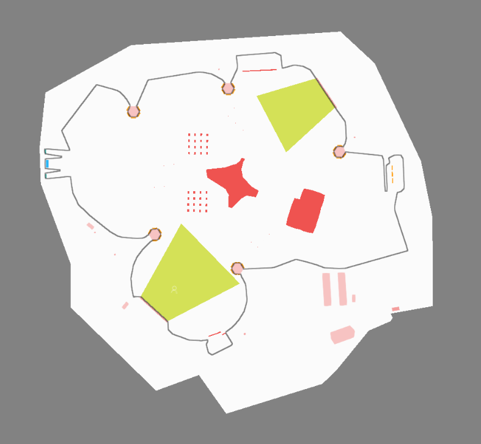
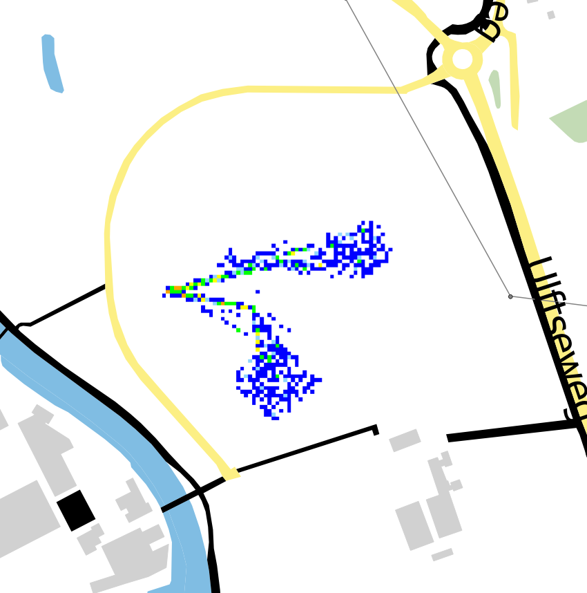

# iCAD: Interoperable CAD-to-Crowd

Geonovum Testbed 2026, phase 2. Research topic #5: Web 3D Context Document (export/import)

Authors: uCrowds and AniVizzion

License: CC BY 4.0

## Executive summary

Crowd simulation helps event organizers evaluate pedestrian movement and identify potential safety risks before an event takes place. Temporary event infrastructure, such as stages, barriers, entrances, and exits, is typically designed in CAD applications. Crowd simulation modelers often need to manually recreate walkable areas, obstacles, and other relevant features from these designs. This process is time-consuming, introduces opportunities for errors, and must be repeated when event designs change.

This research investigates how SCX, a lightweight format for exchanging scene information between applications, can be extended to support crowd simulation. The extension presented in this report adds semantic information to geographic data, allowing simulation applications to distinguish between features such as walkable areas, obstacles, entrances, exits, and queues.

The research was carried out by uCrowds and AniVizzion. AniVizzion implemented the export workflow in SCAD Re-Event, while uCrowds implemented the import workflow in SimCrowds. The demonstration showed that event designs can be transferred directly from CAD into SimCrowds, where the relevant simulation objects and a navigation mesh are created without manual redrawing.

The workflow automates construction of the simulation environment, although users must still connect simulation objects into pedestrian flows and configure simulation parameters. Further research could improve interoperability through shared semantic definitions, investigate applications in other simulation domains, and explore closer integration between CAD design and simulation.

## 1. Introduction

Temporary infrastructure for public events, including stages, barriers, entrances, exits, and queue areas, is commonly designed in computer-aided design (CAD) applications. Crowd simulation applications use models of these event sites to evaluate pedestrian movement and support safety planning. To represent pedestrian movement, these applications need to distinguish areas where people can walk from obstacles and other inaccessible areas. Crowd models also describe destinations and intermediate goals, including points of interest such as food stalls, toilets, and viewing areas, that pedestrians may visit during an event. However, CAD designs are typically not transferred directly into simulation models. Instead, simulation modelers use CAD drawings as visual references and manually recreate walkable areas, obstacles, and other simulation-relevant features and destinations. This process takes time, introduces opportunities for interpretation errors, and must be repeated when event designs change. As a result, simulation models may also become inconsistent with the latest event design.

Geonovum Testbed 2026, phase 2, promotes interoperability between digital twin components based on the Dutch nLDT architecture. Research Topic #5, _Web 3D Context Document (export/import)_, investigates the exchange of scene information between independent applications. This research builds on the work of Esri Nederland in _Digital Twin as a Service Testbed II_, which introduced SCX, a lightweight JSON format for exchanging scene configurations, and demonstrated it between ArcGIS and Cesium. SCX describes a camera view, time settings, and references to external scene layers. The original format supports scene exchange for visualization but does not describe what a layer represents within a simulation.

The iCAD research investigates how SCX can be extended to assign semantic meaning to georeferenced 2D scene layers, allowing simulation applications to interpret their function rather than only their geometry. In the CAD-to-crowd use case, these functions distinguish walkable areas, obstacles, entrances, exits, and queues. The objective is to enable a simulation application to construct its environment directly from an event design, without manually redrawing the relevant geometry.

The research was carried out by a consortium of uCrowds and AniVizzion. uCrowds develops SimCrowds, a real-time crowd simulation application used to model and analyze pedestrian movement. AniVizzion develops SCAD Re-Event, a CAD application for event production and temporary infrastructure design. uCrowds led the design of the SCX extension and implemented the importer in SimCrowds, while AniVizzion implemented the exporter in SCAD Re-Event. Together, these implementations establish an exchange workflow from CAD design to crowd simulation. The demonstration also uses SimCrowds' existing Web Map Service (WMS) functionality to make simulated crowd density available to geographic visualization applications.

The proof of concept focuses on one use case within event planning and crowd safety. It evaluates whether georeferenced 2D scene layers can be exchanged and interpreted to construct a crowd simulation environment without manual redrawing. The resulting simulation objects still require users to establish pedestrian flows and configure simulation parameters. Although the SCX extension could support other simulation domains, this research evaluates its application to crowd simulation.

## 2. Background and standards

Geonovum's Research Topic #5 builds on earlier work on exchanging 3D scene configurations between applications. This section introduces the SCX format developed in Digital Twin as a Service Testbed II, the existing CAD-to-crowd simulation workflow, and the geospatial standards relevant to the research.

### 2.1 Scene exchange with SCX

Geonovum describes a Web 3D Context Document as a portable, platform-independent JSON description of a scene. It contains references to geographic data sources and information needed to reconstruct a scene, such as viewpoint, time, and spatial context.

In Digital Twin as a Service Testbed II, Esri Nederland developed SCX, a lightweight JSON schema for scene exchange. The research examined the ArcGIS Web Scene Specification and the CesiumJS scene model to identify common elements that could be exchanged between visualization applications. The resulting schema was demonstrated through scene exchange between ArcGIS and Cesium.

The original SCX document contains three main sections:

| Section  | Description                                                                   |
| -------- | ----------------------------------------------------------------------------- |
| `view`   | Camera position and orientation, including heading and tilt.                  |
| `time`   | Current scene time, with an optional time range defined by `start` and `end`. |
| `layers` | An ordered list of layers with their title, type, visibility, and source URL. |

SCX references external data sources rather than embedding geometry in the document. This keeps the scene description lightweight and independent of the underlying data formats.

The original schema focuses on visualization. A layer's `type` identifies its representation or loading category, such as `imagery`, `elevation`, or `scene`, but does not describe its meaning within a simulation.

### 2.2 Current CAD-to-crowd simulation workflow

SCAD Re-Event provides detailed CAD layouts of temporary infrastructure for event planning and construction. Crowd simulation applications such as SimCrowds need the same environment described in terms of pedestrian-relevant functions. The simulation model must distinguish walkable areas from obstacles, identify locations where pedestrians enter, exit, or queue, and represent destinations or intermediate goals that pedestrians can visit.

In the existing workflow, modelers use CAD drawings as visual references and manually recreate the relevant geometry in the simulation application. This introduces additional work and potential interpretation errors. Moreover, this workflow can lead to synchronization issues between event planning and the simulation model. When an event design changes, the simulation environment must be updated accordingly, and the two may become inconsistent until these changes are incorporated.

Exchanging the geometry alone does not resolve this problem. The receiving application also needs the semantic meaning, i.e., the `function`, of the geometry to construct the corresponding simulation objects.

### 2.3 Geographic data standards

**GeoJSON (RFC 7946)** is a widely supported JSON format for geographic features. It represents points, lines, polygons, and their associated properties. GeoJSON uses WGS 84 (OGC:CRS84), with coordinates expressed in longitude, latitude order. It does not provide a standardized mechanism for declaring an alternative coordinate reference system (CRS).

**OGC Features and Geometries JSON (JSON-FG) 1.0** extends GeoJSON with additional capabilities, including support for geometry in other coordinate reference systems. Several members are relevant to this research:

- `coordRefSys` identifies the coordinate reference system of the data when it differs from the default WGS 84 (OGC:CRS84).
- `place` represents geometry in the identified CRS, while `geometry` can provide a geographic representation in the default WGS 84 (OGC:CRS84).
- `conformsTo` identifies the JSON-FG conformance classes implemented by the document.

When `coordRefSys` is absent, the default geographic CRS applies. OGC:CRS84 specifies longitude, latitude axis order and should not be confused with EPSG:4326, which uses latitude, longitude axis order.

JSON-FG makes it possible to exchange georeferenced CAD-derived geometry in a projected coordinate system such as the Dutch Rijksdriehoeksstelsel (RD, EPSG:28992). Feature `properties` can also carry application-specific information without requiring the exchange format to standardize individual simulation parameters.

CityJSON provides another JSON-based approach for representing semantically classified 3D city objects. However, this research focuses on exchanging georeferenced 2D functional areas rather than 3D city models, making JSON-FG a more suitable choice for the scene layer data.

### 2.4 Context within the nLDT architecture

Geonovum's nLDT reference architecture promotes a network of interoperable local digital twins in which data, computational models, and visualization components can operate independently and exchange information through open standards.

The CAD-to-crowd workflow follows this approach. SCAD Re-Event provides event design data, while SimCrowds uses the exchanged information to construct an environment for crowd simulation. The simulation results can subsequently be shared with geospatial visualization applications through existing OGC services.

SCX provides the scene-level exchange mechanism between these components. Extending it with semantic information supports the broader objective of interoperability between independent digital twin applications.

## 3. Research question

This research investigates how the SCX schema can be extended beyond scene visualization to support simulation applications. The main research question is:

**How can SCX be extended to give georeferenced scene layers semantic meaning, so that simulation applications can use them to construct simulation environments, as demonstrated through the CAD-to-crowd workflow?**

To answer this question, the research addresses three sub-questions:

1. **Semantic meaning:** What information do crowd simulation applications need to interpret scene layers, and how can SCX represent this information while leaving simulation-specific details to individual applications?
2. **Georeferencing and interoperability:** How can SCX exchange georeferenced 2D scene layers in different coordinate reference systems while retaining its lightweight, application-independent structure?
3. **Practical validation:** To what extent does the extended SCX enable the construction of a crowd simulation environment from CAD data without manual redrawing, and what limitations remain?

The first two sub-questions guide the design of the SCX extension. The third evaluates the extension through the implemented CAD-to-crowd workflow and identifies remaining limitations.

## 4. Methodology

The research followed an iterative, prototype-driven approach in which the SCX extension and its implementation were developed together. The work was organized around four activities: schema design, exporter development, importer development, and integration testing.

### 4.1 Schema design

Schema design began by identifying basic spatial functions commonly needed for pedestrian simulation: areas where people can move, obstacles that restrict movement, locations for entering and exiting, queues, and intermediate destinations. We compared these roles with the information available in SCX and the event design data from SCAD Re-Event. SimCrowds served as the implementation used to evaluate the design; interoperability with other crowd simulation tools was not tested.

uCrowds led the design of the extension, refining it during importer development rather than finalizing it beforehand. Design decisions were informed by practical implementation challenges, a review of related standards including GeoJSON and JSON-FG, and feedback from Geonovum. Particular attention was given to separating the semantic role of scene layers from the geometry and metadata contained in external layer files.

### 4.2 Exporter and importer development

AniVizzion extended SCAD Re-Event with dedicated drawing elements for crowd simulation. Walkable areas, obstacles, waypoints and the terrain boundary are drawn as closed polygons on dedicated drawing layers. Entries, exits, queues and podiums are placed as parametric blocks whose width and height can be adjusted, and whose orientation defines the facing direction. During the modeling phase, designers draw these elements directly on the terrain alongside the temporary event infrastructure. Walkable areas define the terrain on which pedestrians can move, while the other elements represent functional parts of the crowd simulation environment.  
  
AniVizzion developed an SCX exporter that converts the modeled scene into an extended SCX document referencing georeferenced JSON-FG files, one file per function. The exporter assigns the SCX layer `function` from the source of the geometry: the drawing layer for polygons, or the block name for parametric blocks. Polygons nested inside other blocks are included. Function layers without any features are omitted from the export. The exported scene can optionally be uploaded from the export dialog to an AniVizzion scene server, which makes it available through a publicly accessible URL.

uCrowds developed the corresponding importer in SimCrowds. The importer retrieves the SCX document and its referenced JSON-FG files, interprets the layer functions, and creates the corresponding simulation objects. After the import, the simulation environment and underlying datastructures are automatically generated.

### 4.3 Validation

Validation focused on whether the exchanged scene data could be interpreted correctly and used to construct a crowd simulation environment. The workflow was evaluated using a real-world event design for Huntenpop 2025, described in Section 6.1.

The exported JSON-FG files were checked using Geonovum's JSON-FG OGC Checker. In SimCrowds, we tested whether the layer functions were correctly interpreted, whether the corresponding simulation objects were created, and whether a navigation mesh could be generated from the imported environment.

We also examined which steps still required user interaction after import, particularly connecting simulation objects into flows and configuring simulation parameters. Automatic interpretation of simulation-specific JSON-FG feature properties was not tested.

Finally, the return path was tested by publishing simulated crowd density through WMS and displaying the resulting layer in QGIS and Esri Map Viewer. This demonstrated that the simulation output could be consumed by standard geospatial clients.

## 5. SCX extension

The SCX extension developed in this research enables simulation applications to interpret the meaning of georeferenced scene layers, rather than only displaying their geometry. It builds on the lightweight SCX schema introduced by Esri Nederland in Digital Twin as a Service Testbed II, which describes a scene through a camera view, time settings, and references to external data sources.

The extension introduces a `function` field that identifies the role of a layer within a scene and a `preferredCrs` field that identifies the coordinate reference system (CRS) in which the scene is intended to be used. It also uses JSON-FG to exchange georeferenced 2D scene layers, allowing each referenced file to state its data CRS when necessary.

The following subsections explain these design choices and their application in the CAD-to-crowd workflow.

### 5.1 Semantic layer functions

The principal addition is the `function` field on an SCX layer. The existing `type` field indicates how a layer is represented or loaded, while `function` describes the role its data has within a particular scene. Layers containing similar polygons can therefore be interpreted differently by simulation applications.

Because the function belongs to the scene layer rather than the source data, the same dataset can serve different purposes in different scenes. For example, an open area could be available for general pedestrian movement in one event layout but designated as a queueing area in another.

The field accepts an open string rather than a fixed vocabulary. The crowd modeling roles considered in this research are `walkable`, `obstacle`, `entry`, `exit`, `queue`, and `waypoint`. These describe functional concepts rather than a particular application's object classes. The SimCrowds-specific interpretation of each function is provided once, in Section 5.5. In the developed importer, a layer without a recognized function is treated as visual only and does not produce a simulation object.

### 5.2 Coordinate reference systems

The extension distinguishes between the working CRS of a scene and the CRS of its underlying data.

The document-level field `preferredCrs` identifies the CRS in which the scene is intended to be used, typically the CRS of the original design. Its value is a CRS URI, such as `http://www.opengis.net/def/crs/EPSG/0/28992` for the Dutch national projected coordinate system (RD).

This field is advisory. It does not determine how coordinates in referenced datasets are interpreted. Instead, the importer reads the CRS of each dataset and transforms the geometry to its working CRS when necessary. This allows a scene to combine data from different coordinate systems without requiring every source to be converted before export.

Preserving the source CRS also helps avoid unnecessary coordinate transformations. Converting CAD geometry from an original projected CRS into WGS 84 (OGC:CRS84), particularly if it is later transformed back or its coordinates are rounded, may introduce small geometric discrepancies. In principle, shifts near narrow pedestrian passages or obstacle boundaries could affect a navigation mesh and consequently simulated movement.

JSON-FG 1.0 extends GeoJSON with additional members, including `coordRefSys` to identify the data CRS. When `coordRefSys` is absent, or when a layer uses plain GeoJSON, the standard geographic coordinate reference system is WGS 84 (OGC:CRS84).

The original SCX `view` section remains separate from `preferredCrs`. Its camera position uses latitude, longitude, and altitude regardless of the scene's preferred working CRS.

### 5.3 Scene layer data and feature properties

In this research, layers with `type` set to `scene` reference static JSON-FG files containing georeferenced 2D features. Each file contains a FeatureCollection with geometry and associated feature properties. Plain GeoJSON is also accepted.

JSON-FG supports two geometry representations:

- `place` contains geometry in the CRS identified by `coordRefSys`, allowing data to remain in a projected CRS such as RD.
- `geometry` contains the GeoJSON representation in OGC:CRS84. When `place` is used, `geometry` can provide a geographic fallback for clients that do not support the alternative CRS, or it can be null.

This arrangement allows the exporter to preserve georeferenced CAD geometry in its projected CRS while providing a geographic representation when appropriate. JSON-FG files also use the `conformsTo` member to identify the specification conformance classes they implement.

Simulation-specific information can be included in the `properties` member of each feature. For example, an entry could have an `agents_per_second` property indicating an inflow rate. SCX does not standardize these parameters. The exporter determines which values to include, and the importer decides whether and how to interpret them.

JSON-FG is an existing OGC standard, so this report does not reproduce its complete specification. Further information is available in the [official JSON-FG 1.0 specification](https://docs.ogc.org/is/21-045r1/21-045r1.html). Appendix A provides a compact example of a JSON-FG file referenced by an SCX scene layer.

### 5.4 Example SCX document

The following SCX document describes an event scene with three layers: a site boundary for visual context, a walkable area, and an entry area for crowd simulation. The URLs are examples rather than published project resources.

```json
{
  "preferredCrs": "http://www.opengis.net/def/crs/EPSG/0/28992",
  "view": {
    "heading": 0.0,
    "tilt": 45.0,
    "position": {
      "latitude": 51.8975288,
      "longitude": 6.3869445,
      "altitude": 322.85
    }
  },
  "time": {
    "current": "2026-07-16T18:00:00Z",
    "start": "2026-07-16T18:00:00Z",
    "end": "2026-07-16T23:00:00Z"
  },
  "layers": [
    {
      "title": "Terrain boundary",
      "type": "scene",
      "visible": true,
      "url": "https://www.example.com/terrain_boundary.json"
    },
    {
      "title": "Walkable areas",
      "type": "scene",
      "visible": true,
      "url": "https://www.example.com/walkable.json",
      "function": "walkable"
    },
    {
      "title": "Entries",
      "type": "scene",
      "visible": true,
      "url": "https://www.example.com/entry.json",
      "function": "entry"
    }
  ]
}
```

The document retains the original `view`, `time`, and `layers` structure. The `view` describes the camera, and `time` supplies temporal context. The added fields are `preferredCrs` at document level and `function` at layer level.

The SCX document contains references rather than geometry. The example entry layer points to `entry.json`, whose structure is illustrated using a real exported file in Appendix A.

### 5.5 Mapping between SCAD Re-Event and SimCrowds

In the implemented workflow, the SCAD Re-Event exporter assigns the SCX layer `function` from the source of the geometry: closed polygons on a dedicated drawing layer, or a dedicated parametric block. The following table shows how the tested SimCrowds importer interprets the resulting functions. The source names are those used by the SCAD Re-Event exporter; they are not intended as a standardized vocabulary.

| SCAD Re-Event block category   | SCX `function` | SimCrowds object and interpretation                                                              |
| ------------------------------ | -------------- | ------------------------------------------------------------------------------------------------ |
| Walkable area polygons (layer) | `walkable`     | Walkable Area: defines terrain available to pedestrians and supports navigation mesh generation. |
| Obstacle polygons (layer)      | `obstacle`     | Obstacle: excludes its area from pedestrian movement.                                            |
| Entry block*                   | `entry`        | Entry: defines an area where pedestrian agents enter the simulation.                             |
| Exit block                     | `exit`         | Exit: defines an area where pedestrian agents leave the simulation.                              |
| Queue block                    | `queue`        | Grandstand**: represents multiple parallel queues within a defined area.                         |
| Waypoint polygons (layer)      | `waypoint`     | Waypoint: provides an intermediate destination or waiting area.                                  |

_\*Block features carry their width, height, rotation and facing direction (`directionDegrees`) as feature properties; layer polygons carry only an identifier and the source layer name.
\*\*The `queue` function uses SimCrowds' existing Grandstand object, which can also represent a set of parallel queues._

## 6. Demonstration and results

This section reports the observed results of the Huntenpop 2025 CAD-to-crowd demonstration, including file validation, simulation environment construction, and the existing WMS-based crowd density return path.

### 6.1 Test scene

The demonstration used an event design for Huntenpop 2025, a two-day music festival held in Ulft, the Netherlands. The festival site covers approximately 300 × 250 meters (7.5 hectares) and contains five music stages and various supporting facilities, including bars, food and beverage stalls, toilets, and other points of interest.

AniVizzion prepared the event scene in SCAD Re-Event. The scene included the site environment, walkable areas, obstacles, entrances, exits, queues, and waypoints. These elements provided the geographic and functional information needed to evaluate the transfer of the event design into SimCrowds.


*Figure 1: Huntenpop 2025 event design in SCAD Re-Event, showing the festival layout and functional areas.

### 6.2 Export output and JSON-FG validation

The SCAD Re-Event exporter successfully generated an extended SCX document and the associated georeferenced JSON-FG files for the Huntenpop 2025 scene. These files were used directly by SimCrowds without intermediate manual conversion.

The exported JSON-FG files were checked using Geonovum's JSON-FG OGC Checker and passed its checks. An abbreviated example of an exported JSON-FG file is provided in Appendix A.

### 6.3 Import and simulation environment construction

In the demonstration, SimCrowds successfully interpreted the recognized layer functions and created the corresponding simulation objects. Walkable areas, obstacles, entrances, exits, queues, and waypoints were transferred from the event design into the simulation environment using the mappings in Section 5.5.

The imported geometry also supported successful generation of a navigation mesh, which represents the areas through which simulated pedestrians can move while accounting for obstacles.

The result establishes that the relevant CAD-defined areas can be imported as simulation objects without redrawing. The same exchange approach also permits a revised design to be imported, although continuous updates preserving existing simulation settings were not tested.


*Figure 2: imported SCX document in SimCrowds.

The import process does not, however, produce a fully configured simulation. After importing the environment, a user must still connect simulation objects into flows and configure parameters such as the number of pedestrians entering per second and their destinations.

JSON-FG feature `properties` can contain additional information that could support this configuration, but automatic interpretation of these properties was not tested in this project. The demonstrated automation therefore covers the construction of the simulation environment, not the complete configuration of pedestrian behavior.

### 6.4 Crowd density publication through WMS

The demonstration also included a return path from crowd simulation to geospatial visualization. SimCrowds can publish calculated crowd density as a geographic raster layer through an OGC Web Map Service (WMS).

This capability already existed in SimCrowds before the iCAD project. The project used it to demonstrate how simulation results can be made available to other applications through an established open standard.

The WMS output was successfully displayed in QGIS (Figure 3) and Esri Map Viewer. This allows the spatial distribution of simulated crowds to be viewed alongside other geographic information without requiring the receiving application to support the SimCrowds simulation format.


*Figure 3: WMS density map visualization in QGIS. The colors indicate the density levels, e.g. blue areas have low-density and orange areas (in this case, near the entry) are high-density.*

### 6.5 Summary of demonstrated results

The proof of concept produced the following results:

| Component                | Observed result                                                                   |
| ------------------------ | --------------------------------------------------------------------------------- |
| SCAD Re-Event exporter   | Generated an extended SCX document referencing georeferenced JSON-FG scene layers |
| JSON-FG validation       | Exported files passed Geonovum's JSON-FG OGC Checker                              |
| SimCrowds importer       | Interpreted scene layer functions and created corresponding simulation objects    |
| Navigation mesh          | Successfully generated from the imported environment                              |
| Simulation configuration | Connecting flows and setting parameters still requires user interaction           |
| WMS return path          | Crowd density successfully displayed in QGIS and Esri Map Viewer                  |

The main result is that event-design geometry can be exchanged between SCAD Re-Event and SimCrowds with enough semantic information to construct a crowd simulation environment without manual redrawing.

A video demonstrating the end-to-end CAD-to-crowd simulation workflow is available through the [Geonovum project repository](https://github.com/Geonovum/DTaaS-Testbed2026-Phase2/tree/main/Topic5-uCrowds).

## 7. Discussion

The research demonstrates how SCX can be extended beyond visualization to support the construction of simulation environments from georeferenced scene data. The CAD-to-crowd workflow illustrates the practical value of combining a lightweight scene description with semantic information, while preserving the flexibility of the original SCX approach.

### 7.1 Semantic interoperability

The principal contribution of the extension is the ability to describe the function of a layer within a scene. By distinguishing between geometric representation and semantic meaning, SCX allows simulation applications to interpret scene data and construct corresponding simulation objects.

The implemented prototype demonstrates that CAD drawings can be imported into SimCrowds and used to construct a simulation environment without manually redrawing the geometry. In practice, this could save hours or days of manual work, depending on the complexity of the event site. The benefit is particularly relevant when event designs change, since updated designs can be imported without repeating the drawing process.

Defining functions at the SCX layer level also allows the same source data to serve different purposes in different scenes. Combined with the use of open function strings, this makes the extension adaptable to different applications without introducing domain-specific requirements into the core schema.

Simulation-specific parameters can remain in JSON-FG feature properties, allowing individual applications to exchange additional information without requiring SCX to standardize their simulation models.

### 7.2 Coordinate reference systems

The extension separates the preferred working CRS of a scene from the coordinate reference systems of its underlying datasets. The advisory `preferredCrs` communicates the intended working CRS, while each JSON-FG dataset identifies its own CRS through the standard JSON-FG conventions.

This approach permits CAD-derived geometry to remain in a national projected CRS such as RD (EPSG:28992), without an obligatory intermediate WGS 84 conversion. For navigation models sensitive to the placement of walkable boundaries and obstacles, avoiding unnecessary transformations is a relevant design choice. The testbed did not measure changes in simulation accuracy attributable to CRS transformations.

Using JSON-FG also builds on an existing OGC standard rather than introducing a separate coordinate reference mechanism within SCX. This preserves the lightweight character of the scene document and its separation from the referenced geographic data.

### 7.3 Scope and limitations of the prototype

One interoperability limitation concerns the use of open function strings. They provide flexibility but do not guarantee consistent interpretation between independent applications without shared conventions. Applications may name equivalent functions differently or interpret the same function in different ways.

Imported objects still require connections into pedestrian flows and the configuration of simulation parameters. This is a boundary of the demonstrated automation, but not necessarily a weakness of the CAD-to-crowd workflow. Defining pedestrian flows in SCAD Re-Event would require adding simulation-specific functionality to a CAD application that is primarily designed for drawing event layouts. Keeping these steps in SimCrowds allows event designers to define the physical layout in CAD while simulation modelers configure pedestrian behavior in a tool designed for that purpose.

### 7.4 Applicability beyond crowd simulation

Although this research uses crowd simulation as its application, the underlying approach is not specific to pedestrian movement. Other simulation domains, such as traffic or hydraulic modeling, could define their own scene-level functions and interpret the associated geometry according to their requirements.

By separating scene context, geographic data, and application-specific parameters, the extension provides a reusable approach for exchanging information between different types of digital twin components.

This contributes to the objectives of the nLDT architecture by enabling independent applications to exchange meaningful spatial information through open formats, while retaining their specialized simulation capabilities.

## 8. Conclusions, further research, and next steps

### 8.1 Conclusion

This research demonstrates that SCX can be extended to give georeferenced scene layers semantic meaning, allowing simulation applications to construct environments from externally drawn spatial data. The extension introduces a scene-level `function` field, an advisory `preferredCrs`, and the use of JSON-FG for georeferenced 2D scene data.

The implemented CAD-to-crowd demo confirms the feasibility of this approach. Event designs exported from SCAD Re-Event were successfully imported into SimCrowds, where layer functions were interpreted to create simulation objects and generate a navigation mesh without manual redrawing.

The automation covers construction of the simulation environment, not complete simulation configuration. Users must still connect simulation objects into flows and configure parameters before running a simulation.

### 8.2 Further research

The results support further development of semantic scene exchange within the SCX framework. We recommend the following research directions:

- **Application to other simulation domains:** Investigate whether the extended SCX approach can support other simulation domains, such as traffic modeling and flood simulation. Testing exchanges between independent applications in these domains would help establish which semantic conventions can be shared and which require domain-specific definitions.
- **Shared function identifiers:** Investigate a shared vocabulary of layer functions using URI-based identifiers. This would support the consistent interpretation of functions across different applications. For example, the function `queue` could be represented by a URI such as `https://example.org/scx/functions/crowd-sim/queue`. This approach could accommodate functions from different simulation domains while preserving extensibility and reducing ambiguity between implementations.
- **Deeper CAD-to-simulation integration:** Investigate ways to maintain a continuous connection between CAD authoring tools and simulation applications. For example, a crowd simulator could retrieve updated geometry from a CAD endpoint and automatically update its simulation environment while preserving existing simulation flows, connections, and parameters. This could further reduce manual work when event designs change.

### 8.3 Next steps

The CAD-to-crowd SCX extension is already being used in a commercial project. The consortium will continue developing the integration between SCAD Re-Event and SimCrowds based on practical experience and findings from these projects.

Further development can focus on reducing the remaining manual configuration steps, including the interpretation of simulation parameters from JSON-FG feature properties and the preservation of simulation configurations when CAD designs are updated.

These activities will provide additional practical experience with semantic scene exchange and can contribute to the further development of interoperable digital twin applications within the nLDT ecosystem.

## Appendix A. Technical field reference

This appendix summarizes the SCX extension fields and the JSON-FG structure used for georeferenced scene layers. It also provides an example from the CAD exporter.

### A.1 SCX document

The extended SCX document retains the original `view`, `time`, and `layers` structure and adds `preferredCrs` at document level and `function` at layer level.

| Field                    | Description                                                                                                          |
| ------------------------ | -------------------------------------------------------------------------------------------------------------------- |
| `preferredCrs`           | URI identifying the preferred working CRS of the scene. Does not define the CRS of layer data or camera coordinates. |
| `view.heading`           | Camera direction in degrees clockwise from north.                                                                    |
| `view.tilt`              | Camera angle in degrees, from 0° (downward) to 90° (horizontal).                                                     |
| `view.position`          | Camera location as `latitude`, `longitude` (WGS 84 decimal degrees) and `altitude` (meters).                         |
| `time.current`           | Selected scene time, expressed as an ISO 8601 timestamp.                                                             |
| `time.start`, `time.end` | Start and end of the scene's time interval, expressed as ISO 8601 timestamps.                                        |
| `layers`                 | Ordered array of layer objects referencing external sources.                                                         |

SCX layer objects use the following fields:

| Field      | Description                                                                                   |
| ---------- | --------------------------------------------------------------------------------------------- |
| `title`    | Human-readable layer name.                                                                    |
| `type`     | Representation or loading category, such as `scene`, `imagery`, or `elevation`.               |
| `visible`  | Boolean controlling layer visibility.                                                         |
| `url`      | URL of the referenced data source.                                                            |
| `function` | Scene-specific role, such as `walkable`, `obstacle`, `entry`, `exit`, `queue`, or `waypoint`. |

### A.2 JSON-FG scene layer data

In this research, `scene` layers reference static JSON-FG 1.0 FeatureCollections. Plain GeoJSON is also accepted.

| Member                  | Description                                                                                  |
| ----------------------- | -------------------------------------------------------------------------------------------- |
| `type`                  | Identifies the root object as a `FeatureCollection`.                                         |
| `conformsTo`            | Identifies the JSON-FG conformance classes implemented by the file.                          |
| `coordRefSys`           | Identifies the data CRS through a URI. When absent, the default is WGS 84 (OGC:CRS84).       |
| `features`              | Array of geographic features.                                                                |
| `features[].id`         | Feature identifier, where provided.                                                          |
| `features[].place`      | Geometry in the CRS identified by `coordRefSys`.                                             |
| `features[].geometry`   | GeoJSON geometry in WGS 84 (OGC:CRS84), or `null` when geometry is provided through `place`. |
| `features[].properties` | Application-specific attributes, including potential simulation parameters.                  |

The complete format is specified in the [OGC JSON-FG 1.0 specification](https://docs.ogc.org/is/21-045r1/21-045r1.html).

### A.3 Example JSON-FG scene layer

The following abbreviated example is based on the `entry.json` exported by SCAD Re-Event and corresponds to the `Entries` layer in Section 5.4. It contains one entry polygon in RD (EPSG:28992), a geographic fallback in WGS 84 (OGC:CRS84), and selected exporter properties. Coordinates have been rounded for readability.

```json
{
  "type": "FeatureCollection",
  "conformsTo": [
    "http://www.opengis.net/spec/json-fg-1/1.0/conf/core"
  ],
  "coordRefSys": {
    "type": "Reference",
    "href": "http://www.opengis.net/def/crs/EPSG/0/28992"
  },
  "features": [
    {
      "type": "Feature",
      "id": "entry-7E30F",
      "place": {
        "type": "Polygon",
        "coordinates": [[
          [223653.549, 434856.588],
          [223653.932, 434850.600],
          [223655.927, 434850.728],
          [223655.545, 434856.716],
          [223653.549, 434856.588]
        ]]
      },
      "geometry": {
        "type": "Polygon",
        "coordinates": [[
          [6.3846869, 51.8979806],
          [6.3846913, 51.8979267],
          [6.3847203, 51.8979276],
          [6.3847159, 51.8979815],
          [6.3846869, 51.8979806]
        ]]
      },
      "properties": {
        "blockName": "SCX_ENTRY",
        "directionDegrees": 3.6592715
      }
    }
  ]
}
```

